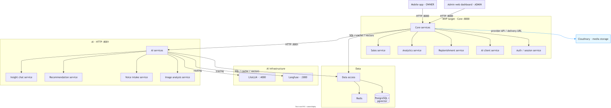

# SmartLedger

AI voice POS for small shops (So Nghe Loi): say a sentence and the AI records items, quantities, and prices. Product overview: [docs/product/project-overview.md](docs/product/project-overview.md).

Core and AI run on Railway, the mobile web app and landing on Vercel; `main` deploys to production after approval ([CI/CD](docs/development/ci-cd.md)). What is built: [Technical design §1](docs/architecture/technical-design.md#1-phạm-vi). Why: [ADRs](docs/architecture/adr/).

## Architecture



| Part | Path | Role |
|---|---|---|
| Core | [`backend/core`](backend/core/README.md) | Java public API for the clients; owns the database |
| AI | [`backend/ai`](backend/ai/README.md) | Python FastAPI internal API; only Core calls it |
| Mobile | [`frontend/mobile`](frontend/mobile/README.md) | Expo app for the shop OWNER |
| Web | [`frontend/web`](frontend/web/README.md) | Landing page and ADMIN dashboard |
| AI schema | [`supabase/`](supabase/) | Supabase CLI migrations for the AI tables |

## Getting started

Setup, run and pre-PR checks per service: [Local development](docs/development/local-development.md). Branches, commits and pull requests: [CONTRIBUTING](CONTRIBUTING.md).

## Repository layout

```text
smart-ledger/
├── README.md
├── AGENTS.md            # instructions for coding agents
├── CLAUDE.md            # imports AGENTS.md
├── CONTRIBUTING.md      # branches, commits, pull requests, releases
├── PROGRESS.md          # recent progress log
├── BLOCKERS.md          # open blockers
├── compose.yaml         # Core + AI (Supabase + Redis Cloud)
├── .github/             # CI/CD workflows, PR templates, CI helper scripts
├── scripts/             # local database, secrets sync, Android and iOS release
├── secrets/             # encrypted env files per environment (DVC + age + R2)
├── tools/secrets-cli/   # `sl`, a menu over scripts/secrets
├── supabase/            # AI schema migrations (Supabase CLI)
├── docs/                # source of truth; start at docs/README.md
│   ├── product/         # product description, BRD, PRD
│   ├── architecture/    # technical design, ERD, ADRs, diagrams, service walkthrough
│   ├── contracts/       # HTTP/wire contracts
│   ├── design/          # mobile UI direction and wording
│   ├── development/     # local development, secrets, CI/CD, release runbooks
│   └── marketing/       # app screenshots per product flow
├── frontend/
│   ├── mobile/          # Expo app for the OWNER; mock data by default
│   └── web/             # landing page + ADMIN dashboard at /admin
└── backend/
    ├── core/            # Core public API (Java), DB owner
    └── ai/              # internal AI API (Python FastAPI)
```

## Documentation

Start at the [documentation index](docs/README.md): it maps every document and says which one owns each fact.
