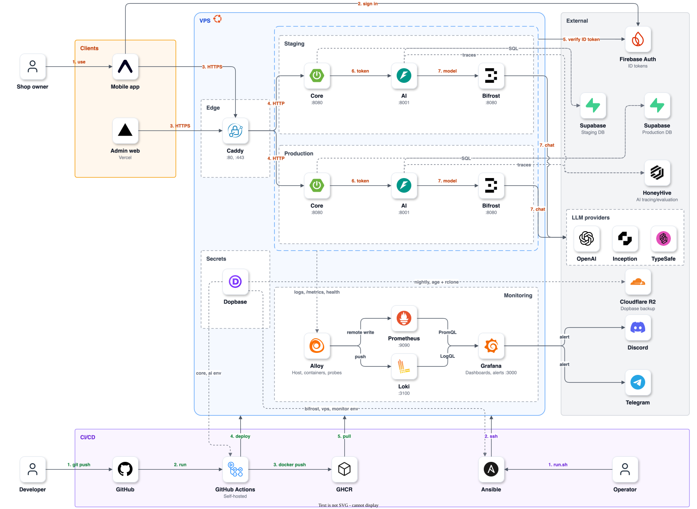

# SmartLedger

SmartLedger (Sổ Nghe Lời) runs in production and helps small shops record sales, payments, debts and expenses. AI voice POS is the product direction: the current mobile order-entry path uses platform speech-to-text and a rule-based `parseOrder()` parser, with owner review before checkout. Bobi chat is a separate AI capability accessed through Core; speech recognition is not evidence of AI order parsing.

EXE201 MVP is a course delivery and acceptance scope, not the system's deployment status. See [product scope](docs/product/project-overview.md) and [implementation evidence](docs/architecture/technical-design.md#1-scope); checked-in features are not automatically enabled, deployed or accepted.

## Tech stack

| Layer | Stack |
|---|---|
| Core API |   |
| AI service |    |
| Clients |     |
| Data and auth |    |
| Delivery |      |

## System boundaries

| Part | Responsibility | Service guide |
|---|---|---|
| Core | Java 21 / Spring Boot public API; authentication, shop ownership and business transactions | [Core](backend/core/README.md) |
| AI | Internal Python / FastAPI service called by Core; Agent chat, conversation history and AI capabilities | [AI](backend/ai/README.md) |
| Frontend | Expo Router OWNER app; separate Vite / React landing and ADMIN web | [Frontend](frontend/README.md) |
| Data | Supabase PostgreSQL; Core Flyway migrations and separate AI CLI migrations | [Local development](docs/development/local-development.md) |

Core verifies client identity and shop access before forwarding Agent requests with an internal token. Core owns business data; AI owns its conversation and memory storage. Runtime configuration and integrated acceptance remain separate from these code boundaries.

## System architecture

| Color | Flow |
|---|---|
| Green | Deploy pipeline: push, CI, image build, deploy to the VPS |
| Purple | VPS setup with Ansible |
| Orange | Runtime request flow from the app to Core, AI and the database |

The diagram shows the target delivery and runtime topology drawn from the tracked `deploy/` files; it does not prove that every component is enabled in an environment. [Technical design §1](docs/architecture/technical-design.md#1-scope) records implementation status, [CI/CD](docs/development/ci-cd.md) explains the pipeline and the [diagram guide](docs/architecture/diagrams/README.md) lists the other diagrams.

## Start here

- [Documentation](docs/README.md): domains, canonical sources and reading paths.
- [Local development](docs/development/local-development.md): setup, Compose and pre-PR checks.
- [CONTRIBUTING](CONTRIBUTING.md): branches, reviews and releases into `staging`, then production.
- [AGENTS](AGENTS.md): root policy and scoped instruction loading for coding agents.
- [Security policy](SECURITY.md): reporting vulnerabilities.

## Repository layout

| Path | Ownership |
|---|---|
| `backend/` | Core and AI services, with their own operational guides |
| `frontend/` | Mobile and web clients |
| `docs/` | Product requirements, contracts, architecture, design and operations |
| `deploy/`, `.github/` | Provisioning and delivery automation; documented in [CI/CD](docs/development/ci-cd.md) |
| `scripts/` | Local DB, CI, secrets, API checks and device-release tooling; documented by the owning service or operations guide |
| `secrets/` | [Credential-file workflow](secrets/README.md); do not commit secrets |
| `supabase/` | AI schema migrations, separate from Core Flyway |

Local mock mode must be selected explicitly for Mobile; consult each service guide rather than assuming checkout defaults are deployment configuration.
