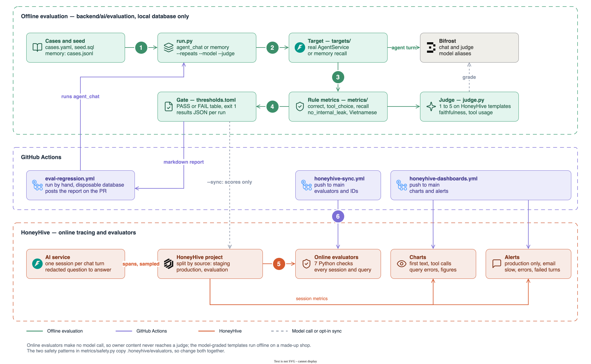

# Evaluation

Scripts that check the AI service still behaves well: they run test cases against the real code, score the results and print a table.

| Evaluation | What it checks | Costs | README |
|---|---|---|---|
| `agent_chat` | The chat agent answers shop questions correctly, picks the right tools and keeps internals out of its answers | Chat and judge model calls | [agent_chat](agent_chat/README.md) |
| `memory` | Memory recall finds the fact a message needs | Nothing once the embedding cache exists | [memory](memory/README.md) |

## Run

From `backend/ai`, with the local database `smartledger-local-db` running:

```bash
uv run evaluation/run.py memory
uv run evaluation/run.py agent_chat
```

A run prints a progress bar, then a table of every metric with its bound and PASS or FAIL, and writes all rows to `evaluation/results/<evaluation>-<name>.json`. It exits 1 when a metric misses its bound in the evaluation's `thresholds.toml`.

Add options when you need more:

```bash
uv run evaluation/run.py agent_chat --dry-run            # show the plan; no model call
uv run evaluation/run.py agent_chat --repeats 1          # each question once instead of 3 times
uv run evaluation/run.py agent_chat --limit 15           # only the first 15 questions, for a quick check
uv run evaluation/run.py agent_chat --model ALIAS        # the agent on another model alias
uv run evaluation/run.py agent_chat --judge ALIAS        # grade with another model alias
uv run evaluation/run.py memory --report /tmp/memory.md  # also write the result as markdown
uv run evaluation/run.py agent_chat --name try-1         # label the run (default baseline)
uv run evaluation/run.py agent_chat --sync               # also send the scores to HoneyHive
uv run evaluation/run.py memory --verbose                # show the app's INFO logs
uv run evaluation/run.py memory --gate other.toml        # use other bounds
```

`--model` replaces only the `chat` alias. With `MODEL_TIERING_ENABLED=true` the router still picks a tier alias for each turn, so set `MODEL_TIERING_ENABLED=false` when you benchmark one alias; evaluating the tier router itself is a separate comparison with tiering on.

Everything stays on your machine unless you pass `--sync`, which needs `HH_API_KEY` and spends one HoneyHive event per case. Both evaluations refuse a database that is not local, so they never touch real shops. CI runs `agent_chat` by hand through the [Eval regression](../../../docs/development/ci-cd.md#eval-regression) workflow and posts the markdown report on the pull request.

## Folders

| Path | What is in it |
|---|---|
| `run.py` | The command line. `EVALS` maps each evaluation name to the class that runs it |
| `agent_chat/`, `memory/` | One evaluation each: its class, its cases, its `thresholds.toml` and its README |
| `targets/` | Wrappers that run the real service for one case: `agent.py` (the chat agent), `memory.py` (memory recall) |
| `metrics/` | One evaluator class per group of metrics, plus `judge.py`, which asks a model to grade an answer |
| `core/` | Shared parts: data classes (`schema.py`), the loop over cases (`pipeline.py`), bounds (`gate.py`), tables (`render.py`), the report (`report.py`) |
| `results/` | One JSON per run; not committed |

## How a run works



The top band is this folder; the bottom band is the online side in [`.honeyhive/`](../../../.honeyhive/README.md), which scores real traffic without a model call.

1. `run.py` builds the evaluation, for example `MemoryEval()`, which has a list of cases, a target and a list of evaluators.
2. For each case, the target runs the real service and returns an `Output`.
3. Each evaluator reads the case and the output and returns scores (`MetricResult`).
4. The report averages each metric, compares it with `thresholds.toml` and prints the tables.

## Common changes

- **Change a bound:** edit the evaluation's `thresholds.toml` and say why in the commit.
- **Add a metric:** add it to the evaluator of its group in `metrics/`, add its name to `LAYERS` in `core/report.py` so the table shows it, and add a unit test.
- **Add an evaluation:**
  1. Create a folder like `agent_chat/` with the cases, a `thresholds.toml` and a README.
  2. Add a target in `targets/` with `ask(case)` that returns an `Output`.
  3. Write the class (`<name>_eval.py`) with the same attributes as `MemoryEval`: `name`, `cases`, `target`, `evaluators`, `thresholds`, `summary`, `check()` and `show_plan()`.
  4. Add one line to `EVALS` in `run.py`.
  5. Add unit tests for any new evaluator; they need no database or network.
