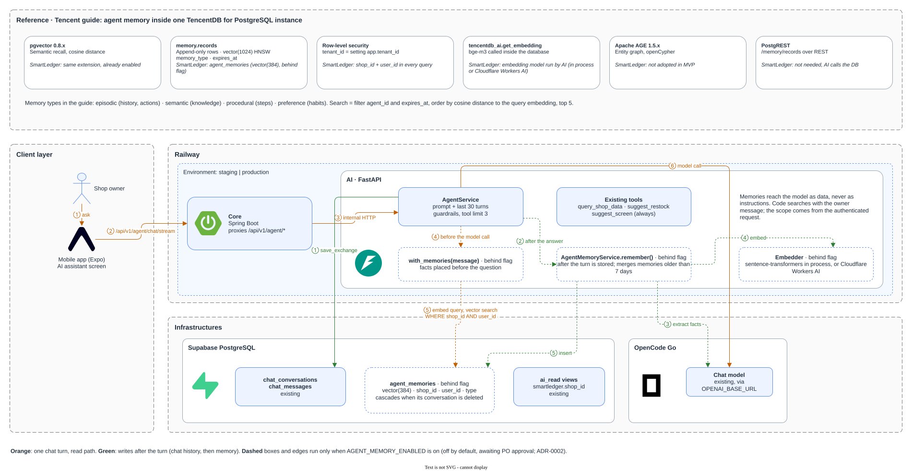

# ADR-0002: Long-term memory cho Agent theo mẫu TencentDB for PostgreSQL, dựng trên pgvector của Supabase

- **Trạng thái:** Proposed. Chưa có FR/AC riêng cho ghi nhớ (`FR-027`/`AC-022` chỉ nói về lịch sử chat); chưa là hành vi sản phẩm cho tới khi PO duyệt yêu cầu và team chấp nhận ADR này. [Contract](../../contracts/api-contracts.md) đã mô tả `memory/settings` và sự kiện SSE `memory`, chỉ hoạt động khi bật cờ và chờ PO duyệt. Phương án A đã có code sau cờ `AGENT_MEMORY_ENABLED` (mặc định tắt), xem [AI README](../../../backend/ai/README.md#long-term-memory-off-by-default); khi tắt, hành vi chat không đổi
- **Ngày:** 2026-10-14
- **Owner:** chưa chỉ định

Nguồn sơ đồ: [`agent-memory.drawio`](../diagrams/src/agent-memory.drawio), xuất như [sơ đồ CI/CD](../../development/ci-cd.md). Băng trên cùng là mẫu Tencent; phần dưới là luồng đề xuất cho SmartLedger. Số cam là một lượt chat (đọc memory), số xanh lá là ghi memory sau lượt; hộp và cạnh nét đứt chỉ chạy khi bật cờ `AGENT_MEMORY_ENABLED` (mặc định tắt, chờ PO duyệt).

## Bối cảnh

- Agent hiện chỉ nhớ trong một hội thoại: mỗi lượt gửi `AGENT_HISTORY_TURNS` lượt gần nhất (mặc định 30), không tóm tắt, không có tool tìm lịch sử ([Ngữ cảnh chat](../../contracts/api-contracts.md#ngữ-cảnh-chat), [AI README](../../../backend/ai/README.md#chat-context)). Thói quen hay sở thích chủ tiệm nói ở hội thoại khác không tới được model.
- Team đã xem ba lựa chọn "long-term memory" của Tencent. Chỉ một lựa chọn chạy trên PostgreSQL: tính năng Agent Long-Term Memory của TencentDB for PostgreSQL, mô tả trong hướng dẫn chính thức.
- [ADR-0001](0001-vector-store-pgvector.md) đã chốt: embedding nằm trong PostgreSQL của Supabase, mọi truy vấn vector lọc `shop_id` trong cùng câu SQL.
- PRD chưa có yêu cầu nào về memory dài hạn. ADR này chỉ ghi phát hiện và hướng kiến trúc để PO quyết định có làm hay không.

## Phát hiện từ hướng dẫn của Tencent

Nội dung dưới đây đã đối chiếu với trang gốc [Agent Long-Term Memory Feature Overview](https://www.tencentcloud.com/document/product/409/80363), [Building Agentic RAG Applications Based on PostgreSQL](https://intl.cloud.tencent.com/document/product/409/80410), [pgvector](https://www.tencentcloud.com/document/product/409/80360) và [Apache AGE](https://www.tencentcloud.com/document/product/409/80361) ngày 2026-10-14.

| Thành phần trong hướng dẫn | Tencent làm gì | Áp dụng cho SmartLedger |
|---|---|---|
| Kiến trúc | Vector + đồ thị + quan hệ trong một instance PostgreSQL, thay bộ Mem0 + Redis + Neo4j | Giữ ý tưởng một DB; Supabase đã có `vector` |
| `pgvector` | Tìm theo khoảng cách cosine; ví dụ index HNSW `m = 16, ef_construction = 200`; khuyên đặt `NOT NULL` cho cột vector vì vector `NULL` không vào index | Dùng y nguyên; staging đã bật `vector` 0.8.2 (baseline, ADR-0001) |
| Bảng `memory.records` | Append-only; `id UUID`, `tenant_id` và `agent_id` (UUID, bắt buộc), `project_id`, `content`, `embedding vector(1024)` (cho phép `NULL`), `memory_type` (mặc định `episodic`), `importance FLOAT` (mặc định 0.5), `metadata JSONB`, `created_at`, `expires_at`; index HNSW cosine. Ví dụ trong trang truyền chuỗi `'agent-planner-001'` vào cột `agent_id` kiểu UUID, nên mã mẫu không chạy nguyên văn | Bảng `agent_memories` theo khóa `BIGINT` của ERD, scope `shop_id` + `user_id`, `embedding NOT NULL` |
| Loại memory | `episodic` (lịch sử, thao tác), `semantic` (kiến thức), `procedural` (quy trình), `preference` (sở thích, thói quen) | Code nhận đủ 4 loại như Tencent; danh sách chốt cho MVP là câu hỏi cho PO |
| Tìm kiếm | Lọc `agent_id` và `expires_at IS NULL OR > now()`, xếp theo khoảng cách cosine tới embedding của câu hỏi, lấy 5 dòng | Giống vậy, lọc thêm `shop_id` và `user_id` trong cùng câu SQL |
| Suy giảm và quên | Xếp theo `importance * exp(-0.01 * số ngày tuổi)` | Đã làm: lấy 20 memory gần nhất theo cosine rồi xếp lại theo `relevance × importance × exp(-0.01 × số ngày)`, lấy 5 |
| Tóm tắt, nén | `tencentdb_ai.chat_completions(...)` gộp các memory cũ hơn 7 ngày theo ngày | Đã làm trong `AgentMemoryService.remember`, sau bước ghi: memory cũ hơn 7 ngày gom theo hội thoại và ngày (giờ VN), model chat gộp mỗi nhóm thành 1–5 fact thay nhóm cũ trong một transaction. Gom thêm theo hội thoại để xóa chat vẫn xóa được bản tóm tắt; tối đa 3 nhóm mỗi lượt |
| Tìm kiếm lai (trang RAG) | Vector + `ts_rank(to_tsvector('chinese', …))`, gộp bằng RRF | PostgreSQL không có cấu hình text search tiếng Việt; staging có sẵn (chưa bật) `pg_trgm`, `unaccent`, `pgroonga` 3.2.5 nếu sau này cần phần từ khóa |
| Cách ly tenant | Row-level security: policy so `tenant_id` với `current_setting('app.tenant_id')` | Cùng ý với setting `smartledger.shop_id` của các view `ai_read`; với bảng ghi, giữ cách repository hiện tại là `WHERE shop_id AND user_id` tường minh |
| Embedding | `tencentdb_ai.get_embedding('bge-m3', …)` chạy trong DB; trang ghi `bge-m3` chỉ là ví dụ | Không có extension này; AI service embed qua `pydantic_ai.Embedder`, chọn bằng `AGENT_MEMORY_EMBEDDING_PROVIDER`: `sentence-transformers` (mặc định) chạy model ngay trong process, hoặc `cloudflare` gọi Workers AI (xem [Embedding](#embedding)) |
| Apache AGE | Bản 1.5.x, đồ thị thực thể bằng openCypher | Không dùng được: `pg_available_extensions` trên staging (PostgreSQL 17.11) không có `age` |
| Cách truy cập | SQL trực tiếp vào bảng `memory.*`, hoặc endpoint `/memory/records` qua PostgREST | Không cần PostgREST: Core không đọc memory, AI nối DB trực tiếp |

Hướng dẫn mô tả cách tự dựng: người dùng tự tạo schema và bảng (`CREATE SCHEMA memory`). Không có API memory đóng gói sẵn hay bảng giá riêng; chi phí là instance TencentDB for PostgreSQL cộng tiền gọi model. Vì vậy phần lớn mẫu này dựng được trên Supabase mà không cần đổi nhà cung cấp DB.

## Embedding

- Provider chat hiện tại là một gateway qua `OPENAI_BASE_URL`; mặc định `MODEL_PROVIDER=anthropic` gọi `/v1/messages` (`openai` gọi `/v1/responses`, `openai-chat` gọi `/chat/completions`) ([AI README](../../../backend/ai/README.md)). Ngày 2026-10-14, gọi `POST /v1/embeddings` (`text-embedding-3-small`) qua proxy đang cấu hình trong `.env` của AI trả 404. Vì vậy mặc định (`AGENT_MEMORY_EMBEDDING_PROVIDER=sentence-transformers`) embed bằng `paraphrase-multilingual-MiniLM-L12-v2` chạy local trong AI service (nhóm dependency `memory`): không cần secret, nội dung chat không gửi ra ngoài để embed; provider `cloudflare` thì gửi tin nhắn và fact tới Cloudflare Workers AI để embed.
- [VN-MTEB](https://arxiv.org/abs/2507.21500) (EACL 2026 Findings, 41 tập dữ liệu dịch từ MTEB) chỉ đo model mã nguồn mở. Điểm Retrieval trung bình (15 tập) và trung bình chung:

  | Model | Dim | Retrieval | Trung bình |
  |---|---|---|---|
  | gte-Qwen2-7B-instruct | 3584 | 46.05 | 65.84 |
  | e5-Mistral-7B-instruct | 4096 | 41.73 | 67.67 |
  | multilingual-e5-large-instruct | 1024 | 40.88 | 67.99 |
  | bge-m3 | 1024 | 39.84 | 64.90 |
  | gte-multilingual-base | 768 | 38.38 | 65.22 |

  Model 1024 chiều (`bge-m3`, `multilingual-e5-large-instruct`) gần bằng model 7B về retrieval với kích thước nhỏ hơn nhiều, và vừa với `vector(1024)` như mẫu Tencent. Bảng không có model API như OpenAI `text-embedding-3-*`, nên nếu chọn model API vẫn phải tự đo.
- Baseline đúng mẫu Tencent với `paraphrase-multilingual-MiniLM-L12-v2` chạy local, đo trên staging. Trên 40 câu hỏi tổng hợp: Hit@1 0.575, Recall@5 0.825; RLS và lọc `expires_at` không lọt dòng nào; mọi câu gõ không dấu đều trượt.
- Ngày 2026-10-15 đo local (CPU, macOS) trên 34 fact và 38 câu hỏi tiếng Việt kiểu chủ tiệm, có 4 câu không dấu hoặc lẫn tiếng Anh. Bộ nhỏ, chênh 1 câu là 2,6 điểm:

  | Model | Dim | Recall@1 | Recall@5 | MRR@10 | ms/câu hỏi | RSS |
  |---|---|---|---|---|---|---|
  | paraphrase-multilingual-MiniLM-L12-v2 | 384 | 0.658 | 0.842 | 0.751 | 6.7 | 1.16 GB |
  | bge-m3 | 1024 | 0.895 | 0.974 | 0.928 | 45.7 | 4.14 GB |
  | embeddinggemma-300m | 768 | 0.921 | 0.974 | 0.950 | 22.7 | 1.34 GB |
  | embeddinggemma-300m cắt còn 384 | 384 | 0.947 | 0.974 | 0.961 | 22.7 | 1.34 GB |

  embeddinggemma (có prompt query/document, huấn luyện Matryoshka) giữ chất lượng khi cắt về `vector(384)`, nên đổi model không cần migration. Không model nào chạy local vừa gói Railway Free (0.5 GB RAM); Cloudflare Workers AI có `@cf/google/embeddinggemma-300m` (beta) qua `/v1/embeddings`, nên AI service có thêm provider `cloudflare`.

## Các phương án

| Phương án | Ưu | Nhược |
|---|---|---|
| **A. Tự dựng theo mẫu Tencent trên Supabase** | Giữ ADR-0001: cùng DB, lọc `shop_id` trong SQL, xóa theo hội thoại trong một transaction; không thêm service hay secret ngoài embedding | Tự viết bước trích xuất fact và đánh giá chất lượng tiếng Việt; embedding local làm image nặng thêm (`torch`) || B. Chuyển sang TencentDB for PostgreSQL | Có sẵn `tencentdb_ai`, AGE | Phải dời hoặc chạy song song DB nghiệp vụ, đổi quy trình backup/migration, thêm chi phí instance |
| C. Chạy [TencentDB-Agent-Memory](https://github.com/TencentCloud/TencentDB-Agent-Memory) (mã nguồn mở) bên cạnh AI | Có pipeline L0–L3, SDK Python | Service Node.js riêng; chỉ lưu `sqlite`, `tcvdb`, `mongodb`. Backend Postgres mới ở PR cộng đồng [#1387](https://github.com/TencentCloud/TencentDB-Agent-Memory/pull/1387) và [#1466](https://github.com/TencentCloud/TencentDB-Agent-Memory/pull/1466), còn mở. Thiếu ID thì rơi về bucket `default`; BM25 chỉ có tham số `zh`/`en` |
| D. Giữ nguyên cửa sổ lịch sử (`AGENT_HISTORY_TURNS`, mặc định 30 lượt) | Không tốn gì | Không nhớ qua hội thoại |

## Đề xuất

Giữ **D** cho tới khi PO duyệt yêu cầu. Nếu PO duyệt, làm theo **A** và theo các pattern đang có của `backend/ai`:

- **Schema:** migration [`20261014000000_agent_memories.sql`](../../../supabase/migrations/20261014000000_agent_memories.sql), không sửa baseline. Giữ các cột của `memory.records` (`memory_type`, `importance`, `metadata`, `expires_at`, index HNSW cosine); khóa `BIGINT` có foreign key, `shop_id` + `user_id` thay `tenant_id` + `agent_id`, `embedding vector(384) NOT NULL` theo model đang dùng, bật RLS không có policy để role API của Supabase không đọc được. `source_conversation_id ... ON DELETE CASCADE` giữ đúng contract "xóa chat loại tin nhắn khỏi lịch sử và ngữ cảnh assistant": `AgentConversationRepository.delete_conversation` xóa hội thoại thì fact sinh từ hội thoại đó mất trong cùng transaction.
- **Đọc:** theo luồng của Tencent, code tìm memory theo câu hỏi hiện tại trước khi gọi model, không qua tool. `AgentMemoryService.with_memories` embed câu hỏi bằng `pydantic_ai.Embedder`, tìm theo cosine trong memory còn hạn của đúng shop và user, rồi đặt tối đa 5 fact tìm được (sau tối đa 10 memory `preference` luôn nạp, xem mục "Bổ sung theo Cognition") trước câu hỏi như phần "Reference Materials" trong prompt Agentic RAG của Tencent. Tin nhắn lưu vào DB là tin của chủ tiệm đã qua `GuardrailService.check_input` (che khóa và dữ liệu nhạy cảm), không kèm memory. Tìm lỗi thì trả lời không kèm memory. Không tốn lượt `AGENT_TOOL_CALL_LIMIT`, câu trả lời vẫn qua `AnswerScreen.check`.
- **Ghi:** `AgentMemoryService.remember` chạy nền sau khi `_save_turn` lưu xong, ngoài thời hạn lượt 35 giây nên không làm chậm câu trả lời. Nó đọc lượt trao đổi gồm tin của chủ tiệm đã qua `GuardrailService.check_input` và câu trả lời (prompt chỉ cho lấy fact từ lời chủ tiệm), gọi model trích fact bằng prompt tĩnh tiếng Anh trong `src/prompt_templates/` (kèm ngày hôm nay để đổi "tuần trước" thành ngày cụ thể), embed rồi `INSERT` qua repository; sau đó tóm tắt memory cũ như bảng trên. Lỗi ở bước nào cũng chỉ ghi log, không làm hỏng lượt chat.
- **Cách ly:** mọi câu SQL đọc hoặc ghi `agent_memories` có `shop_id` và `user_id`. Integration test chéo shop giống `tests/integration_tests/test_sql_reader.py` (`NFR-007`, `AC-012`).

## Hệ quả

- Khi làm: thêm FR/NFR/AC vào PRD (và BRD nếu PO coi đây là phạm vi nghiệp vụ mới), cập nhật [Ngữ cảnh chat](../../contracts/api-contracts.md#ngữ-cảnh-chat), [AI README](../../../backend/ai/README.md#chat-context), [Technical design §1](../technical-design.md#1-phạm-vi), `erd.dbml` và trang quyền riêng tư nếu cần, vì nội dung chat được gửi thêm tới model chat để trích và tóm tắt fact.
- Khi bật với provider `sentence-transformers`, image AI phải cài nhóm `memory` (sentence-transformers, `torch`), vì proxy chat hiện tại không phục vụ `/v1/embeddings`. Provider `cloudflare` không cần nhóm này nhưng gửi tin nhắn của chủ tiệm và fact tới Cloudflare để embed, và cần `CLOUDFLARE_ACCOUNT_ID` cùng `CLOUDFLARE_API_TOKEN`.
- Mỗi lượt có memory tốn thêm một lần embed khi đọc (local, hoặc một lời gọi Workers AI với `cloudflare`); sau lượt thêm một lời gọi model và một lần embed fact khi ghi và, khi có memory cũ cần tóm tắt, tối đa 3 lời gọi model cùng 3 lần embed (mỗi nhóm một lời gọi model và một lần embed các fact thay thế).
- Request và response của `/internal/v1/agent/chat` và `/api/v1/agent/chat` không đổi; endpoint `memory/settings` và sự kiện SSE `memory` của route stream được thêm ở các mục "Bổ sung" bên dưới.

## Bổ sung theo Sakana "My Fish"

Migration [`20261015000000_agent_memory_visibility.sql`](../../../supabase/migrations/20261015000000_agent_memory_visibility.sql), cùng cờ `AGENT_MEMORY_ENABLED`, cùng chờ PO duyệt:

- **Đếm dùng và suy giảm theo lần dùng cuối:** mỗi lần `search` trả memory, cột `last_used_at` và `use_count` được cập nhật trong cùng session; tuổi trong công thức suy giảm tính từ `coalesce(last_used_at, created_at)` (độ mới như Generative Agents). Bản tóm tắt giữ `last_used_at` lớn nhất và tổng `use_count` của nhóm.
- **Thay thế (supersede) kiểu Mem0:** model trích xuất thấy các memory vừa dùng dạng `[id] nội dung` và có thể đặt `replaces` cho fact sửa lại một memory đó. Code chỉ nhận id nằm trong danh sách vừa dùng. Dòng cũ nhận `superseded_by` và không còn được tìm; không xóa, nên khi xóa hội thoại sinh ra fact mới thì `ON DELETE SET NULL` đưa fact cũ trở lại, giữ `AC-022`. Prompt đọc thêm quy tắc: hai fact mâu thuẫn thì fact có ngày muộn hơn thắng.
- **Loại tự ghi:** `preference`, `procedural` và `semantic` (`AGENT_MEMORY_TYPES`, mặc định `preference,procedural,semantic`); fact loại khác (như `episodic`) bị bỏ ở bước trích (bản tóm tắt chỉ giữ loại theo prompt, code chỉ lọc số điện thoại). `semantic` là fact ổn định như nhà cung cấp, nhân viên, giờ mở cửa. Ban đầu chỉ ghi `preference` và `procedural`, nhưng E2E trên staging cho thấy agent trả lời "Đã ghi nhớ" với một fact về nhà cung cấp rồi fact đó bị lọc bỏ, nên chủ tiệm bị hiểu sai; staging và production nay chạy với cả `semantic`. Đây vẫn là câu trả lời tạm cho câu hỏi mở về loại memory; PO chưa duyệt danh sách loại, vẫn duyệt cùng yêu cầu.
- **Lọc số điện thoại:** fact (kể cả bản tóm tắt) chứa số điện thoại Việt Nam bị bỏ; prompt trích xuất cũng cấm lưu số điện thoại.
- **Biểu tượng trong chat:** sự kiện SSE `memory` gửi trước `delta` đầu tiên khi có memory được dùng; app hiện biểu tượng ghi nhớ trên câu trả lời. Không đổi `/internal/v1/agent/chat`.
- **Công tắc theo chủ tiệm:** bảng `agent_memory_settings`, mặc định bật khi chưa có dòng. Tắt thì không tìm và không ghi, không xóa memory đã có. Cờ toàn cục vẫn quyết định cuối. Endpoint `memory/settings` ở [contract](../../contracts/api-contracts.md#6-core--ai-nội-bộ); mobile có công tắc trong "Cài đặt trợ lý" của màn chat, tải lại mỗi lần mở và có nút thử lại khi lỗi.

## Bổ sung theo Cognition "agent memory repo"

So với [agent memory repo](https://cognition.com/agent-memory-repo) của Cognition, nơi một `MEMORY.md` ngắn luôn được nạp vào mọi session, cách đọc ở trên chỉ tìm theo độ giống với câu hỏi. Sở thích như "trả lời dạng bảng" thường không giống câu hỏi về nghĩa nên dễ bị bỏ sót. Cùng cờ `AGENT_MEMORY_ENABLED`, cùng chờ PO duyệt, không thêm migration:

- **Luôn nạp preference:** `search` lấy trước tối đa 10 memory `preference` còn hiệu lực (chưa bị thay, chưa hết hạn), xếp theo `importance` rồi mới nhất, bất kể câu hỏi; sau đó tìm theo cosine và suy giảm thêm tối đa 5 memory khác, bỏ các dòng đã lấy. Preference vượt giới hạn vẫn được tìm như memory thường. Mỗi dòng trong prompt ghi ngày và loại; `MEMORY_PROMPT` dặn model áp preference (định dạng, độ dài, giọng, cách xưng hô) cho mọi câu trả lời. Preference được nạp cũng vào danh sách `[id]` của bước trích xuất, nên chủ tiệm đổi ý thì fact mới thay được preference cũ.
- **Biểu tượng dẫn về hội thoại gốc:** sự kiện `memory` gửi thêm `source_conversation_id` và `created_at` (đã có trong bảng). Chạm biểu tượng để xem từng ghi nhớ, chạm một ghi nhớ mở hội thoại sinh ra nó; ghi nhớ từ chính hội thoại đang mở chỉ hiện ngày. Hội thoại gốc luôn còn, vì xóa hội thoại thì memory của nó mất theo (`ON DELETE CASCADE`).

## Câu hỏi mở trước khi Accepted

- PO: chủ tiệm có cần agent nhớ qua hội thoại không và có cần màn xem/xóa từng memory riêng không (hiện chỉ có biểu tượng ghi nhớ và công tắc bật/tắt)?
- Thời hạn lưu: hợp đồng hiện tại nói MVP không có TTL; `expires_at` có dùng không?
- Chọn embedder cho staging/production: embeddinggemma qua Cloudflare Workers AI (model beta, chưa công bố giá; dữ liệu chat ra khỏi hạ tầng của mình) hay chạy local (cần gói RAM trên 1.3 GB). Cần PO/owner duyệt việc gửi nội dung chat tới Cloudflare.

## Tham khảo

- [Agent Long-Term Memory Feature Overview](https://www.tencentcloud.com/document/product/409/80363)
- [Building Agentic RAG Applications Based on PostgreSQL](https://intl.cloud.tencent.com/document/product/409/80410)
- [pgvector Vector Extension Usage Guide](https://www.tencentcloud.com/document/product/409/80360)
- [Apache AGE Graph Database Usage Guide](https://www.tencentcloud.com/document/product/409/80361)
- [TencentCloud/TencentDB-Agent-Memory](https://github.com/TencentCloud/TencentDB-Agent-Memory)
