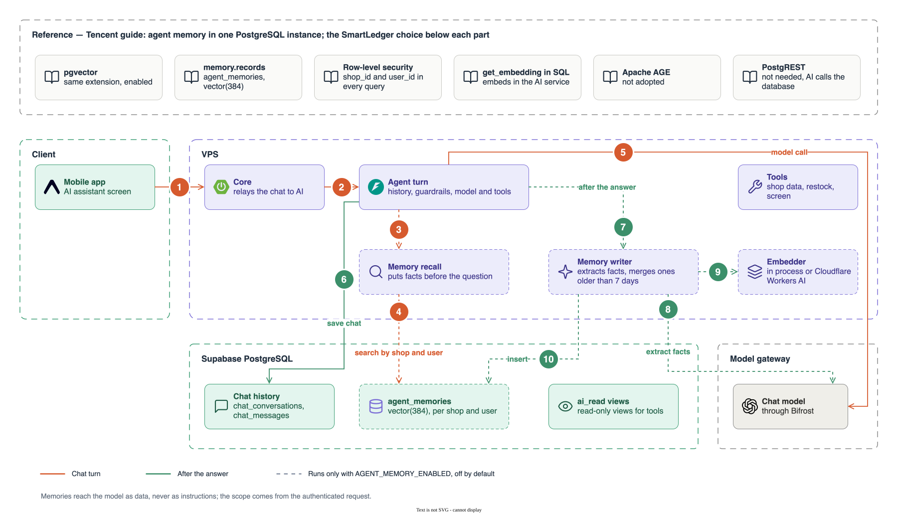

# ADR-0002: Agent long-term memory modeled on TencentDB for PostgreSQL, built on Supabase pgvector

- **Status:** Accepted on 2026-11-07. The product owner approved agent long-term memory, option A as implemented in `backend/ai/src/memory`, and it is deployed and enabled in production. The requirement is [`FR-040`](../../product/product-requirements.md#4-danh-mục-yêu-cầu-chức-năng--áp-dụng-ưu-tiên-exe201-ở-mục-11) with acceptance criteria [`AC-122`–`AC-126`](../../product/product-requirements.md#ghi-nhớ-dài-hạn-fr-040--đã-duyệt-ngày-2026-11-07); integrated acceptance (QA sign-off) of those criteria is still pending. The [Contract](../../contracts/api-contracts.md) describes `memory/settings`, `memory/items` and the SSE event `memory`. `AGENT_MEMORY_ENABLED` still defaults to `false` in code (`backend/ai/src/app_config.py`); production sets it in the environment. See the [AI memory guide](../../../backend/ai/docs/architecture.md#long-term-memory-and-onnx-embeddings); where the flag is off, chat behavior does not change
- **Date:** 2026-10-14
- **Owner:** not assigned

Diagram source: [`agent-memory.drawio`](../diagrams/src/agent-memory.drawio), exported like the [CI/CD diagram](../../development/ci-cd.md). The top band is the Tencent reference; the lower part is the proposed flow for SmartLedger. Numbers give the order: orange is one chat turn (reading memory) and green is writing after the answer; dashed boxes and edges only run when the `AGENT_MEMORY_ENABLED` flag is on (off by default in code, on in production).

## Context

The provider settings, staging observations and evaluation results below are dated design evidence from 2026-10-14 onward, not today's runtime configuration. Current defaults (including ONNX) and re-embedding operations are owned by the [AI memory guide](../../../backend/ai/docs/architecture.md#long-term-memory-and-onnx-embeddings); the decision itself is unchanged by that evidence.

- The Agent currently remembers only within one conversation: each turn sends the most recent `AGENT_HISTORY_TURNS` turns (default 30), with no summary and no tool to search history ([Chat context](../../contracts/api-contracts.md#chat-context), [AI README](../../../backend/ai/docs/architecture.md#chat-history-and-context)). Habits or preferences the shop owner stated in another conversation do not reach the model.
- The team looked at three Tencent "long-term memory" options. Only one runs on PostgreSQL: the Agent Long-Term Memory feature of TencentDB for PostgreSQL, described in the official guide.
- [ADR-0001](0001-vector-store-pgvector.md) already decided: embeddings live in Supabase PostgreSQL, and every vector query filters by `shop_id` in the same SQL statement.
- The PRD had no requirement for long-term memory when this ADR was drafted. This ADR recorded the findings and the architecture direction so the PO could decide whether to build it; the PO approved it on 2026-11-07 as [`FR-040`](../../product/product-requirements.md#4-danh-mục-yêu-cầu-chức-năng--áp-dụng-ưu-tiên-exe201-ở-mục-11).

## Findings from Tencent's guide

The content below was checked against the original pages [Agent Long-Term Memory Feature Overview](https://www.tencentcloud.com/document/product/409/80363), [Building Agentic RAG Applications Based on PostgreSQL](https://intl.cloud.tencent.com/document/product/409/80410), [pgvector](https://www.tencentcloud.com/document/product/409/80360) and [Apache AGE](https://www.tencentcloud.com/document/product/409/80361) on 2026-10-14.

| Component in the guide | What Tencent does | Applies to SmartLedger |
|---|---|---|
| Architecture | Vector + graph + relational in one PostgreSQL instance, replacing the Mem0 + Redis + Neo4j stack | Keep the one-database idea; Supabase already has `vector` |
| `pgvector` | Search by cosine distance; example HNSW index `m = 16, ef_construction = 200`; recommends `NOT NULL` for the vector column because a `NULL` vector does not enter the index | Use as is; staging already has `vector` 0.8.2 enabled (baseline, ADR-0001) |
| `memory.records` table | Append-only; `id UUID`, `tenant_id` and `agent_id` (UUID, required), `project_id`, `content`, `embedding vector(1024)` (allows `NULL`), `memory_type` (default `episodic`), `importance FLOAT` (default 0.5), `metadata JSONB`, `created_at`, `expires_at`; HNSW cosine index. The example on the page passes the string `'agent-planner-001'` into the UUID-typed `agent_id` column, so the sample code does not run verbatim | An `agent_memories` table with the ERD's `BIGINT` keys, scoped by `shop_id` + `user_id`, `embedding NOT NULL` |
| Memory types | `episodic` (history, actions), `semantic` (knowledge), `procedural` (procedures), `preference` (preferences, habits) | The code accepts all 4 types like Tencent; the final list for the MVP is a question for the PO |
| Search | Filter by `agent_id` and `expires_at IS NULL OR > now()`, order by cosine distance to the question's embedding, take 5 rows | The same, additionally filtering by `shop_id` and `user_id` in the same SQL statement |
| Decay and forgetting | Order by `importance * exp(-0.01 * age in days)` | Implemented and then replaced: it once re-ranked the 20 most recent memories by `relevance × importance × exp(-0.01 × days)`; it now ranks by cosine + BM25, see [Addition: hybrid ranking instead of decay](#addition-hybrid-ranking-instead-of-decay) |
| Summarization, compaction | `tencentdb_ai.chat_completions(...)` merges memories older than 7 days by day | Implemented in `AgentMemoryService.remember`, after the write step: memories older than 7 days are grouped by conversation and day (Vietnam time), and the chat model merges each group into 1–5 facts replacing the old group in one transaction. Grouping by conversation as well means deleting a chat still deletes the summary; at most 3 groups per turn |
| Hybrid search (RAG page) | Vector + `ts_rank(to_tsvector('chinese', …))`, merged with RRF | PostgreSQL has no Vietnamese text search configuration; staging has `pg_trgm`, `unaccent`, `pgroonga` 3.2.5 available (not enabled) if the keyword part is needed later |
| Tenant isolation | Row-level security: a policy compares `tenant_id` with `current_setting('app.tenant_id')` | The same idea as the `smartledger.shop_id` setting of the `ai_read` views; for the write table, keep the repository's current approach of an explicit `WHERE shop_id AND user_id` |
| Embedding | `tencentdb_ai.get_embedding('bge-m3', …)` runs inside the database; the page says `bge-m3` is only an example | This extension is not available; the AI service embeds through `pydantic_ai.Embedder`, chosen by `AGENT_MEMORY_EMBEDDING_PROVIDER`: `sentence-transformers` (the default at that review) runs the model inside the process, or `cloudflare` calls Workers AI (see [Embedding](#embedding)) |
| Apache AGE | Version 1.5.x, entity graph with openCypher | Not usable: `pg_available_extensions` on staging (PostgreSQL 17.11) has no `age` |
| Access method | Direct SQL on the `memory.*` tables, or the `/memory/records` endpoint through PostgREST | PostgREST is not needed: Core does not read memory, and AI connects to the database directly |

The guide describes a do-it-yourself setup: users create the schema and tables themselves (`CREATE SCHEMA memory`). There is no packaged memory API or separate price list; the cost is the TencentDB for PostgreSQL instance plus model calls. So most of this pattern can be built on Supabase without changing the database provider.

## Embedding

- At the 2026-10-14 review, the chat provider was a gateway through `OPENAI_BASE_URL`; the then-default `MODEL_PROVIDER=anthropic` calls `/v1/messages` (`openai` calls `/v1/responses`, `openai-chat` calls `/chat/completions`) ([AI README](../../../backend/ai/README.md)). On 2026-10-14, calling `POST /v1/embeddings` (`text-embedding-3-small`) through the proxy configured in the AI `.env` returned 404. The default at that review (`AGENT_MEMORY_EMBEDDING_PROVIDER=sentence-transformers`) embeds with `paraphrase-multilingual-MiniLM-L12-v2` running locally in the AI service (the `memory` dependency group): no secret is needed and chat content is not sent out to be embedded; the `cloudflare` provider sends messages and facts to Cloudflare Workers AI to embed.
- [VN-MTEB](https://arxiv.org/abs/2507.21500) (EACL 2026 Findings, 41 datasets translated from MTEB) only measures open-source models. Average Retrieval score (15 datasets) and overall average:

  | Model | Dim | Retrieval | Average |
  |---|---|---|---|
  | gte-Qwen2-7B-instruct | 3584 | 46.05 | 65.84 |
  | e5-Mistral-7B-instruct | 4096 | 41.73 | 67.67 |
  | multilingual-e5-large-instruct | 1024 | 40.88 | 67.99 |
  | bge-m3 | 1024 | 39.84 | 64.90 |
  | gte-multilingual-base | 768 | 38.38 | 65.22 |

  The 1024-dimension models (`bge-m3`, `multilingual-e5-large-instruct`) are close to the 7B models on retrieval at a much smaller size, and fit `vector(1024)` as in the Tencent pattern. The table has no API models such as OpenAI `text-embedding-3-*`, so if an API model is chosen it still has to be measured.
- Baseline following the Tencent pattern exactly, with `paraphrase-multilingual-MiniLM-L12-v2` running locally, measured on staging. On 40 synthetic questions: Hit@1 0.575, Recall@5 0.825; RLS and the `expires_at` filter let no row through; every question typed without diacritics missed.
- On 2026-10-15, measured locally (CPU, macOS) on 34 facts and 38 Vietnamese questions in the style of a shop owner, 4 of them without diacritics or mixed with English. The set is small; one question is 2.6 points:

  | Model | Dim | Recall@1 | Recall@5 | MRR@10 | ms/question | RSS |
  |---|---|---|---|---|---|---|
  | paraphrase-multilingual-MiniLM-L12-v2 | 384 | 0.658 | 0.842 | 0.751 | 6.7 | 1.16 GB |
  | bge-m3 | 1024 | 0.895 | 0.974 | 0.928 | 45.7 | 4.14 GB |
  | embeddinggemma-300m | 768 | 0.921 | 0.974 | 0.950 | 22.7 | 1.34 GB |
  | embeddinggemma-300m truncated to 384 | 384 | 0.947 | 0.974 | 0.961 | 22.7 | 1.34 GB |

  embeddinggemma (with query/document prompts, trained with Matryoshka) keeps its quality when truncated to `vector(384)`, so changing the model needs no migration. No model that runs locally fits the Railway Free plan (0.5 GB RAM); Cloudflare Workers AI has `@cf/google/embeddinggemma-300m` (beta) through `/v1/embeddings`, so the AI service has an extra `cloudflare` provider.

## Options considered

| Option | Pros | Cons |
|---|---|---|
| **A. Build it ourselves following the Tencent pattern on Supabase** | Keeps ADR-0001: same database, `shop_id` filter in SQL, delete by conversation in one transaction; no extra service or secret besides embedding | We write the fact-extraction step and evaluate Vietnamese quality ourselves; local embedding makes the image heavier (`torch`) || B. Move to TencentDB for PostgreSQL | Has `tencentdb_ai` and AGE out of the box | Must migrate or run the business database in parallel, change the backup/migration process, and add instance cost |
| C. Run [TencentDB-Agent-Memory](https://github.com/TencentCloud/TencentDB-Agent-Memory) (open source) next to AI | Has the L0–L3 pipeline and a Python SDK | A separate Node.js service; it only stores to `sqlite`, `tcvdb`, `mongodb`. The Postgres backend is only in community PRs [#1387](https://github.com/TencentCloud/TencentDB-Agent-Memory/pull/1387) and [#1466](https://github.com/TencentCloud/TencentDB-Agent-Memory/pull/1466), still open. Missing IDs fall back to the `default` bucket; BM25 only has `zh`/`en` parameters |
| D. Keep the history window as is (`AGENT_HISTORY_TURNS`, default 30 turns) | Costs nothing | No memory across conversations |

## Proposal

The PO approved the requirement on 2026-11-07, so **A** is built and follows the patterns already in `backend/ai` (**D** applies only where the flag is off):

- **Schema:** migration [`20261014000000_agent_memories.sql`](../../../supabase/migrations/20261014000000_agent_memories.sql), without editing the baseline. Keep the columns of `memory.records` (`memory_type`, `importance`, `metadata`, `expires_at`, HNSW cosine index); `BIGINT` keys with foreign keys, `shop_id` + `user_id` replacing `tenant_id` + `agent_id`, `embedding vector(384) NOT NULL` for the model in use, and RLS enabled with no policy so Supabase's API roles cannot read it. `source_conversation_id ... ON DELETE CASCADE` upholds the contract "deleting a chat removes the messages from history and from the assistant context": when `AgentConversationRepository.delete_conversation` deletes a conversation, the facts generated from that conversation disappear in the same transaction.
- **Read:** following Tencent's flow, the code searches memory by the current question before calling the model, not through a tool. `AgentMemoryService.with_memories` embeds the question with `pydantic_ai.Embedder`, searches by cosine among the unexpired memories of the right shop and user, and then puts at most 5 found facts (after at most 10 always-loaded `preference` memories, see the section "Additions from Cognition") before the question as the "Reference Materials" part of Tencent's Agentic RAG prompt. The message stored in the database is the shop owner's message after `GuardrailService.check_input` (which redacts keys and sensitive data), without the memories. If the search fails, it answers without memories. It does not spend the `AGENT_TOOL_CALL_LIMIT` budget, and the answer still goes through `AnswerScreen.check`.
- **Write:** `AgentMemoryService.remember` runs in the background after `_save_turn` finishes, outside the turn's 35-second limit so it does not slow the answer. It reads the exchange made of the shop owner's message (after `GuardrailService.check_input`) and the answer (the prompt only allows taking facts from what the shop owner said), calls the model to extract facts with a static English prompt in `src/prompt_templates/` (with today's date so "tuần trước" ("last week") becomes a concrete date), embeds, and then `INSERT`s through the repository; after that it summarizes old memory as in the table above. A failure in any step is only logged and does not break the chat turn.
- **Isolation:** every SQL statement that reads or writes `agent_memories` has `shop_id` and `user_id`. A cross-shop integration test like `tests/integration_tests/test_sql_reader.py` (`NFR-007`, `AC-012`).

## Consequences

- When building (done: `FR-040`/`AC-122`–`AC-126` were added to the PRD): add FR/NFR/AC to the PRD (and the BRD if the PO treats this as a new business scope), update [Chat context](../../contracts/api-contracts.md#chat-context), the [AI README](../../../backend/ai/docs/architecture.md#chat-history-and-context), [Technical design §1](../technical-design.md#1-scope), `erd.dbml` and the privacy page if needed, because chat content is additionally sent to the chat model to extract and summarize facts.
- When enabled with the `sentence-transformers` provider, the AI image must install the `memory` group (sentence-transformers, `torch`), because the current chat proxy does not serve `/v1/embeddings`. The `cloudflare` provider does not need this group but sends the shop owner's messages and facts to Cloudflare to embed, and needs `CLOUDFLARE_ACCOUNT_ID` and `CLOUDFLARE_API_TOKEN`.
- Each turn with memory costs one extra embed on read (local, or one Workers AI call with `cloudflare`); after the turn it costs one more model call and one fact embed on write and, when old memory needs summarizing, at most 3 model calls and 3 embeds (each group takes one model call and one embed of the replacement facts).
- The request and response of `/internal/v1/agent/chat` and `/api/v1/agent/chat` do not change; the `memory/settings` endpoint and the SSE event `memory` of the stream route are added in the "Additions" sections below.

## Additions from Sakana "My Fish"

Migration [`20261015000000_agent_memory_visibility.sql`](../../../supabase/migrations/20261015000000_agent_memory_visibility.sql), the same `AGENT_MEMORY_ENABLED` flag, approved and enabled together with the base design:

- **Use count and decay by last use:** `search` is read-only; after answering, the background task `remember` calls `mark_used` to update the `last_used_at` and `use_count` columns of the memories that were used; the age in the decay formula is computed from `coalesce(last_used_at, created_at)` (recency as in Generative Agents). A summary keeps the largest `last_used_at` and the total `use_count` of the group.
- **Mem0-style supersede:** the extraction model sees the memories just used in the form `[id] content` and can set `replaces` for a fact that corrects one of them. The code only accepts ids in the list just used. The old row gets `superseded_by` and is no longer searched; it is not deleted, so when the conversation that produced the new fact is deleted, `ON DELETE SET NULL` brings the old fact back, upholding `AC-022`. The read prompt adds a rule: when two facts contradict, the fact with the later date wins.
- **Auto-saved types:** `preference`, `procedural` and `semantic` (`AGENT_MEMORY_TYPES`, default `preference,procedural,semantic`); facts of other types (such as `episodic`) are dropped at the extraction step (a summary keeps only the types per the prompt, and the code only filters phone numbers). `semantic` is stable facts such as suppliers, staff, opening hours. At first only `preference` and `procedural` were saved, but E2E on staging showed the agent answering "Đã ghi nhớ" ("Remembered") for a supplier fact and then that fact being filtered out, so the shop owner was misled; staging and production now run with `semantic` as well. The PO approved this type list together with the requirement on 2026-11-07.
- **Phone number filter:** a fact (including a summary) containing a Vietnamese phone number is dropped; the extraction prompt also forbids storing phone numbers.
- **Icon in chat:** the SSE event `memory` is sent before the first `delta` when memories were used; the app shows a memory icon on the answer. `/internal/v1/agent/chat` does not change.
- **Per-shop-owner switch:** the table `agent_memory_settings`, on by default when there is no row. When off, it neither searches nor writes, and does not delete existing memory. The global flag still decides last. The `memory/settings` endpoint is in the [contract](../../contracts/api-contracts.md#6-core--ai-internal); mobile has a switch in "Cài đặt trợ lý" ("Assistant settings") of the chat screen, reloaded on every open, with a retry button on error.

## Additions from Cognition "agent memory repo"

Compared with Cognition's [agent memory repo](https://cognition.com/agent-memory-repo), where a short `MEMORY.md` is always loaded into every session, the read approach above only searches by similarity to the question. A preference such as "trả lời dạng bảng" ("answer in a table") is often not close in meaning to the question and is easily missed. The same `AGENT_MEMORY_ENABLED` flag, approved and enabled together with the base design, no new migration:

- **Always load preferences:** `search` first takes at most 10 active `preference` memories (not superseded, not expired), ordered by `importance` and then newest, regardless of the question; it then searches by cosine and decay for at most 5 more memories, skipping the rows already taken. Preferences beyond the limit are still found like ordinary memories. Each line in the prompt records the date and type; `MEMORY_PROMPT` tells the model to apply preferences (format, length, tone, form of address) to every answer. Loaded preferences also go into the `[id]` list of the extraction step, so when the shop owner changes their mind, a new fact can replace the old preference.
- **Icon leads to the source conversation:** the `memory` event additionally sends `source_conversation_id` and `created_at` (already in the table). Tapping the icon shows each memory, and tapping a memory opens the conversation that produced it; a memory from the currently open conversation only shows the date. The source conversation always still exists, because deleting a conversation removes its memories with it (`ON DELETE CASCADE`).

## Additions from Hy Memory

Compared with the `pro` mode of [Hy Memory](https://github.com/Tencent-Hunyuan/Hy-Memory), the extraction step only compares new facts with the memories just used in the turn, so if the shop owner repeats or changes an old fact in a question about another topic, the old fact is not replaced and memory keeps two versions. The same `AGENT_MEMORY_ENABLED` flag, approved and enabled together with the base design, no new migration:

- **Reconcile against the most similar memories:** a new fact without `replaces` is embedded, and then `similar` takes at most 3 of the nearest active memories for each fact, with cosine at or above 0.6, skipping the memories this turn already used, and without recording a use. The threshold was measured on 2026-10-17 with embeddinggemma on staging: same-topic pairs 0.66–0.95, different-topic pairs 0.53–0.67, and the fact about changing the rice supplier extracted by the model reached only 0.65 against the old fact. The low threshold only selects candidates; the reconciliation model separates the different matters. When there are candidates, one model call (`MEMORY_RECONCILE_PROMPT`) chooses for each fact: `new`, `replaces` an id, or `known` (drop the fact). The code only accepts ids the model was shown; if the model fails, the fact is saved as before. With no candidates, the model is not called.
- **Use frequency in the ranking score:** the weight is additionally multiplied by `1 + ln(max(use_count, 1))`, following the strength `(1 + ln(access_count))` of Hy Memory; a memory that is unused or used once keeps the old weight. Risk: `use_count` increases for every returned memory, including weakly relevant memories that slip into the top 5, so frequently used memories grow stronger on their own (30 uses ≈ 4.4 times).

## Addition: hybrid ranking instead of decay

Measured on 2026-10-22 on the recall bench (embeddinggemma through Cloudflare, test set read once): the formula `relevance × importance × exp(-0.01 × days) × (1 + ln use_count)` reached Recall@5 0.284, and pure cosine 0.807. Because every returned memory gets its `use_count` increased, a few frequently used memories grow stronger on their own and push relevant memories out of the top 5 (the risk recorded in the Hy Memory section). The same `AGENT_MEMORY_ENABLED` flag, approved and enabled together with the base design, no new migration:

- **Candidates:** the 20 nearest memories by cosine plus the 20 best-matching memories by the question's BM25. BM25 is computed in the AI service over the shop owner's own diacritic-stripped syllables and adjacent syllable pairs, so "gao" finds "gạo" without `unaccent` or a Vietnamese text search configuration.
- **Score:** `cosine + 0.1 × BM25 / highest BM25`; Recall@5 0.860 on the same bench. Importance, decay and `use_count` no longer take part in ranking; `last_used_at` and `use_count` are still recorded, after answering and in the background, so the shop owner can see them.
- **Checked on PostgreSQL 16 + pgvector:** the order matches the bench (differing only among memories with equal scores), and the p95 of each `search` is under 20 ms with a shop of 120 memories. The embedding in this check was a stand-in, not embeddinggemma.
- **Code location:** the formula lives in `backend/ai/src/memory/ranking.py`, a pure module with no I/O like `restock/policy.py` and `drafts/matching.py`; `AgentMemoryRepository.search` only loads the candidates and cosine scores and then calls it. The eval in `backend/ai/evaluation/memory/` calls the real `AgentMemoryService.with_memories` on the local database, so it measures the rule actually running; the grid search that chose the formula is in Git history (PR #346).
- **Scaling limit:** on each `search`, BM25 reads the content of every active memory of the shop owner, so time grows with the number of memories (p50 about 6 ms at 15 memories, 10 ms at 130). Summarizing old memory keeps this number low. Linear extrapolation (an estimate, not measured) gives about 50 ms at 1,000 memories. Cosine is also computed over every active memory of the shop owner, not through the HNSW index: checked on 2026-10-22 on PostgreSQL 16 + pgvector, with a 52,000-row table where one shop owner holds 4,000 rows, the planner chose HNSW, the index returned the 40 nearest rows of all shops and only then filtered by shop owner, so `LIMIT 20` was left with 4 rows. When one shop owner exceeds that level or the p95 exceeds the budget, move BM25 into PostgreSQL: add a `tsvector` column on the diacritic-stripped content with a GIN index (needs a migration), and turn on `hnsw.iterative_scan` (available since pgvector 0.8, staging is on 0.8.2) so cosine uses the index again and still gets 20 candidates; keep the score formula unchanged.

## Open questions

- Answered on 2026-11-07: the PO approved cross-conversation memory, with the owner able to list, delete and open the source of individual memories in the app's assistant settings (`AC-125`).
- Retention: the current contract says there is no automatic TTL yet; is `expires_at` used? Third-party copies and traces are tracked under `OQ-008` in the business requirements.
- Choosing the embedder for staging/production: embeddinggemma through Cloudflare Workers AI (a beta model, price not yet published; chat data leaves our infrastructure) or run locally (needs a plan with more than 1.3 GB RAM). The PO/owner must approve sending chat content to Cloudflare.
- The `onnx` provider (2026-11-05) runs the int8 build of `static-similarity-mrl-multilingual-v1` inside the AI process: on a 1-CPU VPS it costs about 330 MB RAM, under 1 ms per question and at most 11 ms when 10 questions run at once, versus 680-835 ms per turn through Workers AI. On the recall bench at 384 dimensions it reaches 0.753 (embeddinggemma 0.861), and on questions worded differently from the keywords only 0.331 (embeddinggemma 0.627). It needs to be measured on staging before deciding to use it for production; changing the provider on an environment requires re-embedding that environment's `agent_memories`.

## References

- [Agent Long-Term Memory Feature Overview](https://www.tencentcloud.com/document/product/409/80363)
- [Building Agentic RAG Applications Based on PostgreSQL](https://intl.cloud.tencent.com/document/product/409/80410)
- [pgvector Vector Extension Usage Guide](https://www.tencentcloud.com/document/product/409/80360)
- [Apache AGE Graph Database Usage Guide](https://www.tencentcloud.com/document/product/409/80361)
- [TencentCloud/TencentDB-Agent-Memory](https://github.com/TencentCloud/TencentDB-Agent-Memory)
