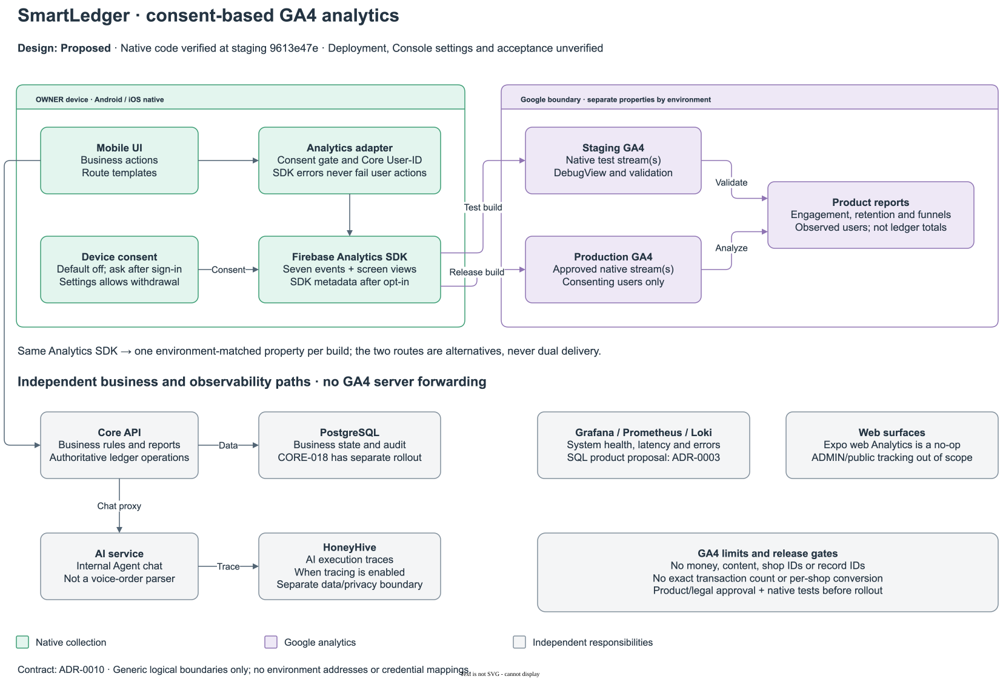

# ADR-0010: Consent-based GA4 product analytics for SmartLedger

- **Status:** Proposed; product and legal approval remain required for `BR-026`, `FR-039` and `NFR-011`. The native Mobile implementation is already merged at the reviewed revision; native delivery, Console settings and `AC-119`–`AC-121` are not verified. This design does not authorize new collection, a Core change or removal of Grafana resources.
- **Date:** 2026-11-06; design and source review: 2026-11-09.
- **Evidence:** Verified against `staging` revision `9613e47eb8a8a3a134bb550966a666adfde4db80`. “Verified” below means source inspection, not live behavior; proposed settings and interpretations are explicitly distinguished.
- **Owners:** Product owner maintains questions, definitions and event approval; Mobile owner maintains instrumentation and device evidence; operations owner controls Firebase/GA4 access and configuration; legal owner approves disclosures, retention and deletion procedures. Assign accountable people before rollout.
- **Related:** [`BR-026`](../../product/business-requirements.md), [`FR-039`, `NFR-011`, `AC-119`–`AC-121`](../../product/product-requirements.md), [Data safety](../../product/google-play-data-safety.md), [ADR-0003](0003-product-analytics-grafana.md), [technical design](../technical-design.md#consent-based-product-analytics), [Mobile verification runbook](../../../frontend/mobile/docs/operations.md#ga4-native-verification).

## 1. Context and vocabulary

SmartLedger needs to understand which screens and workflows consenting owners use, without exporting their ledger or customer data. SQL on business records cannot show screen visits or all pre-save interactions. Firebase already provides native authentication, so its Analytics SDK avoids introducing a second client analytics vendor.

**Product analytics** describes observed client behavior; **business reporting** describes authoritative ledger state; **operational monitoring** describes system health; **AI tracing** explains a chat execution. These are separate questions, not interchangeable implementations of one metric.

A GA4 user is an identity resolved by GA4, not necessarily an authenticated OWNER or a shop. A `sale_completed` event is a client-observed save, not an additional ledger entry. A voice workflow is Mobile's on-device speech/rule-based parser workflow, not a server AI order parser.

## 2. System boundaries

Editable [draw.io source](../diagrams/src/system-ga4.drawio), [PNG](../diagrams/images/system-ga4.png) and [diagram reading scope](../diagrams/README.md#ga4-system-boundaries) accompany this proposed design; arrows do not establish deployment or completed approval.

| Component | Verified implementation or existing owner | Design boundary |
|---|---|---|
| Mobile Android/iOS | Firebase Analytics adapter, consent prompt, manual screen views and seven business-interaction events | Send the bounded catalogue only after consent; Android native validation is the first rollout gate, iOS requires separate device evidence |
| Expo web | `analytics.web.ts` exports no-op functions; no consent prompt | Keep it untracked; web preview is not GA4 validation |
| Web ADMIN and public pages | Separate frontend from Mobile; not instrumented by this design | Do not add a tag, cookies or a shared identity stream; any future web collection needs its own consent/privacy and event review |
| Core and PostgreSQL | Business APIs, reports, audit and the separately governed CORE-018 daily-activity capability | Remain authoritative for transactions, revenue, debt and business activity; no GA4 forwarding, endpoint, table or migration |
| AI | Internal Agent chat behind Core | No direct GA4 events or chat payload export; usage is observed at Mobile's completed chat call |
| Grafana/Prometheus/Loki | Monitoring infrastructure; SQL product dashboard is separately proposed in ADR-0003 | Own availability, latency and errors; do not treat GA4 as an alerting or audit backend |
| HoneyHive | AI trace boundary in [ADR-0009](0009-end-to-end-tracing.md) | Own execution diagnosis; never copy prompts, answers, SQL, tool results or trace IDs into GA4 |
| Firebase → GA4 | Native SDK integration is checked in; actual destination configuration is not inspected | Direct outbound analytics path from the device; no data path through Core, the database or the VPS |

The ordered data flow is: user chooses consent → `AppStore` applies settings and account identity → UI calls `track`/`trackScreen` → native adapter gates and isolates SDK errors → Firebase SDK delivers to the environment's GA4 property → the product team reads aggregate reports/explorations. Business requests independently go to Core; their success must never depend on this analytics path.

[ADR-0003](0003-product-analytics-grafana.md) preserves the separate SQL proposal. GA4 is the proposed owner of consented UI behavior, not proof that the SQL dashboard has been retired or its activity source enabled. Any removal or database-role change is a separate approved change.

## 3. Consent, identity and data minimization

### 3.1 Checked-in lifecycle

Verified source: [`firebase.json`](../../../frontend/mobile/firebase.json), [`app.json`](../../../frontend/mobile/app.json), [`analytics.ts`](../../../frontend/mobile/src/lib/analytics.ts), [`AppStore.tsx`](../../../frontend/mobile/src/store/AppStore.tsx) and [`AnalyticsConsentPrompt`](../../../frontend/mobile/src/components/AnalyticsConsentPrompt.tsx).

1. Collection defaults to off. Configuration disables advertising identifiers, automatic screen reporting and advertising-related defaults; Android blocks `AD_ID`, and the iOS plugin requests a build without IDFA support.
2. Once authentication and stored settings are ready, native Mobile asks once per device, including before shop onboarding. Decline or dismiss means no consent. Settings exposes “Gửi số liệu sử dụng”; `analytics` and `analyticsAsked` persist on the device, not per account.
3. Granting consent enables native collection and sets the currently known Core account ID as `user_id`. The first sign-in on a fresh installation precedes this grant and is not replayed.
4. Account changes update `user_id`; sign-out sets it to null. The device's consent choice remains. Shared-device/account-switch behavior needs explicit product and legal review; consent is not an account-specific authorization record.
5. Withdrawal disables collection; when the adapter was enabled it also requests `resetAnalyticsData`. That resets local Analytics data/installation identity; it is not a server-side deletion request and does not retract events already uploaded.
6. Missing native modules, synchronous SDK errors and rejected SDK promises are caught and debug-logged. Calls are not awaited by the business workflow; there is no application-level analytics retry queue.

The SDK persists collection settings across launches ([Firebase collection controls](https://firebase.google.com/docs/analytics/configure-data-collection)). Therefore static default-off configuration alone does not establish consent correctness after a restart. Verify cold start, restored settings, withdrawal, offline reconnect and identity transitions on a native build before claiming that no events leave the device without consent. SDK calls are asynchronous; source ordering alone is not evidence that an event always carries the intended identity.

### 3.2 Payload boundary

- Application event parameters are enums or counts. Do not send names, phone numbers, email, shop/product/customer names, money, bank details, transcripts, chat content, auth tokens, raw URLs/query strings or error messages.
- `user_id` is the Core account ID as a string, not Firebase UID or email. It is a pseudonymous linkable identifier, not anonymous data. Do not register it as a custom dimension or expose it in shared screenshots; use [GA4 User-ID](https://support.google.com/analytics/answer/9213390) and restrict access.
- Do not add `shop_id`, sale IDs, draft IDs, product IDs, conversation IDs, request IDs or trace IDs. Without shop identity, GA4 cannot answer shop-level adoption or prove that a sale belongs to the shop created in an onboarding step.
- Screen names derive from Expo Router segments: remove route groups and preserve placeholders such as `invoice/[id]`; never substitute actual IDs. Manual reporting prevents duplicate automatic screen events.
- The application catalogue is not the entire SDK payload. When collection is enabled, Firebase may collect session/engagement events, app-instance identity, app/device metadata and IP-derived approximate location; verify the actual build against [automatic events](https://support.google.com/analytics/answer/9234069) and [Firebase data disclosure](https://support.google.com/analytics/answer/11582702).
- Keep advertising off: no Google signals, Ads links, ad personalization or optional Google-product data sharing. These Console settings require operational evidence; they do not by themselves settle legal processor/sharing classification.

## 4. Event contract

The executable names and parameter types remain owned by [`analyticsEvents.ts`](../../../frontend/mobile/src/lib/analyticsEvents.ts); this table records their verified emission semantics. Do not create another emitter or rename an event without reviewing existing reports.

| Event | Parameters | Emission boundary and interpretation |
|---|---|---|
| `screen_view` | `screen_name`, `screen_class`: sanitized route template | Root layout effect on route/consent change; not every tap, foreground return or modal impression |
| `login` | `method`: `google`, `zalo`, `email` | Successful instrumented sign-in flow; not session restoration, every auth API call, or a complete signup denominator |
| `shop_created` | `via`: `onboarding`, `new_shop` | Shop creation completes in the corresponding screen; not a screen-open event |
| `sale_completed` | `source`: `voice`, `pos`, `manual`; `payment`: `cash`, `transfer`, `debt`; `item_count`: number | Checkout submit resolves and `recovered` is false; count is cart lines, not quantity sold; payment is the UI choice, not verified bank settlement |
| `voice_order_reviewed` | `item_count`: number of cart lines | Voice screen puts the draft into app state and navigates to checkout; includes typed input on that screen, not necessarily a microphone session or parser success |
| `ai_message_sent` | `conversation`: `new`, `existing` | Emitted after `chatStream` resolves, not when Send is tapped; measures client-observed completed turns, not all attempts or unique conversations |
| `product_created` | `via`: `products`, `pos`, `voice` | Creation completes from one of the instrumented screens |
| `expense_created` | `via`: `expenses`, `voice` | Expense save completes from one of the instrumented screens |

Recovered checkout results intentionally do not emit another `sale_completed`. This is not exactly-once analytics: crashes, denied consent, network loss and recovery after a lost response can undercount; other repeated UI actions can produce multiple events. Never reconcile the ledger by replaying GA4 events.

Use GA4's recommended `login`; do not use `purchase`, `value`, `currency` or ecommerce item arrays for shop sales, because these are not app revenue. Keep `item_count` numeric and non-negative in any future instrumentation change. The existing tests validate names and route sanitization, not runtime parameter validation or SDK delivery.

## 5. Properties, definitions and reporting

### 5.1 Proposed configuration

Use separate Firebase projects and GA4 properties for staging/test and production. A native stream belongs to its platform/application in the matching environment; Android and iOS may share that environment's property once iOS is verified. Resolve project/property IDs, signing identities and native configuration files from the private operations knowledge base, not this ADR. Build-profile names alone do not prove correct routing.

| Setting | Proposed value or action | Owner |
|---|---|---|
| Reporting timezone | `Asia/Ho_Chi_Minh` in both properties | Operations; record effective date before comparing daily windows |
| Reporting identity | Use User-ID where available and document the selected GA4 reporting identity | Product + operations; do not claim every reported user is authenticated |
| Custom dimensions | Event scope: `method`, `via`, `source`, `payment`, `conversation`, unless already available as a built-in dimension | Operations, using descriptive display names such as “Sale source” for `source` |
| Custom metric | Event scope: `item_count`, standard numeric unit | Operations; label it cart-line count, not sales volume |
| Built-in dimensions | Screen name/class, platform and app version | Product; do not duplicate with custom fields |
| User/event retention | Retain the earlier 14-month proposal only if product/legal approve; otherwise leave the configured value documented as unverified | Legal + operations; record “Reset on new activity” explicitly |
| Key events | Optionally mark `sale_completed` and onboarding `shop_created` after definitions are approved | Product; not revenue or billing conversions |
| BigQuery export | Deferred until a concrete approved query requires it | Product + operations + legal; separate access, billing, retention and deletion review |

[Custom definitions](https://support.google.com/analytics/answer/14240153) must be configured before relying on parameter breakdowns in reports; DebugView visibility is not proof that a report definition exists. Allow processing time and record when definitions became available. [Retention controls](https://support.google.com/analytics/answer/7667196) affect event/user data used in explorations, not all standard aggregated reports; 14 months is not a universal deletion deadline.

### 5.2 Measurement plan

Every saved report records property, date range, timezone, platform/app-version filters, reporting identity, numerator, denominator and known data gaps. Production reports exclude test builds; staging exists to validate events, not to estimate real adoption. GA4 data may arrive late or be thresholded/sampled; annotate those limitations and avoid promises of exact real-time counts.

| Question | Report definition using existing events | Limit |
|---|---|---|
| Do consenting users return? | GA4 active users for 1/7/30-day windows and retention cohorts; name the GA4 user metric explicitly | [Active users](https://support.google.com/analytics/answer/12253918) use GA4 engagement rules, not Core successful-request days; first-open cohorts are not signup cohorts |
| Do observed onboarders reach checkout success? | Closed user funnel: `shop_created` where `via=onboarding` → `sale_completed`, indirectly followed within 7 days | Seven days is a proposed analysis window; no `login` prerequisite because first login is missed; no shop identity or proof of the first-ever order |
| Where does the sales UI lose users? | Closed user funnel: `screen_view` where `screen_name=checkout` → `sale_completed`, indirectly followed within the same session | Approximate observed-user progression, not a per-cart failure rate; return visits and consent changes affect inclusion |
| Which selling paths are observed? | Event counts of `sale_completed` by `source` and `payment`; optionally share of observed sales events | Not revenue, unique sales, microphone adoption or bank-payment verification |
| Do voice-screen users continue to save? | Closed user funnel: `voice_order_reviewed` → `sale_completed` where `source=voice`, same session | No draft correlation; event-count ratios are not conversion rates and may exceed 100% |
| Is the assistant used repeatedly? | Users with `ai_message_sent`, split by `conversation`, over a fixed 7/30-day window | “Existing” means a conversation ID was supplied, not that the person is a returning user; repeat-user analysis needs a user-level exploration |
| Which creation workflows are used? | Users and event counts for `product_created`/`expense_created`, by `via`, over a fixed window | No shop denominator, quantities, money, failed attempts or coverage of uninstrumented clients |

No activation target or rollout success percentage is invented here. Consent selection bias, offline delivery, app-version coverage, reinstall/reset and identity association prevent GA4 totals from equalling Core totals. CORE-018/`BR-023` keeps its separate activity definition and rollout approval.

## 6. Alternatives and consequences

| Alternative | Trade-off |
|---|---|
| SQL-only Grafana product analytics | Can describe durable business outcomes, but cannot recover unrecorded UI behavior; retains separate approval and database-access constraints |
| Mixpanel, Amplitude or PostHog | More specialized product analysis, but another SDK/vendor and privacy/cost review; no demonstrated need beyond the existing Firebase path |
| Core event ingestion or GA4 Measurement Protocol | Would add API/schema/secret management and consent propagation or duplicate client events; not needed for the current catalogue and not authorized |
| Automatic collection without a consent gate | Conflicts with the proposed opt-in requirement and data-minimization boundary |
| Track all platforms immediately | Would mix OWNER, ADMIN and public acquisition populations before their purposes and consent have been approved |

The design intentionally cannot measure refused consent as a GA4 event, all signup attempts, logout rate, per-shop funnels, exact transaction conversion, parser accuracy, request failures or AI answer quality. Add instrumentation only for a named product question with approved requirements and a reviewed payload; do not silently infer those metrics from the current catalogue.

## 7. Rollout and verification gates

1. **Product/legal gate:** approve the existing proposed requirements and report definitions; assign accountable owners; review shared-device consent, User-ID linkage, SDK metadata, retention and Google terms. Reconcile policy, Play Data safety and deletion handling with [the legal checklist](../../product/google-play-data-safety.md#việc-người-đứng-tên-cần-xác-nhận). Legal and cross-border-processing conclusions require the legal owner's current official sources and approval; this ADR supplies neither.
2. **Configuration gate:** operations verifies actual native files → Firebase app → GA4 stream/property mapping, advertising controls, custom definitions, reporting timezone/identity and least-privilege access. Do not record private identifiers or credentials in repository evidence.
3. **Staging gate:** Mobile runs the [native verification matrix](../../../frontend/mobile/docs/operations.md#ga4-native-verification), records build/commit/platform and sanitized results, and checks `AC-119`–`AC-121`. Unit tests and an Expo web export cannot close this gate.
4. **Release gate:** approve the native artifact and release separately; inspect the final Android manifest for `AD_ID` and verify production routing with an authorized consenting test account. No production release or Console mutation is part of this documentation change.
5. **Observation gate:** product validates processed reports after data arrives, records coverage and compares definitions rather than expecting parity with Core. Grafana retirement, if desired, is independently approved; it is not a prerequisite to collect consented UI events.

For a consent/payload defect, stop the rollout and ship a native update that explicitly disables SDK collection regardless of previously persisted consent and suppresses application tracking; changing the static default alone is insufficient. There is no verified fleet-wide kill switch. Local withdrawal applies only to that installation. Rollback does not delete previously uploaded data: operations/legal must separately handle Google-held data, any future exports and account-erasure requests with an auditable approved procedure. That procedure and live deletion evidence remain unverified.
