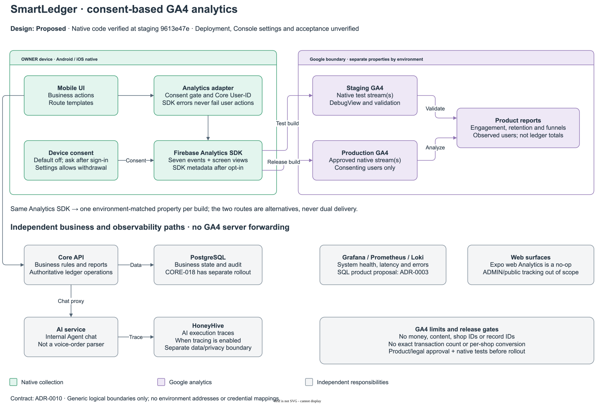

# Diagram guide

Repository diagrams explain logical responsibilities, data relationships, code paths and the delivery/runtime topology drawn from tracked `deploy/` and workflow files. Environment addresses, domains, IPs, server paths, credential values and access procedures belong to the private operations knowledge base and must not appear in a diagram source or export; use generic labels such as `private host` instead.

## Reading scope

| Artifact | Meaning and boundary |
|---|---|
| [Logical architecture](images/logical-architecture.svg) ([source](src/logical-architecture.mmd)) | Current component responsibilities, not network placement or deployment evidence |
| [GA4 system boundaries](images/system-ga4.svg) ([source](src/system-ga4.drawio), [PNG](images/system-ga4.png)) | Consent-based native analytics, environment separation and independent business/observability paths; [ADR-0010](../adr/0010-mobile-usage-analytics-ga4.md) owns the proposed design and rollout limits |
| [ERD source](src/erd.dbml) | Checked-in Core/AI table structure; SQL migrations own checks, policies, triggers and partial indexes |
| [ERD layout](src/erd.dbdiagram) | Editor positions only, not a schema definition |
| [Service walkthrough](../service-walkthrough/README.md) | Source-reading and transaction diagrams with their own verification boundaries |
| [Target architecture](images/architecture.svg) ([source](src/architecture.drawio), [PNG](images/architecture.png)) | Target components including future services; [technical design §1](../technical-design.md#1-scope) records code status |
| [System design](images/system-design.svg) ([source](src/system-design.drawio), [PNG](images/system-design.png)) | Runtime topology, external services, delivery and VPS setup; source-derived rather than proof of live deployment; explained in [CI/CD](../../development/ci-cd.md#delivery-and-runtime-topology) |
| [VPS setup with Ansible](images/ansible-flow.svg) ([source](src/ansible-flow.drawio)) | Infra workflow, `run.sh`, role order and handlers; explained in [CI/CD](../../development/ci-cd.md#vps) |
| [VPS networks](images/vps-network.svg) ([source](src/vps-network.drawio)) | Docker networks, container aliases and in-network ports from the tracked Compose files |
| [AI evaluation and HoneyHive](images/ai-evaluation.svg) ([source](src/ai-evaluation.drawio)) | Offline evaluation run, its CI workflows and HoneyHive tracing, evaluators, charts and alerts; explained in the [evaluation README](../../../backend/ai/evaluation/README.md) |
| [Dopbase secrets and backup](images/dopbase-secrets-and-backup.svg) ([source](src/dopbase-secrets-and-backup.drawio)) | Secret distribution and nightly encrypted backup flow, without hosts or values |
| [Sign-in request flow](images/auth-request-flow.svg) ([source](src/auth-request-flow.drawio)) | Firebase browser sign-in, CORS and project matching; not the Zalo flow, see the [Zalo contract](../../contracts/api-contracts.md#zalo-core-015) |
| [APK release](images/apk-release.svg) ([source](src/apk-release.drawio)) | Android release build and landing-page download path |
| [Memory decision diagram](src/agent-memory.drawio) | Supporting artifact for ADR-0002; the ADR's status remains authoritative |

The logical architecture is a system-level capability overview; the walkthrough's [Core services](../service-walkthrough/README.md#2-core-service-interfaces) and [request resolution](../service-walkthrough/README.md#1-request-resolution-logic) drill into code ownership and authorization. System design shows deployment and delivery topology, while the GA4 diagram focuses on consent, environment separation and reporting limits. They share components but answer different questions; do not duplicate implementation detail across them.

The [technical design](../technical-design.md#1-scope) records source-level implementation; the [ERD description](../erd-description.md) records migration alignment. Neither a diagram nor a checked-in migration proves live deployment, runtime enablement or integrated acceptance.

## Logical architecture

Business-capability and component boundaries from checked-in source, not separate deployable services or an environment, network or acceptance diagram. The Core group owns accounts/shops, catalog/inventory, sales/refunds, expenses/debt, reporting, ADMIN support and notifications; the assistant is a separate read-only capability behind Core's chat proxy. The [AI architecture](../../../backend/ai/docs/architecture.md) and [service walkthrough](../service-walkthrough/README.md) own implementation details. Edit [`src/logical-architecture.mmd`](src/logical-architecture.mmd), then re-render it with every walkthrough diagram on a white background:

```bash
docs/architecture/service-walkthrough/export.sh
```


## GA4 system boundaries

[ADR-0010](../adr/0010-mobile-usage-analytics-ga4.md) owns the event contract, consent and identity lifecycle, measurement definitions and approval gates. This diagram separates native Firebase → GA4 delivery from Mobile → Core business requests and AI traces; it is not deployment or consent-verification evidence. The two environment routes are alternatives selected by the build's verified native configuration, not dual delivery. Staging validation and production insights stay separate: staging events test tracking and reports but never count toward production adoption. The logical and runtime architecture diagrams also show Mobile's direct opt-in GA4 path outside the application boundary; no Core forwarding is implied.



## Editing

- Keep labels in English and show ownership, trust boundaries and data direction rather than environment addresses or internal hosts.
- Edit the source, not only an exported image. Keep source and export consistent when an export is maintained.
- The logical diagram disables Mermaid HTML labels so SVG renderers can show its text without `foreignObject`; its export script preserves whitespace in SVG text. For viewers that do not render draw.io HTML labels, use the system design PNG.
- Keep diagram canvases white in both light and dark viewers. Export draw.io SVGs with `--svg-theme light -b ffffff`; a white model background alone still permits automatic dark-mode colors. Render Mermaid exports with `-b white`.
- Use the repository's draw.io skill for editable draw.io changes; Mermaid remains appropriate for simple text diagrams.
- Validate node/edge references, render the affected artifact when tooling is available, and inspect readability. Do not claim visual verification from a successful source edit alone.
- Do not embed credentials, certificate-to-environment mappings or private network identifiers in diagram metadata or compressed exports.

Product mock screenshots and design references have their own scope in [marketing](../../marketing/README.md) and [design](../../../.okf/docs/design/index.md). They are not provider, device or acceptance evidence.
