# Diagram guide

Repository diagrams explain logical responsibilities, data relationships, code paths and the delivery/runtime topology drawn from tracked `deploy/` and workflow files. Environment addresses, domains, IPs, server paths, credential values and access procedures belong to the private operations knowledge base and must not appear in a diagram source or export; use generic labels such as `private host` instead.

## Reading scope

| Artifact | Meaning and boundary |
|---|---|
| [Logical architecture](images/logical-architecture.svg) ([source](src/logical-architecture.mmd)) | Current component responsibilities, not network placement or deployment evidence |
| [ERD source](src/erd.dbml) | Checked-in Core/AI table structure; SQL migrations own checks, policies, triggers and partial indexes |
| [ERD layout](src/erd.dbdiagram) | Editor positions only, not a schema definition |
| [Service walkthrough](../service-walkthrough/README.md) | Source-reading and transaction diagrams with their own verification boundaries |
| [Target architecture](images/architecture.svg) ([source](src/architecture.drawio), [PNG](images/architecture.png)) | Target components including future services; [technical design §1](../technical-design.md#1-scope) records code status |
| [CI/CD and runtime](images/ci-cd.svg) ([source](src/ci-cd.drawio)) | Delivery pipeline, VPS setup and request flow; explained in [CI/CD](../../development/ci-cd.md#delivery-and-runtime-topology) |
| [VPS setup with Ansible](images/ansible-flow.svg) ([source](src/ansible-flow.drawio)) | Infra workflow, `run.sh`, role order and handlers; explained in [CI/CD](../../development/ci-cd.md#vps) |
| [VPS networks](images/vps-network.svg) ([source](src/vps-network.drawio)) | Docker networks, container aliases and in-network ports from the tracked Compose files |
| [Dopbase secrets and backup](images/dopbase-secrets-and-backup.svg) ([source](src/dopbase-secrets-and-backup.drawio)) | Secret distribution and nightly encrypted backup flow, without hosts or values |
| [Sign-in request flow](images/auth-request-flow.svg) ([source](src/auth-request-flow.drawio)) | Firebase browser sign-in, CORS and project matching; not the Zalo flow, see the [Zalo contract](../../contracts/api-contracts.md#zalo-core-015) |
| [APK release](images/apk-release.svg) ([source](src/apk-release.drawio)) | Android release build and landing-page download path |
| [Memory decision diagram](src/agent-memory.drawio) | Supporting artifact for ADR-0002; the ADR's proposal/status remains authoritative |

The [technical design](../technical-design.md#1-scope) records source-level implementation; the [ERD description](../erd-description.md) records migration alignment. Neither a diagram nor a checked-in migration proves live deployment, runtime enablement or integrated acceptance.

## Logical architecture

Component boundaries from checked-in source. It is not an environment, network, deployment or acceptance diagram. Edit [`src/logical-architecture.mmd`](src/logical-architecture.mmd), then re-render it with every walkthrough diagram on a white background:

```bash
docs/architecture/service-walkthrough/export.sh
```



## Editing

- Keep labels in English and show ownership, trust boundaries and data direction rather than environment addresses or internal hosts.
- Edit the source, not only an exported image. Keep source and export consistent when an export is maintained.
- Use the repository's draw.io skill for editable draw.io changes; Mermaid remains appropriate for simple text diagrams.
- Validate node/edge references, render the affected artifact when tooling is available, and inspect readability. Do not claim visual verification from a successful source edit alone.
- Do not embed credentials, certificate-to-environment mappings or private network identifiers in diagram metadata or compressed exports.

Product mock screenshots and design references have their own scope in [marketing](../../marketing/README.md) and [design](../../design/index.md). They are not provider, device or acceptance evidence.
