# Service walkthrough

Core documentation audit, 2026-10-26, against `feat/admin-dashboard-growth` at
`3e93dd1`: the request/service overview below now includes the implemented
ADMIN, Zalo, media and notification boundaries. The detailed sale/money/report
diagrams retain their dated review history. This is source-code alignment;
runtime enablement, deployment and integrated acceptance remain separate.

Core diagrams reviewed against `staging` commit [`b1de421c461d59473b3bb73aae103027afd67a89`](https://github.com/miphu2804/smart-ledger/tree/b1de421c461d59473b3bb73aae103027afd67a89) on 2026-10-06. AI diagrams (§8) were reviewed separately against `staging` commit [`f1a4818800446e82b0b3cb9eec24d2fa809f9436`](https://github.com/miphu2804/smart-ledger/tree/f1a4818800446e82b0b3cb9eec24d2fa809f9436) on 2026-10-16.

Query-optimization update (#138), reviewed on 2026-10-10 against `perf/query-optimization` commit [`b6e4169dcfb9ffb2534b20baa9aa5e368b86d9b3`](https://github.com/miphu2804/smart-ledger/tree/b6e4169dcfb9ffb2534b20baa9aa5e368b86d9b3): the preparation note in §5.2 and confirm/void diagrams in §5.3/§6.3 reflect #134–#137. This is a branch-code review, not confirmation of staging deployment or FE acceptance; other diagrams retain the baseline above. Query budgets and regression evidence are described in [technical design §4.1](../technical-design.md#41-truy-vấn-theo-lô) and [§7](../technical-design.md#7-kiểm-chứng-trước-merge).

These are reading notes, not a source of truth — scope and behavior stay in `docs/product/` and `docs/contracts/`.

CORE-013 (#181), reviewed on 2026-10-13 against `fix/core-concurrency` commit [`089611b`](https://github.com/miphu2804/smart-ledger/commit/089611b): session sync, profile/catalog writes and Category assignment use fresh rows under locks; void validates the restored total before assignment. The affected auth/void SVGs are re-rendered. This describes branch code and disposable PostgreSQL tests, not staging deployment or FE acceptance; see [technical design §4.4](../technical-design.md#44-concurrency-và-vòng-đời-core-013).

| Folder | Diagrams |
|---|---|
| `01-overview/` | request resolution, core services |
| `02-access/` | shop access guard, auth session |
| `03-sales/` | draft/sale/debt states, draft validation, checkout confirm |
| `04-money/` | idempotency, debt repay, sale void |
| `05-report/` | report summary |
| `06-ai/` | AI components, chat turn (JSON and stream) |

Colors: blue = step, yellow = decision / open state, red = error / terminal failure, green = start, success or final state, purple = data store, orange = shared service. Each group box has its own tint.

Re-render after editing this file: `./export.sh` (SVG, lossless zoom).

## 1. Request Resolution Logic

Protected OWNER ledger requests follow Firebase auth → controller → service →
active-shop ownership guard → repository. Auth/session, avatar, OWNER inbox,
ADMIN support and public Zalo bootstrap use different guards. Avatar writes
resolve the current UID to an ACTIVE user (OWNER or ADMIN); they use no shop or
notification-recipient scope. Inbox requires an ACTIVE OWNER and checks recipient,
shop ownership and visibility: ACTIVE shops expose eligible events; INACTIVE
shops expose only shop-status events, and ARCHIVED shops expose none. The diagram
keeps those paths separate. Public OAuth callbacks do not authenticate ledger requests.

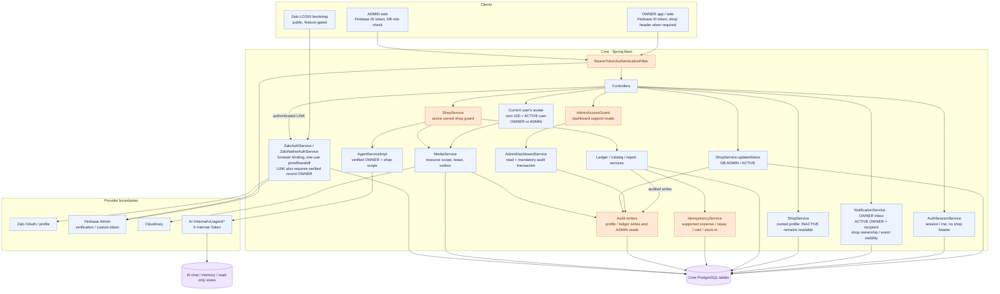

## 2. Core Service Interfaces

OWNER ledger services take `VerifiedFirebaseToken` and `X-Shop-Id`. Session,
avatar, inbox, ADMIN and Zalo methods have their own scopes, so a shop header
does not replace those checks. The map lists interfaces, not an API contract;
request/response and error rules remain in the canonical contract.

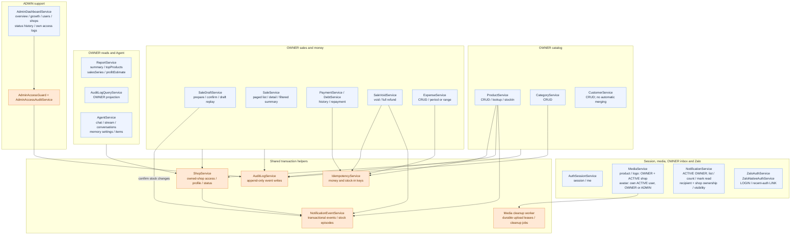

## 3. Shop Access Guard — `requireOwnedActiveShop`

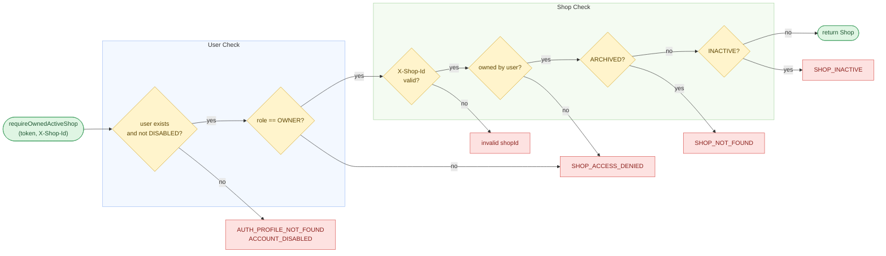

## 4. Auth Session — `openSession`

Existing identities are first resolved to a User ID without fetching a stale User. Lock and refresh User before checking DISABLED and synchronizing Firebase fields. Role/status and Cloudinary avatar handle remain DB-owned; concurrent avatar/status/role writers serialize on the User row. New-owner creation and Firebase fallback avatar retain their behavior. This does not introduce an ADMIN user-disable/demote API; those races are exercised by DB test fixtures.

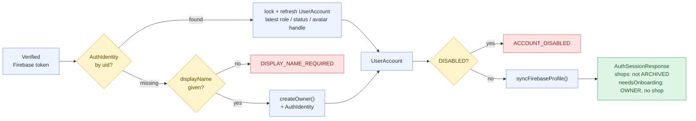

## 5. Sale lifecycle — draft → sale → payment / debt

### 5.1 State machines

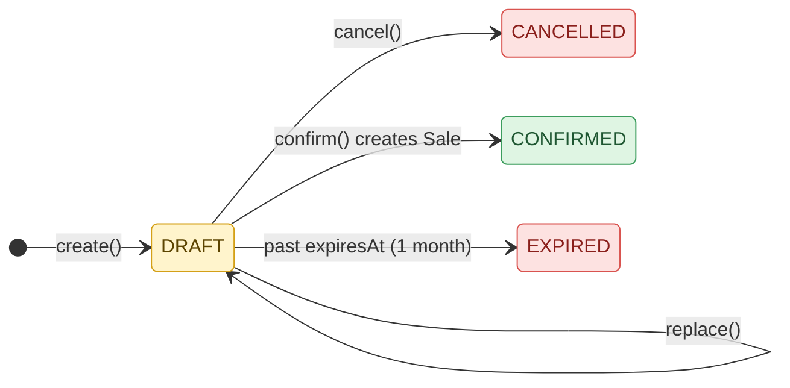

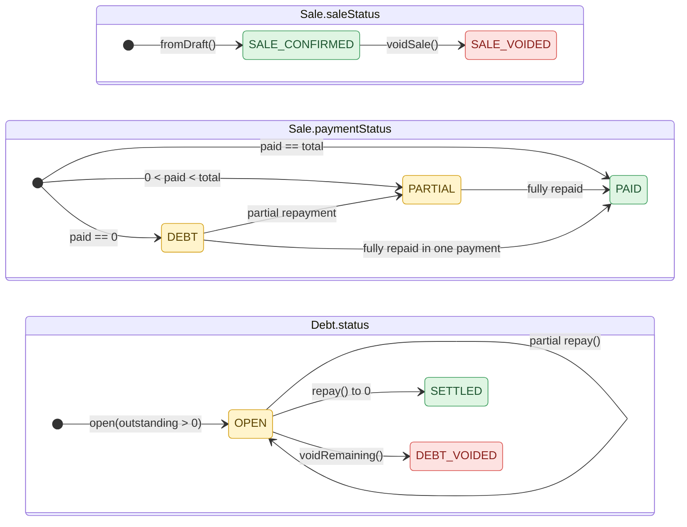

### 5.2 `SaleDraftService.create / replace` — validation (`prepare`)

After customer validation, `prepare` collects distinct catalog IDs without raising duplicate-item errors, then reads ACTIVE products in the shop once into a map. All-custom requests skip this Product query. The diagram below shows validation order, not one SQL query per item: `product ACTIVE?` is a map lookup. Items are still validated in request order (custom fields → catalog text → duplicate ID → product lookup → money calculation), preserving error precedence, snapshots, rounding, discount and initial-payment checks.

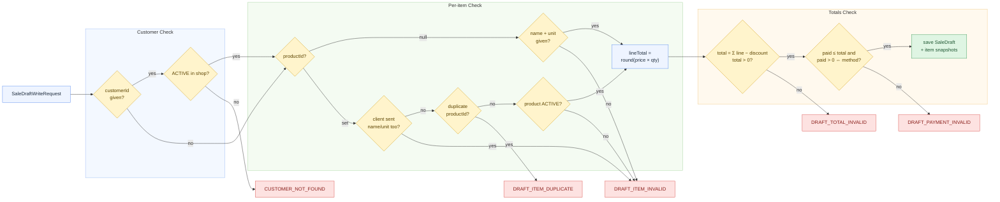

### 5.3 `SaleDraftService.confirm` — checkout

When a selected Customer is needed for a new debt, the write lock order is **SaleDraft → Customer → Product ID ascending**. Refresh Customer under its lock before checking ACTIVE and taking its current profile snapshot; hold the lock through commit so archive cannot race debt creation. If confirm commits first, a later archive may retain that historical debt. Fully paid sales retain their existing snapshot behavior without taking this Customer lock. Confirmation replay returns before this check.

The draft lock still protects confirmation/replay. Nonempty catalog groups use one `PESSIMISTIC_WRITE` Product query filtered by shop and ACTIVE status, with `ORDER BY p.id ASC` in SQL; no catalog IDs means no Product-lock query. Missing/inactive/foreign products remain invalid. After all deductions, one grouped stock reconciliation runs on the already-locked products before persisting the sale. Custom items do not deduct stock; response item order and cost snapshots are unchanged.

```mermaid
flowchart LR
    S(["confirm(draftId)"]) --> LOCK["lock SaleDraft"]

    subgraph Guard["Draft Guard"]
        REP{"already<br/>CONFIRMED?"}
        ED{"DRAFT and<br/>not expired?"}
    end

    subgraph Cust["Customer for Debt"]
        CU{"paid < total?"}
        CN{"customer<br/>source?"}
        NEWC["Customer.create()"]
    end

    subgraph Stock["Totals and Stock"]
        CHK["re-check<br/>Σ line − discount == total"]
        STK["lock products by id asc (1 query)<br/>ACTIVE in shop; skip if empty<br/>deductStock() if tracked"]
        ALERT["reconcile stock alerts (batch)<br/>1 open-alert read if nonempty"]
    end

    subgraph Persist["Persist"]
        SALE["Sale.fromDraft()<br/>+ SaleItems"]
        P1{"initialPaid > 0?"}
        PAY["Payment.initial()"]
        D1{"initialPaid < total?"}
        DEBT["Debt.open()"]
        DONE["draft.confirm(saleId)<br/>audit SALE_CONFIRMED"]
    end

    LOCK --> REP
    REP -->|yes| RET(["return existing Sale"])
    REP -->|no| ED -->|yes| CU
    ED -->|no| X1["DRAFT_NOT_EDITABLE"]
    CU -->|yes| CN
    CU -->|no| CHK
    CN -->|active id| CHK
    CN -->|name only| NEWC --> CHK
    CN -->|none| X2["CUSTOMER_REQUIRED_FOR_DEBT<br/>CUSTOMER_NOT_FOUND"]
    CHK --> STK --> ALERT --> SALE --> P1
    STK -.->|"short stock"| X3["PRODUCT_STOCK_INSUFFICIENT"]
    STK -.->|"missing / inactive / foreign"| X4["DRAFT_ITEM_INVALID"]
    P1 -->|yes| PAY --> D1
    P1 -->|no| D1
    D1 -->|yes| DEBT --> DONE
    D1 -->|no| DONE
    classDef default fill:#eef4ff,stroke:#5b8def,color:#1f2d3d
    classDef decision fill:#fff4cc,stroke:#d4a017,color:#5c4400
    classDef error fill:#fde2e1,stroke:#d9534f,color:#8a1f1b
    classDef terminal fill:#dff5e3,stroke:#3c9d5d,color:#1e5631
    classDef store fill:#efe6ff,stroke:#8a63d2,color:#3d2a6b
    classDef shared fill:#ffe9d6,stroke:#e07b24,color:#6b3500
    class REP,ED,CU,CN,P1,D1 decision
    class X1,X2,X3,X4 error
    class ALERT shared
    class S,RET,DONE terminal
    style Guard fill:#f3f8ff,stroke:#9dbcf5
    style Cust fill:#f4fbf2,stroke:#a8d5a2
    style Stock fill:#fff9ee,stroke:#f0c987
    style Persist fill:#faf3ff,stroke:#cfa8f0
```

## 6. Money writes with idempotency

### 6.1 `IdempotencyService.execute`

Runs inside the caller's transaction (`Propagation.MANDATORY`).

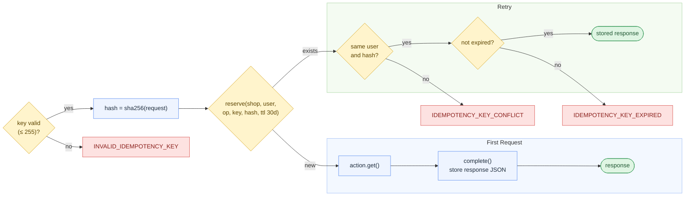

### 6.2 `DebtService.repay`

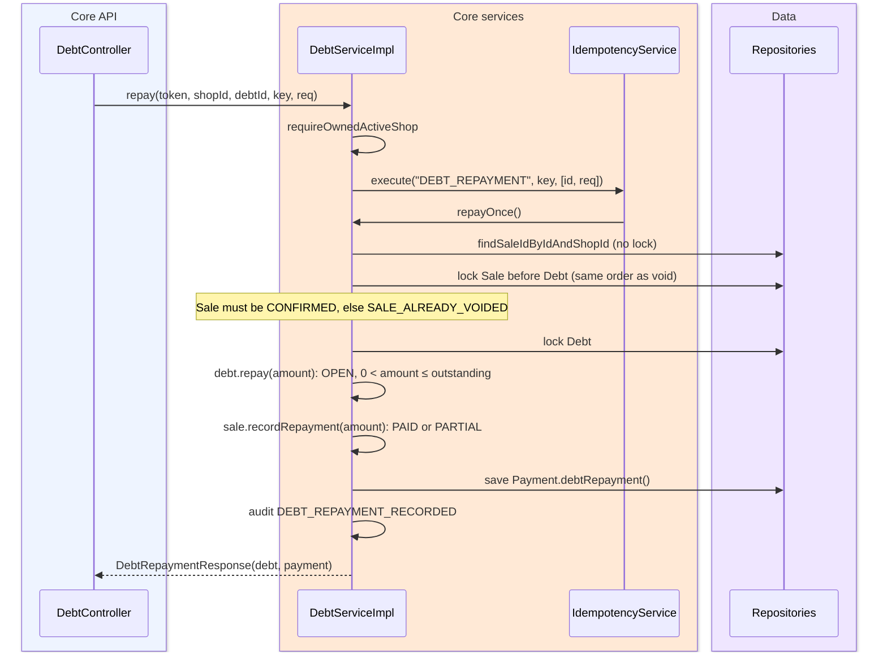

### 6.3 `SaleVoidService.voidSale`

Repayment and void share the lock order **Sale → Debt**. A restocking void then locks Products in ascending ID order; confirm instead starts with its draft lock (§5.3).

With `restockItems=true`, validate deduction snapshots before locking products. Only `stockDeducted=true` items contribute IDs; custom/non-deducted items do not restore stock, and unknown snapshots fail rather than guessing. One nonempty Product-lock query is scoped to the shop, ordered by ID and has no ACTIVE filter, so archived products remain eligible for restoration under the existing stock rules. Reconcile the restored product group once; an empty group skips both Product locking and open-alert reads. Restock audit, debt cancellation, full refund and idempotent replay keep their existing behavior.

The stock-restoration limit, error response and retry rules are defined in the [sale void API contract](../../contracts/api-contracts.md#hủy-toàn-bộ-và-hoàn-tiền). `restoreStock()` validates before mutating that Product; a failure on a later item rolls back earlier stock/audit writes and the entire void transaction, including refund, debt, notification and idempotency reservation.

```mermaid
flowchart LR
    S(["voidSale(saleId, key, req)"]) --> IDEM["Idempotency<br/>SALE_VOID"] --> LS["lock Sale"]

    subgraph Check["Pre-checks"]
        ST{"CONFIRMED?"}
        SUM{"Σ payments<br/>== paidVnd?"}
        RM{"received > 0 ⇔<br/>refundMethod?"}
    end

    subgraph Reverse["Reverse Effects"]
        LD["lock Debt"]
        RS{"restockItems?"}
        SNAP["validate stockDeducted snapshots<br/>collect deducted product IDs"]
        RP["lock products by id asc (1 query)<br/>same shop, including ARCHIVED<br/>skip if empty; restoreStock checks MAX_STOCK"]
        ALERT["reconcile restored stock alerts (batch)<br/>1 open-alert read if nonempty"]
        DV["debt.voidRemaining()"]
    end

    subgraph Close["Close Sale"]
        RF{"received > 0?"}
        REF["SaleRefund.record()"]
        V["sale.voidSale(reason)<br/>audit SALE_VOIDED"]
    end

    LS --> ST -->|yes| SUM -->|yes| RM -->|yes| LD --> RS
    RS -->|yes| SNAP --> RP --> ALERT --> DV
    RS -->|no; empty group| ALERT
    DV --> RF
    RF -->|yes| REF --> V
    RF -->|no| V

    ST -->|no| X1["SALE_ALREADY_VOIDED"]
    SUM -->|no| X2["SALE_PAYMENT_MISMATCH"]
    RM -->|no| X3["SALE_REFUND_METHOD_<br/>REQUIRED / INVALID"]
    SNAP -.->|"unknown / invalid snapshot"| X4["SALE_RESTOCK_UNAVAILABLE"]
    RP -.->|"missing / unrestorable"| X4
    RP -.->|"total exceeds MAX_STOCK"| X5["409 PRODUCT_STOCK_OVERFLOW<br/>rollback whole void + key"]
    classDef default fill:#eef4ff,stroke:#5b8def,color:#1f2d3d
    classDef decision fill:#fff4cc,stroke:#d4a017,color:#5c4400
    classDef error fill:#fde2e1,stroke:#d9534f,color:#8a1f1b
    classDef terminal fill:#dff5e3,stroke:#3c9d5d,color:#1e5631
    classDef store fill:#efe6ff,stroke:#8a63d2,color:#3d2a6b
    classDef shared fill:#ffe9d6,stroke:#e07b24,color:#6b3500
    class ST,SUM,RM,RS,RF decision
    class X1,X2,X3,X4,X5 error
    class ALERT shared
    class S,V terminal
    style Check fill:#f3f8ff,stroke:#9dbcf5
    style Reverse fill:#f4fbf2,stroke:#a8d5a2
    style Close fill:#fff9ee,stroke:#f0c987
```

For both confirm and void, stock-alert reconciliation shares the business transaction: failures roll back stock, money/debt, notifications, audit and the idempotency reservation where applicable (confirm uses draft replay). Only the open-alert lookup is batched; creating new alert cycles can still require per-product history/dedup reads and writes. The diagrams do not promise a fixed total SQL count for the complete transaction.

## 7. Report — `ReportService.summary(period)`

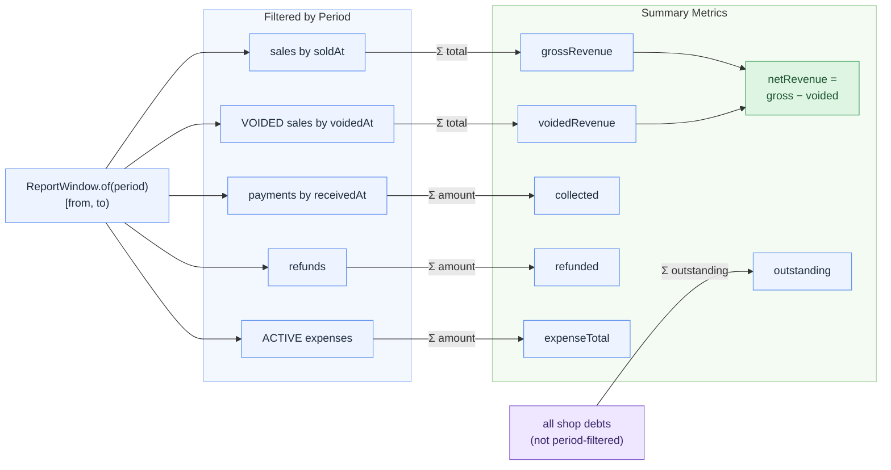

## 8. AI service

### 8.1 Components (composition root: `main.lifespan`)

`main.py` builds one `APIRouter` with prefix `/internal/v1` and the `X-Internal-Token` dependency, includes the agent router under it, and mounts it on the app, so every route under that prefix requires the token. `GET /health` sits outside the prefix and needs no token. The agent router exposes `POST /agent/chat`, `POST /agent/chat/stream`, the conversation list, get, rename and delete routes, and `GET`/`PUT /agent/memory/settings`; the endpoint contract is in [API contracts](../../contracts/api-contracts.md).

`lifespan` opens two `PostgreDBClient` pools: one for chat history (`POSTGRES_URL`, `POSTGRES_POOL_MAX_SIZE`) and one for the read-only SQL reader (`AI_SQL_READER_URL`, `SQL_POOL_MAX_SIZE`, used by `ShopDataRepository`). Both default to 2 connections. It connects Redis at startup, but no feature reads it yet. It builds the chat model with `build_chat_model`: `MODEL_PROVIDER` picks the API, and a `FallbackModel` wraps the primary model when at least one `MODEL_FALLBACKS` entry builds (an invalid entry is logged and dropped). Without `OPENAI_API_KEY`, or when the primary model cannot be built, the model is `None` and every chat turn answers `503 ai_unavailable`. `AgentService` then receives `shop_data` and `restock`; both are `None` when `AI_SQL_READER_URL` is unset, so chat still runs with only the `suggest_screen` tool, which the agent always has. It also receives `memory`, which `build_memory_service` builds only when `AGENT_MEMORY_ENABLED` is on (default off, awaiting PO approval), a chat model and the chat-history pool exist, and an embedder can be built (sentence-transformers in the process, or Cloudflare Workers AI); otherwise memory is `None` and the memory settings report `available: false`. `configure_tracing` runs at module import, before any agent runs, and sends Pydantic AI spans to Logfire only when `LOGFIRE_TOKEN` is set. Spans carry the run's `shop_id`, never message content.

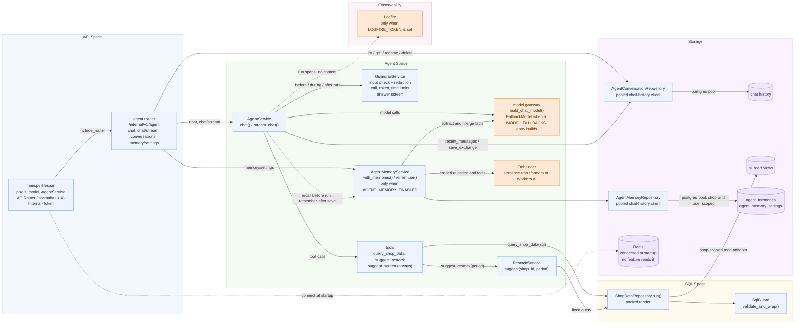

### 8.2 One chat turn end-to-end

`POST /chat` returns one JSON reply after the turn is saved. `POST /chat/stream` answers with server-sent events while the model runs: `memory` lists the recalled memories once, before the first `delta`, when memory is on and some were used; `delta` carries new text, `reset` discards text already sent (a preamble before a data tool call, or an answer the screen rejected; text written before a call to `suggest_screen` alone is part of the answer and stays), and `done` carries the saved ids and answer. `done` is sent only after `save_exchange`. A refusal before the stream opens, such as `input_too_long` or a missing conversation, is an HTTP error; a later failure, such as `answer_timeout`, arrives as an `error` event. If the app disconnects, Core closes the stream and the turn is cancelled; nothing is saved unless the disconnect lands while the exchange is already being written.

Core checks the owner's shop, sends the owner's `user_id` with `shop_id`, and copies the stream line by line, narrowing `done` to `conversation_id`, `message_id` and `answer`; the JSON route returns the same three fields. An AI `404` becomes `conversation_not_found`, an AI `422` with a guardrail code (`input_too_long`, `answer_unavailable` or `answer_timeout`) keeps that code, and any other failure, including any other `422`, becomes `503 ai_unavailable`. The codes are listed in [API contracts](../../contracts/api-contracts.md).

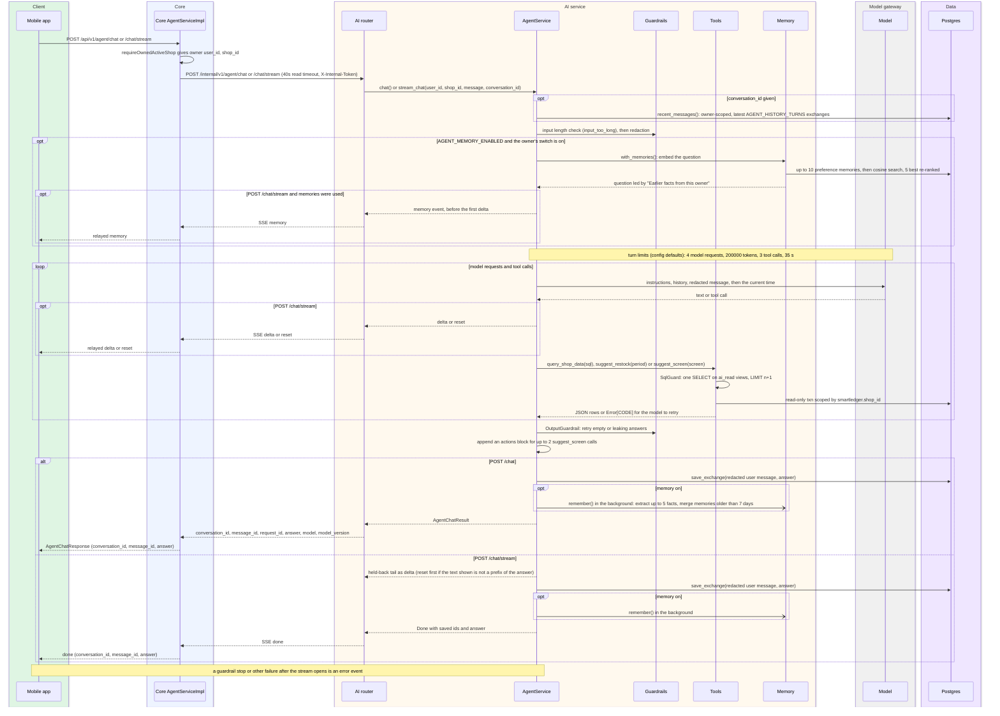
