# AI statecharts

Three statecharts trace how one chat turn and the agent memory move between states, so a trace in HoneyHive or a log line can be placed on a chart while debugging. Each chart is drawn from a small TLA+ model of the AI code under `backend/ai/src/`, and TLC checks the rules listed under each chart on every state of that model. The charts describe the code on `staging` as of 2026-11-05; a model is not a test of the code, so a change to the flow needs the model and the chart changed with it.

| Chart | Code | Model |
|---|---|---|
| [Agent chat turn](#agent-chat-turn) | `AgentService.chat` and `stream_chat` in `src/agent/service.py` | [`agent-turn/`](agent-turn/) |
| [Memory: learning after a turn](#memory-learning-after-a-turn) | `AgentMemoryService.remember` in `src/memory/service.py` | [`memory-remember/`](memory-remember/) |
| [Memory: one stored fact](#memory-one-stored-fact) | `MemoryRepository` in `src/memory/repository.py` | [`memory-row/`](memory-row/) |

## Agent chat turn



Where each state shows up while debugging:

| State | Trace or log |
|---|---|
| Reading the history | `history_ms` in the session metadata: 1-2 ms on a Redis hit, about 200 ms or more from the database |
| Recalling memories and picking the tier | spans `memory ready`, `memory recall` and `llm router`; both branches run together under `asyncio.gather` |
| Model writing the answer, Tools running | the Pydantic AI model and tool spans; `first_text_ms` in the session metadata |
| Saving the exchange | span `save turn` |
| Failed | `metadata.error` on the session, set by `fail_turn` with the guardrail code, the exception type or `cancelled` |

Rules TLC checks:

- `RefusedBeforeModel`: a refused turn never reaches the model.
- `ForeignNeverAnswered`: another owner's conversation never reaches the model.
- `MemoryOffNeverEmbedded`: the question of an owner who switched memory off is never sent to the embedding provider.
- `FailedStoresNothing`: a failed turn stores nothing.
- `DoneAfterSave`: the `done` event comes only after the exchange is saved.

The model leaves out the JSON route's lack of stream events, the order between the recall and the tier pick inside their shared state, the tier classifier's own failures, Core's mapping of AI status codes, the conversation delete that drops the Redis entry, and a disconnect while the exchange is being written: the save runs in a worker thread that cancellation does not stop, so that exchange can still be stored.

## Memory: learning after a turn



The task runs after `save_exchange`, so the owner never waits for it, and each failure only logs a warning. The logs to look for are `memory not stored`, `memory use not recorded` and `memory stored: shop=... facts=N`.

Rules TLC checks:

- `SwitchOffLearnsNothing`: nothing is extracted, stored or summarized for an owner whose switch is off or cannot be read.
- `AtMostThreeGroups`: one turn summarizes at most `SUMMARY_GROUPS_PER_TURN` (3) groups.

The model leaves out the extractor's filters (allowed types, phone numbers, which recalled ids it may replace) and the reconciler's per-fact decision; both only change which facts reach "Storing facts".

## Memory: one stored fact



Recall and search read only Live rows: `superseded_by` is null and `expires_at` is null or in the future. When a group is merged, rows the group had superseded are pointed at the summary row, which starts Live with the group's latest date and summed use count. Forgetting resolves the newest version first, then deletes every version, because `superseded_by` is `ON DELETE SET NULL` and an older version would otherwise come back. Turning the switch off keeps every row; recall and learning are skipped until it is on again.

Rule TLC checks: `OnlyLiveRecalled`, only a Live row is handed to the model.

## Regenerate

Each chart hides only the steps that stay in an end state. Run the `statechart` skill from a scratch folder outside the repository with TLC (`TLA2TOOLS` pointing at `tla2tools.jar`, Java 11 or later), then render the Mermaid with Pele 1.9.0 and the shared theme:

```bash
statechart agent-turn/AgentTurn.tla --config agent-turn/AgentTurn.cfg --view agent-turn/view.ts --out /tmp/agent-turn
```

```bash
node render.mjs /tmp/agent-turn/chart.mmd agent-turn/agent-turn.svg
```

`render.mjs` imports `pele`, so copy it and `theme.css` next to an `npm install pele@1.9.0` outside the repository and run it there. The theme follows the viewer's light or dark setting.
