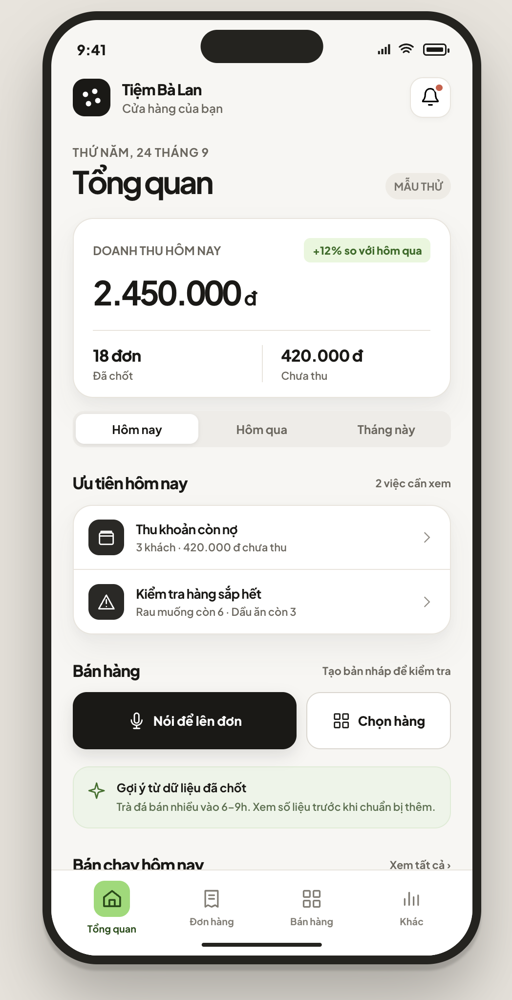

# Mobile UI style proposal and migration plan

**Status:** visual decision for the `feat/mobile-minimal-ui` branch, dated 2026-09-24; this is not an approved production brand identity. This document only directs the `OWNER` interface; product requirements and acceptance criteria remain in the [BRD](../product/business-requirements.md) and the [PRD](../product/product-requirements.md).

**Status update 2026-10-04:** the mobile branch has been merged into `staging`. This document is a planning record from 2026-09-24; its branch milestones and the sentence "staging does not have the mobile app yet" do not describe the current code. The interface on `staging` already differs from the plan in these points: the fourth tab is `Quản lý`; the mascot menu is `Hỏi đáp` / `Đọc đơn` / `Báo cáo`; the introduction modal has four steps (Assistant, Sales, Overview, Management); `Đọc đơn` accepts real voice input on web; `Hỏi đáp` calls the Agent chat through Core when mock mode is off; the `Nhân viên` entry has been removed from the Quản lý tab. The code in `frontend/mobile` is the source for the current state.

## Sources and confidence

| Source | Verified from file | How it is used |
|---|---|---|
| [Admin design brief at `b6e7100`](https://github.com/miphu2804/smart-ledger/blob/b6e7100f2820eeff5670ab06e3dfb5d601ccf4e0/frontend/DESIGN.md) and [admin CSS](https://github.com/miphu2804/smart-ledger/blob/b6e7100f2820eeff5670ab06e3dfb5d601ccf4e0/frontend/src/index.css) | Warm gray background, white cards with thin borders, Plus Jakarta Sans, green accent, very light shadows. The brief itself states it is locked for the prototype only and is not a standard source for brand or legal matters. | Take the type rhythm, compactness, colors, and depth; do not copy the desktop layout or the Elera/clinic content in the reference images. |
| [Mobile theme at `0bd5ada`](https://github.com/miphu2804/smart-ledger/blob/0bd5ada83ccafb620ff25161313a3d4ea1adc732/frontend/mobile/src/theme.ts) | Mobile currently uses blue `#2858D8`, a cool background `#F3F6FD`, and blue-tinted shadows; it already uses Plus Jakarta Sans. | Technical baseline for replacing tokens gradually, keeping the existing font and business flows. `staging` does not yet contain this mobile app. |
| `/tmp/smartledger-mobile-style-preview.html` | The CSS/JS of the preview was read: warm colors, revenue card, bottom tabs, draggable Zen ring, menu, and simulated voice. The file lives outside the repo and may be lost. | Interactive sample and shadow reference for discussion; **not** yet visually verified on a device or integrated with the microphone/AI. |
| Old mobile screenshots and admin screenshots sent by the user in the conversation | Visual reference and the remark that the old mobile has many color blocks and large feature tiles, while admin has more pleasant type and shadows. | Calibrate the design direction; the content of the images is not treated as a product requirement. |

**Proposed direction:** one warm background surface; white cards and thin borders to group content; green only for the selected state, affirmation, and one primary action. Use shadows to create real layering (main cards, floating controls, floating menus), not under every row, chip, and icon. Mobile still needs a single-column reading flow, large enough touch targets, and the operating system safe areas.

## Visual decision for the `feat/mobile-minimal-ui` branch

The image is a reference for **hierarchy, whitespace, shapes, and color feel**; the shop name, date, money, order count, growth percentage, and suggestions in the image are not data requirements. Do not put the phone bezel, Dynamic Island, or a fake status bar into the app. Data and integrations that are still mock are stated explicitly in the review document; do not call the build production-ready.

- **Background and text:** a neutral light screen `#F7F6F2`, or white when a more open reading surface is needed; white cards, border `#E8E4DC`, primary text `#1A1916`, secondary text `#6B675E`. Avoid blue/purple blocks and decorative gradients. Use green only for the selected tab, positive states, and suggestions backed by data; warnings and debt keep their own semantic colors.
- **Home rhythm:** the first row holds the shop identity and notifications; next come the date and the title `Tổng quan`; the selector `Hôm nay / Tuần này / Tháng này` sits directly above the revenue card so that the control comes before the content it changes. The selector has a sliding indicator and changes the period label and figures on the card. After that come at most two priority tasks, one item-picking CTA, a suggestion with a clear source/data period, then the best-seller list. Do not keep the large feature grid, and do not let the chart and many KPIs compete with the primary action on Home; tapping the card opens the analytics screen for the selected period.
- **Figure semantics:** revenue and order count come from the closed orders of the selected period; when there is no data show `Chưa có đơn trong kỳ`, and do not fill in the numbers from the image. Shop-wide debt must be labeled `Còn nợ toàn tiệm`; label it `Chưa thu trong kỳ` only if it is computed from exactly the orders of the period. The comparison percentage appears only when a valid previous-period sample exists. Profit and costs keep the `ước tính` label per the PRD.
- **Navigation:** 4 bottom tabs labeled `Tổng quan`, `Đơn hàng`, `Bán hàng`, `Khác`. `Bán hàng` goes straight to item picking/POS; Home has one quick-sale CTA. A mascot button floating over the 4 tabs opens `Chatbot`, `Giọng nói`, and `Gợi ý` to the Hôm nay analysis, replacing the repeated AI entry points on Home, Bán hàng, and Khác. The button uses exactly the image the user provided at `frontend/mobile/assets/assistant-mascot-badge.png`, cropped on display to get the round badge; the behavior of the `ZenRing` component remains: drag within the safe area, tap to open three separate pills with shadows and hover/press feedback, and hold for about 500 ms to open Giọng nói directly. The initial resting position is the right edge, at about 60% of the screen height; once the user drags it, releasing snaps it to the left or right edge and every tab uses that same coordinate. Only on the Bán hàng tab does the ring temporarily move up so it does not cover the cart bar, and it returns to the chosen spot when leaving the tab. Voice/chat still use sample data per the review document; the mascot does not simulate a waveform or imply that a real microphone is active.
- **Interaction and sizing:** the existing Plus Jakarta Sans; Home title 30–32, section title 20–22, revenue figure 30–34, body 14–16, meta at least 12. Cards radius 18–20, controls radius 12–14; base spacing 8/16/24. Tabs, icon buttons, tappable rows, and CTAs have a touch target of at least 44 × 44. Use borders/spacing for lists; a soft shadow under cards, a very light shadow under icon buttons and the selected button, and a stronger shadow for the CTA/ring/menu. At widths 320–430, money figures and buttons are not clipped; large system font sizes still scroll and remain tappable.
- **State and scope:** the review build uses wording as in the target interface and does not repeat the "demo/simulated" label on the main screens. Data, OTP, voice, and chat are still mock; state this explicitly in the documents/PR and do not treat the build as production-ready. Suggestions come only from existing closed figures, with a period/scope or a missing-data state. Remove the `Nhân viên` entry because `FR-012` is outside the MVP; do not promote an upgrade plan or a printer in `Khác` because PRD section 9 places them outside the MVP. Keep the existing calculations and APIs during the copy adjustment.

Visual acceptance of the branch: Home renders the correct hierarchy on mobile web at 320–430px; every CTA and tab follows the old flow; cards have perceptible depth; the ring does not cover the tabs, tapping opens the menu, dragging changes its position, and holding opens Voice; the remaining screens use the same tokens, with consistent card/border/text hierarchy; empty and mock states are stated explicitly. Behavioral acceptance only confirms the existing mock app flow and does not replace the AC of the real backend/voice integration.

## Color palette

The values below are **reference tokens verified from admin** and have not been approved as brand. Status colors keep their own meaning and are not used to color each feature tile arbitrarily.

| Role | Color | Used for |
|---|---|---|
| `canvas` / `line` | `#E8E4DC` | Outer background, thin dividers |
| `frame` | `#F7F6F2` | Mobile screen background |
| `card` | `#FFFFFF` | Content cards, menus |
| `text` | `#1A1916` | Primary text, primary dark-background button |
| `text-2` | `#6B675E` | Descriptions, secondary labels |
| `text-3` | `#9A958A` | Less important meta; check contrast before using for small text |
| `accent` / hover | `#8FDB6E` / `#7CC85C` | Selected tab, positive accent |
| `accent-ink` | `#16350C` | Text/icon on the accent background |
| `icon-well` | `#2A2926` | Dark square icon background, used selectively |
| Green chip | `#E7F6DC` / `#2F6B1F` | Positive, completed |
| Blue chip | `#E4F0FF` / `#2157A4` | Neutral information |
| Amber chip | `#F8E9C8` / `#8A5A12` | Needs attention |
| Red chip | `#F8D9D4` / `#9B2C1F` | Error/important warning |
| Gray chip | `#EEEBE4` / `#5C5850` | De-emphasized state |

**Differences being tried in the preview:** dark Zen ring `#292824`, insight banner `#EDF4E8`/`#516C48`, faint secondary text `#928E86`. Prefer the admin tokens for shared parts; keep a difference only after comparing against real images and checking contrast. Do not bring the shadow of the fake phone frame in the HTML into the app.

## Type, shapes, and hierarchy

- **Verified:** admin uses Plus Jakarta Sans, headings with tight tracking, and semibold KPI figures; mobile already loads the same font. Primary text is near black and secondary text is warm gray. The primary button is dark or green, and the secondary button is white with a border. Admin cards have a radius of about `16px` with a `1px #E8E4DC` border.
- **Proposed for mobile:** screen title about `22–24px`, section `16–18px`, revenue figure `28–32px`, body at least `14px`, label/meta at least `12px`. Use tabular figures for money and align the `đ` unit clearly. Base spacing `8px`; card padding about `16–20px`; card corners `16–20px`, buttons `12–14px`, pill-shaped chips when needed.
- The preview has many `10–11px` labels: treat this as something to fix before moving to the app. Check large system font sizes, contrast, and the minimum touch target of about `44 × 44px` on a device.

## Shadows per component

The values are the **verified CSS of the preview**, used as a target for the feel of depth. The original admin mostly uses borders and almost no shadows. For React Native, tune `shadowColor`, `shadowOpacity`, `shadowRadius`, `shadowOffset` on iOS and `elevation` on Android after comparing on a device; do not copy CSS strings into native.

In the mock app, the card shadow was increased to `0 2px 4px rgba(42,41,38,.06), 0 10px 22px rgba(42,41,38,.09)` on web because the earlier build was too faint. Native uses `shadowOpacity: .12`, `shadowRadius: 12`, `shadowOffset.height: 5` and Android `elevation: 4`; this is a trial level and needs comparison on a real device. Icon buttons use their own light level; the ring/menu use stronger shadows to show the floating layer.

| Component / layer | Reference CSS shadow | Rule |
|---|---|---|
| Main cards: revenue, task list, analytics, chat card | `0 1px 3px rgba(42,41,38,.025), 0 8px 18px rgba(42,41,38,.045)` | A very light soft shadow **together with** a `1px #E8E4DC` border; one content group is one surface, and individual rows are not lifted. |
| Revenue card on hover in the web preview | `0 2px 5px rgba(42,41,38,.04), 0 12px 24px rgba(42,41,38,.065)` | Pointer feedback on web only; mobile uses the pressed state instead of hover. |
| Single icon button | `0 1px 3px rgba(42,41,38,.035)` | Very light; the border is still the main signal. |
| Primary CTA button | `0 5px 12px rgba(26,25,22,.10)` | Only for the screen's prominent action. |
| Zen ring at rest | `0 5px 16px rgba(26,25,22,.19), 0 12px 26px rgba(26,25,22,.13)` | Floats more clearly than the content so it is recognizable as draggable; still does not cover the tabs and CTA. |
| Zen ring while dragging | `0 9px 26px rgba(26,25,22,.23)` | A temporary layer increase; returns to the resting shadow after release. |
| Each pill of the Zen ring menu | Rest: `0 7px 22px rgba(26,25,22,.13), 0 2px 5px rgba(26,25,22,.05)`; hover: `0 12px 28px rgba(26,25,22,.18), 0 3px 8px rgba(26,25,22,.07)` | Three separate choices with no decorative connecting line; hover lifts slightly, press shrinks slightly; the position is constrained to the visible area. |
| Ring suggestion bubble | `0 2px 7px rgba(42,41,38,.05)` | Used briefly, and can be hidden when it blocks content. |
| Orb in voice mode | `0 0 0 12px rgba(143,219,110,.12), 0 0 0 26px rgba(143,219,110,.055)` | This is a **state halo**, not an elevation shadow. It moves with the sound level only when there is a real mic signal; the preview simulates it with CSS. |
| Bottom tabs, chips, individual rows, insight banner | No shadow | Use background/border/whitespace; avoid the impression that everything is a floating card. |

## Sample layout and interaction

### Home and revenue

Place the period selector `Hôm nay / Tuần này / Tháng này` directly above **one rounded revenue card**, following the requirement to put the control before the content it controls (replacing the old layout that put the selector after the card). `Tuần này` is the calendar week from Monday to the present; the comparison indicator currently exists only for `Hôm nay` (against yesterday). The card changes its label and figures by the selected period but keeps the same height across periods: the title row reserves space for the comparison indicator, even when there is no valid comparison period; on narrow screens, the indicator drops to its own row in all three states. The card clearly shows revenue from closed orders in the period, the order count, and debt/uncollected amounts only when the label states the correct data scope. Tapping the card opens `/analytics` with the selected period; the analytics screen has the revenue trend, recorded expenses, estimated cost of goods/gross profit, best sellers, and a path to the order list. Recorded expenses are shown separately because ingredient spending may overlap with cost of goods; do not subtract twice and call it net profit. The after-expense result of `AC-007` is still waiting on the classification rule for ingredient spending and cost of goods. Do not mix "revenue", "collected", and "outstanding" in the same figure. If data is missing, show a clearly meaningful empty state, and do not use sample numbers as real data. While a period's figures are loading, the card shows a placeholder block of the same size and then the figures appear gradually in order; do not show `0đ` or the empty state before the result is known. A previously loaded period updates immediately, with the figure counting from the old value to the new one. The operating system's Reduce Motion mode keeps only a brief fade-in/out effect. Requirement basis: [`BR-004`](../product/business-requirements.md), [`FR-004`, `FR-006`, `AC-004`](../product/product-requirements.md).

After the overview card: tasks to handle and warnings with priority; one clear sales CTA; a short list of related figures/items. Remove the 2×2 grid of large icons if it pushes the main task below the screen. The "Nhân viên" item of the old mobile mock conflicts with [`FR-012`, which was removed from the MVP](../product/product-requirements.md); resolve it during migration, and do not turn this document into a scope change.

### Navigation and Zen ring

This branch keeps **4 bottom tabs** per the visual decision above. The Zen ring is draggable and follows the top-level tabs like AssistiveTouch; tapping opens three pills `Chatbot` / `Giọng nói` / `Gợi ý`, and holding for about `500ms` goes straight to the existing Giọng nói screen, with a progress ring around the ring while holding. Releasing after a drag snaps the ring to the left or right edge (chosen by the fling direction), keeps its vertical coordinate, and keeps its position when switching tabs; after about 3 seconds without touching the ring, it fades. The menu expands from the ring with a blurred backdrop. The three pills float independently with soft shadows and have no connecting line to the mascot. `Gợi ý` opens the existing Hôm nay analysis and does not generate new AI conclusions. The ring is constrained above the tab bar and within the safe area; the pills open toward the side with room, or stack above/below the ring if it is dragged to the middle of the screen. The ring disappears on the Voice/Chat/Analytics child screens. It still needs to be checked and adjusted where a keyboard or modal on a real device may block the interaction; the tap menu and the accessibility labels are the entry path that does not need the hold gesture. This behavior follows [`FR-026`, `AC-019`](../product/product-requirements.md).

After an **active sign-in**, Home shows a three-step modal in the app's minimal style: (1) the mascot and two entry points `Chatbot`/`Giọng nói`; (2) Bán hàng/Đơn hàng; (3) Tổng quan/shop management tools. `Tiếp` and `Quay lại` move between steps within the same modal; `Bắt đầu`, `Để sau`, or closing returns to Home. The first step states clearly the tap/hold/drag gestures on the mascot. The modal keeps a blurred backdrop, a rounded white card, the provided mascot image, and a soft green accent; on short screens the CTA must always be visible. Automatic session restoration does not open the modal; within the same sign-in session where it was closed, it does not appear again. This is a UI flow per [`FR-025`, `AC-018`](../product/product-requirements.md) and does not confirm a real mic/AI integration.

Voice mode prefers a focused screen, with a clear close button, indicators for listening/processing/could not hear, and a waveform based on real input. Voice serves order creation, expense recording, and Q&A within scope; its output goes to a **draft to edit/confirm** and does not write to the ledger automatically. If the AI fails or times out, keep the input and allow switching to text/POS. This is a proposed interaction direction based on [`FR-008`, `FR-020`, `FR-021`, `NFR-006`, `AC-008`, `AC-010`, `AC-011`](../product/product-requirements.md), not behavior that has run in the app.

## Migration plan for the mobile app

| Step | Smallest reviewable change | Check before moving to the next step |
|---|---|---|
| 0. Fix the baseline | This branch was split from `origin/feat/mobile-firebase-auth` because `staging` does not have the mobile app yet; record the Home, report, navigation, and voice flows before editing and compare against the PRD/AC. | A behavior baseline exists; do not overwrite other people's changes. |
| 1. Tokens | Change background/text/border/semantic colors and the shadow levels in `frontend/mobile/src/theme.ts`; keep Plus Jakarta Sans. Create an old-to-new token mapping for the components in use; check contrast before dropping the old colors. | The current screens still render, text is readable, and the warning/error semantics keep their meaning. |
| 2. Home and reused components | Move Home to the revenue card, task group, and CTA; consolidate the card/button/chip/tab styles that genuinely repeat, and do not create a new library for one screen. Separate sample data from real figures with clear labels. | The report period, order count, revenue, and debt are named correctly; the old sales flows still open. |
| 3. Zen ring and AI | The ring, menu, drag, and hold already exist in the mock; the menu leads to the existing Voice/Chat demo screens. A real mic, a volume-based waveform, and a general-purpose AI belong to the later integration phase. | Check the ring across tabs, the safe area, and the Voice demo; do not take mock behavior for a real microphone/AI. |
| 4. Remaining screens | Move each screen (sales, history, expenses, debt, products, reports) to the new tokens; keep routes, calculations, confirmations, and empty/error states. Remove the staff entry from the MVP build after reviewing the current sources. | Compare before/after per flow; do not change the business logic just because of a restyle. |
| 5. Acceptance | Compare mobile web at `320–430px`, check contrast, touch targets, CTAs, and the mock navigation paths; iOS/Android, font scale, and the integration AC are accepted only when a device and backend are available. | There is runtime evidence for the mock flows; list the checks that have not run separately. |

**Unverified:** the actual color/shadow levels and font scale on iOS/Android; microphone permission and a waveform reacting to real volume in the later AI phase. The HTML prototype only proves the layout/interaction idea, not those integrations.
