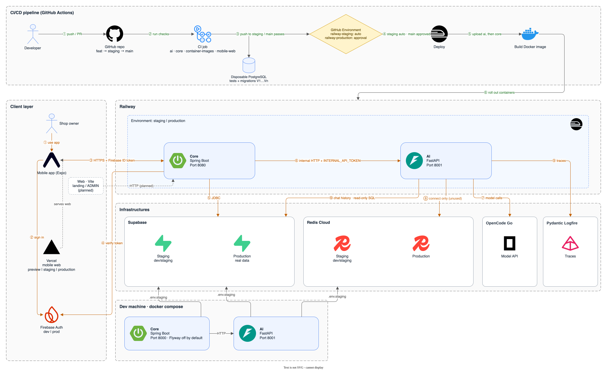
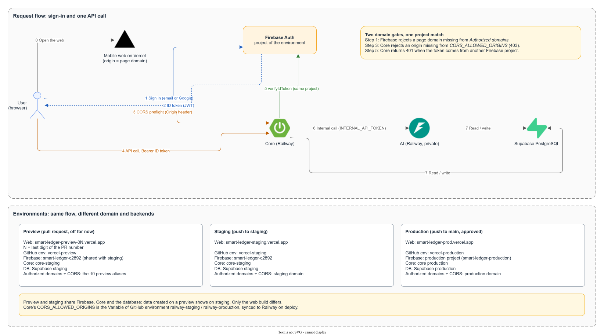
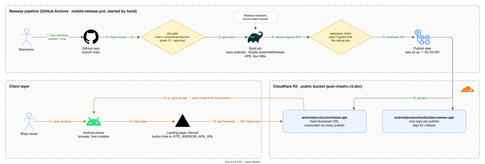

# CI/CD to Railway and Vercel

This document traces a change from a feature branch to Railway for `backend/core` and `backend/ai`, and to Vercel for the mobile web and the landing page. Everything runs in [`.github/workflows/ci.yml`](../../.github/workflows/ci.yml), split into `###` sections: **Test**, **Report**, **Deploy backend** (job `deploy`, after the backend, mobile web and container image jobs pass) and **Deploy web** (job `deploy-web`, see [Mobile web on Vercel](#mobile-web-on-vercel)). Branch and review rules live in [CONTRIBUTING](../../CONTRIBUTING.md). The Android app is built by a separate manual workflow, [`mobile-release.yml`](../../.github/workflows/mobile-release.yml); see [Android build](#android-build).

## Overview



Diagram source: [`ci-cd.drawio`](../architecture/diagrams/src/ci-cd.drawio); edit it in draw.io, then re-export the SVG (`drawio -x -f svg -e --embed-svg-images --svg-theme light -b ffffff -o docs/architecture/diagrams/images/ci-cd.svg docs/architecture/diagrams/src/ci-cd.drawio`). Blue numbers are the deploy pipeline; orange numbers are the runtime request flow.

## Steps

1. **PR into `staging`:** CI runs the tests, checks migrations on a throwaway PostgreSQL and builds the images. Job `deploy` is skipped because the event is `pull_request`.
2. **Merge into `staging`:** CI runs again on the merged commit. When `ai`, `core`, `mobile-web` and `container-images` all pass, job `deploy` uses environment `railway-staging` and deploys to Railway staging. No approval is needed.
3. **PR `staging` → `main`:** open it only after checking staging (see [Target branch](../../CONTRIBUTING.md#target-branch)).
4. **Merge into `main`:** use a merge commit, never a squash. If `staging` and `main` conflict, release from a `release/staging-to-main-<date>` branch as described in [CONTRIBUTING](../../CONTRIBUTING.md#target-branch). CI runs again on `main`; jobs `deploy` (`railway-production`) and `deploy-web` (`vercel-production`) wait in *Waiting*. A reviewer opens the run in the Actions tab → **Review deployments** → approves both. Only then does a job receive its production token and deploy.
5. **Check production, then tag:** the web smoke test runs against `https://smart-ledger-prod.vercel.app` and must pass; open the app and sign in. Then create the release on the commit that ran, for example `gh release create vX.Y.Z --target <merge commit> --generate-notes`. Tags are created by a person, not by CI.

The backend deploy (`deploy`) waits for `ai`, `core`, `mobile-web` and `container-images`, not for `landing`, so a red landing does not hold back the backend. `deploy-web` waits for `mobile-web`, and `deploy-landing` waits for `landing` only, so a red `core` does not hold back the landing. Each deploy uploads a `deploy-summary-<branch>` artifact (environment, commit, `ai`/`core` result) and a summary table on the run page.

## Configuration

### GitHub Environments

| Environment | Allowed branches | Approval | Secrets | Variables |
|---|---|---|---|---|
| `railway-staging` | `staging` | No | `RAILWAY_TOKEN`: project token of the Railway staging environment | `CORS_ALLOWED_ORIGINS` |
| `railway-production` | `main` | Yes | `RAILWAY_TOKEN`: project token of the Railway production environment | `CORS_ALLOWED_ORIGINS` (optional) |
| `vercel-preview` | Any branch (PR) | No | `VERCEL_TOKEN`, `VERCEL_ORG_ID`, `VERCEL_PROJECT_ID` | `EXPO_PUBLIC_*` |
| `vercel-staging` | `staging` | No | Same as above | `EXPO_PUBLIC_*`, `VERCEL_STAGING_ALIAS` |
| `vercel-production` | `main` | Yes | Same as above | `EXPO_PUBLIC_*` |
| `landing-preview` | Any branch (PR) | No | `VERCEL_TOKEN`, `VERCEL_ORG_ID`, `VERCEL_PROJECT_ID` of the `landing` project | `VITE_CONTACT_EMAIL`, `VITE_LEGAL_DRAFT` |
| `landing-staging` | `staging` | No | Same as above | `VITE_CONTACT_EMAIL`, `VITE_LEGAL_DRAFT`, `LANDING_URL` |
| `landing-production` | `main` | Yes | Same as above | `VITE_CONTACT_EMAIL`, `VITE_LEGAL_DRAFT`, `LANDING_URL`, `VITE_ANDROID_APK_URL` |
| `android-dev` | None; job `gate` pairs it with branches other than `main` and `staging` | No | `ANDROID_GOOGLE_SERVICES_JSON`: Firebase config of the dev/staging project | `EXPO_PUBLIC_*` |
| `android-staging` | `staging` | No | `ANDROID_GOOGLE_SERVICES_JSON`: Firebase config of the staging project | `EXPO_PUBLIC_*` |
| `android-production` | `main` | Yes | `ANDROID_GOOGLE_SERVICES_JSON`: Firebase config of the production project; `ANDROID_KEYSTORE_*` ([Release signing](#release-signing)); `R2_*` ([Publish the APK](#publish-the-apk-for-the-landing-page)) | `EXPO_PUBLIC_*`, `R2_BUCKET` |

Do not put backend secrets in the `vercel-*` or `landing-*` environments.

Each Railway project token can deploy to exactly one Railway environment, so a job running with `railway-staging` cannot deploy to production.

### Railway

- One project with two environments, `staging` and `production`, each with services `core` and `ai`. Service names must match `--service` in the workflow.
- The workflow uploads code with `railway up backend/<service> --path-as-root`, so each service's **Root Directory** stays empty and GitHub auto-deploy stays **off** (otherwise every commit deploys twice).
- Service variables (database, Firebase, `INTERNAL_API_TOKEN`, model key…) are set on Railway per environment; GitHub keeps only the deploy token and `CORS_ALLOWED_ORIGINS`. Railway does not mount files, so Core receives the Firebase Admin key through `FIREBASE_SERVICE_ACCOUNT_JSON` (the full service-account JSON, one service account per environment); when it is empty, Core falls back to `GOOGLE_APPLICATION_CREDENTIALS` as in local runs.

### Railway service variables

Enter each value once and reuse it with a [reference variable](https://docs.railway.com/guides/variables#reference-variables), so Railway fills it in for the environment being deployed. Staging and production then share one configuration with different values, and rotating a secret touches one place.

**Shared Variables** (Project Settings → Shared Variables, set per environment):

| Variable | Value |
|---|---|
| `INTERNAL_API_TOKEN` | Random string, different for staging and production |

**Service `core`:**

| Variable | Value |
|---|---|
| `AI_BASE_URL` | `http://${{ai.RAILWAY_PRIVATE_DOMAIN}}:8001` |
| `INTERNAL_API_TOKEN` | `${{shared.INTERNAL_API_TOKEN}}` |
| `DATABASE_URL`, `DATABASE_USERNAME`, `DATABASE_PASSWORD` | Supabase of the matching environment (JDBC URL) |
| `FIREBASE_PROJECT_ID`, `FIREBASE_SERVICE_ACCOUNT_JSON` | Firebase project of the matching environment |
| `FLYWAY_ENABLED` | `false` |
| `CORS_ALLOWED_ORIGINS` | Managed from GitHub, see [Core CORS origins](#core-cors-origins). Do not edit it on Railway. |
| `CLOUDINARY_ENABLED` | `true` only after V13 is migrated in the matching environment; otherwise leave `false` |
| `CLOUDINARY_CLOUD_NAME`, `CLOUDINARY_API_KEY`, `CLOUDINARY_API_SECRET` | Cloudinary credential for this environment, stored as Railway secrets/reference variables only; never Vercel or GitHub Variables |
| `CLOUDINARY_PUBLIC_ID_PREFIX` | Required when enabled; distinct namespace such as `smartledger/staging` or `smartledger/prod`, with no leading/trailing slash or `..` |
| `MEDIA_UPLOAD_LEASE_SECONDS` | Optional PENDING upload lease; retain Core default `300` unless operations approves a different bounded retry window |
| `CLOUDINARY_CLEANUP_FIXED_DELAY_MS` | Optional; retain the Core default `60000` in hosted environments unless an operations decision changes it |

**Service `ai`:**

| Variable | Value |
|---|---|
| `INTERNAL_API_TOKEN` | `${{shared.INTERNAL_API_TOKEN}}` |
| `POSTGRES_URL` | Supabase of the matching environment (`postgresql://…`) |
| `AI_SQL_READER_URL` | Read-only `ai_sql_reader` login (AI baseline in `supabase/migrations/`); when empty, the agent cannot read shop data |
| `REDIS_URL` | Redis Cloud of the matching environment |
| `OPENAI_API_KEY` | Model provider key |

- `ai` has no public domain; `core` calls it over the private network. Port `8001` is AI's default `SERVER_PORT`, not the `PORT` Railway assigns, so changing `SERVER_PORT` on `ai` requires updating `AI_BASE_URL`.
- Variables have local defaults (`AI_BASE_URL` defaults to `http://localhost:8001`), so a missing variable on Railway still reports a successful deploy while Core cannot reach AI. After changing variables, run one chat through Core on staging.
- Backend secrets live only on Railway. The mobile web Vercel project receives only `EXPO_PUBLIC_*`.
- Before enabling Cloudinary in staging/production, run V13 from merged code under the approved migration workflow, then set the variables above and run a controlled upload/replace/delete smoke check. Use separate Cloudinary credentials or at least non-overlapping prefixes per environment. `CLOUDINARY_API_SECRET` must never be placed in `EXPO_PUBLIC_*`, GitHub Variables, client source, Swagger request data, audit metadata or logs.

### Core CORS origins



Diagram source: [`auth-request-flow.drawio`](../architecture/diagrams/src/auth-request-flow.drawio), exported like the CI/CD diagram above. A browser request passes two domain gates, Firebase Authorized domains (step 1) and Core CORS (step 3), and Core accepts only ID tokens from its own Firebase project (step 5).

Core accepts browser calls only from the exact origins in `CORS_ALLOWED_ORIGINS`: comma-separated, `http(s)` only, no wildcard, path, trailing `/` or whitespace. Core **refuses to start** on any invalid entry, so a stray line break pasted on Railway takes staging down.

The value is kept in the **Variables** of GitHub environments `railway-staging` and `railway-production`. Before deploying Core, step `Sync core CORS origins` rejects whitespace or wildcards and writes the value to Railway service `core`. When the GitHub variable is unset, the step is skipped and the Railway value stays as is. A change takes effect on the next push to the branch, or by re-running the `deploy` job.

Staging value:

```text
https://smart-ledger-staging.vercel.app,https://smart-ledger-preview-00.vercel.app,…,https://smart-ledger-preview-09.vercel.app
```

The ten `smart-ledger-preview-0N` origins belong to pull-request previews (see below); the same domains must also be listed in Firebase Authorized domains for sign-in to work.

## Production environment checklist

Check each item before deploying to a new production environment. A deploy can report success while production still cannot work:

| Check | Where | Symptom when missing |
|---|---|---|
| Project token of the **production** Railway environment stored as `RAILWAY_TOKEN` in `railway-production` | Railway → project → Settings → Tokens | Step `Sync core CORS origins` fails with `Invalid RAILWAY_TOKEN`; no backend deploy |
| Email/Password (and Phone, if used) enabled; the web domain listed under Authorized domains | Firebase Console of the production project → Authentication | Sign-in returns 400 `signInWithPassword`; the app says the sign-in method is not enabled |
| AI baseline applied to the production database | [Database migrations](../../README.md#database-migrations): run `db push` with `--dry-run` first | Chat returns 503 `ai_unavailable`; the `ai` log shows `relation "chat_conversations" does not exist` |
| All Core migrations applied | [Database migrations](../../README.md#database-migrations) | Core fails the schema check or queries fail |
| `CORS_ALLOWED_ORIGINS` set on `railway-production` to `https://smart-ledger-prod.vercel.app` | GitHub environment variable | Smoke test fails with `Core CORS does not allow <URL>`; browser calls to Core are blocked |
| Supabase Data API off for staging and production | Supabase → Settings → Data API | The `public` tables are readable through the anon key; Core and AI connect directly and do not use it |

A new Firebase project limits SMS to 10 a day until a billing account is attached, which affects phone sign-in only.

## What this flow does not do yet

- No database migrations. Flyway stays off by default and `supabase db push` is not in CI; the migration owner runs them by hand following [Database migrations](../../README.md#database-migrations), on staging before production.
- No path filtering: every push to `staging` or `main` redeploys both `ai` and `core`, even for a mobile-only change.
- Rollback: pick the previous deploy on the Railway dashboard → **Redeploy**; there is no automated step.

## Mobile web on Vercel

Job `deploy-web` builds `frontend/mobile` on the runner (`vercel build`) and uploads the build to Vercel (`vercel deploy --prebuilt`). Vercel does not build from Git (`git.deploymentEnabled: false` in `frontend/mobile/vercel.json`), so each commit deploys once and GitHub is the only place holding web configuration.

| Event | Environment | Result |
|---|---|---|
| PR (branch in this repo) | `vercel-preview` | Aliased to `smart-ledger-preview-0N.vercel.app`, where `N` is the last digit of the PR number; the bot comments the alias on the PR |
| Push `staging` | `vercel-staging` | Preview deploy, then aliased to `VERCEL_STAGING_ALIAS`; the GitHub Deployments link is `https://smart-ledger-staging.vercel.app` |
| Push `main` | `vercel-production` | Production deploy after approval; the smoke test and the GitHub Deployments link use `https://smart-ledger-prod.vercel.app` |

- The `url` of `vercel-staging` and `vercel-production` is set on job `deploy-web` in `ci.yml` and fixed to the two domains above, so the repository's Deployments panel links to them. `vercel-preview` has no `url`: its alias depends on the PR number and is already commented on the PR. If a domain changes in Vercel (Project → Settings → Domains), update `ci.yml` too.
- Only job `mobile-web` must pass; the web does not wait for the backend deploy.
- PRs from forks get no secrets, so they get no preview.
- `EXPO_PUBLIC_*` values are baked into the bundle at build time, so set them as **Variables** (not Secrets) of each environment: `EXPO_PUBLIC_USE_MOCK`, `EXPO_PUBLIC_MOCK_CORE`, `EXPO_PUBLIC_MOCK_SHOPS`, `EXPO_PUBLIC_API_ENDPOINT`, `EXPO_PUBLIC_FIREBASE_API_KEY`, `EXPO_PUBLIC_FIREBASE_AUTH_DOMAIN`, `EXPO_PUBLIC_FIREBASE_PROJECT_ID`, `EXPO_PUBLIC_FIREBASE_APP_ID`. Re-run the job after changing one so the web picks it up.
- `EXPO_PUBLIC_API_ENDPOINT`, `EXPO_PUBLIC_USE_MOCK`, `EXPO_PUBLIC_MOCK_CORE` and `EXPO_PUBLIC_MOCK_SHOPS` have no default in code: `frontend/mobile/src/config.ts` stops the app at launch when one is missing or a flag is not `true`/`false`.
- Calling the real Core from a browser needs the web origin in Core's [`CORS_ALLOWED_ORIGINS`](#core-cors-origins) and the web domain in Firebase Authorized domains. Each deploy URL carries a random hash and cannot be listed, so previews use ten fixed aliases, `smart-ledger-preview-00` … `-09`. Two open PRs sharing a last digit overwrite each other's alias; re-run the job to take the slot back.
- The smoke test fails the job when the deployed web would not reach Core: page not returning 200, API endpoint missing from the bundle, or Core rejecting the origin's CORS preflight. Mock builds skip the Core checks.
- `VERCEL_ORG_ID` and `VERCEL_PROJECT_ID` come from Vercel Project Settings → General; create `VERCEL_TOKEN` under Account Settings → Tokens, scoped to the project's team.

## Landing page on Vercel

Job `landing` runs `npm run lint` and `npm run build` in `frontend/web` on every push and PR. Job `deploy-landing` (after `landing`) builds the landing on the runner and uploads it to a separate Vercel project, `landing`, the same way as `deploy-web`. Vercel's Git deployments are off in [`frontend/web/vercel.json`](../../frontend/web/vercel.json) (`git.deploymentEnabled: false`), so a push deploys only through this job.

| Event | Environment | Result |
|---|---|---|
| PR (branch in this repo) | `landing-preview` | Aliased to `https://smart-ledger-landing-pr-<number>.vercel.app`, shown in the run summary; smoke test on the alias; no PR comment |
| Push `staging` | `landing-staging` | Preview deploy, then aliased to `LANDING_URL`; smoke test on `LANDING_URL` |
| Push `main` | `landing-production` | Production deploy after approval; smoke test on `LANDING_URL` |

- Vercel project `landing`: **Root Directory** `frontend/web`. Store its project ID as `VERCEL_PROJECT_ID` in each `landing-*` environment; `VERCEL_TOKEN` and `VERCEL_ORG_ID` are the same team values as `vercel-*`.
- `LANDING_URL` is the fixed domain (`https://…`) of the environment. Set it in `landing-staging` and `landing-production`.
- `VITE_LEGAL_DRAFT` must stay unset or `true` until the product owner approves the legal pages; set `false` only in `landing-production` after approval. `VITE_CONTACT_EMAIL` shows on `/privacy` and `/data-deletion`; leave it empty until the address is confirmed.
- The landing has no path filter: a backend-only push also rebuilds and redeploys it.
- Vercel Authentication (Settings → Deployment Protection) must stay off on the `landing` project. With it on, preview deployments redirect to the Vercel login (`302`) and the smoke test fails on pull requests and on `staging`.
- Admin (`/admin/*`) is hidden unless the build has `VITE_ADMIN_ENABLED=true`. No GitHub environment sets it. Step `Check no admin code in the build` in `deploy-landing` fails the job if the build output has an `AdminRoutes-*` chunk or the mock password `admin123`, which catches a `VITE_ADMIN_ENABLED=true` set in the Vercel project `landing` (`vercel pull` brings those variables into the build).

## Android build

[`mobile-release.yml`](../../.github/workflows/mobile-release.yml) builds the Android app only when someone starts it (`workflow_dispatch`); no push or pull request triggers it. It lives outside `ci.yml` so the Android toolchain is downloaded only when needed and a change here cannot affect the backend and web gates. The Expo cloud build (`eas build`) is not used because the free plan queues builds behind paid ones ([Expo build queues](https://github.com/expo/fyi/blob/main/eas-build-queues.md)).

### Run a build

Actions tab → **Mobile release** → **Run workflow**, choose the branch in *Use workflow from*, then the inputs; or `gh workflow run mobile-release.yml --ref <branch> -f environment=<environment> -f runner=auto`.

The branch picks the code and the environment picks the config (Firebase file, `EXPO_PUBLIC_*`, approval), and job `gate` allows only one pair per branch:

| Branch | Environment | Points at |
|---|---|---|
| `main` | `android-production` | Production Core and Firebase |
| `staging` | `android-staging` | Staging Core and Firebase |
| any other branch | `android-dev` | Staging Core and Firebase (the dev environment shares the staging backend) |

| Environment | Builds from | Output | ABIs |
|---|---|---|---|
| `android-dev` | Any branch except `main` and `staging`, including a pull request branch; no CI-green check | APK | `arm64-v8a` |
| `android-staging` | `staging`, after a green CI run on the commit | APK | all four |
| `android-production` | `main`, after a green CI run and approval | AAB, or APK with `publish` | all four |

Job `gate` rejects a branch and environment that do not pair as above, or a staging or production commit without a successful `ci.yml` run, before any runner starts. Only people with write access can run a workflow, and forks cannot.

### Runners

Job `select-runner` resolves input `runner`:

| Input | Result |
|---|---|
| `github-hosted` | `ubuntu-24.04` |
| `self-hosted` | A machine labelled `android-build`; the job waits if none is free |
| `auto` | A free online `android-build` machine, otherwise `ubuntu-24.04` |

`auto` lists runners through the GitHub API, which the default `GITHUB_TOKEN` cannot do. Create a fine-grained token with repository permission **Administration: read** and store it as repository secret `RUNNERS_READ_TOKEN`; without it `auto` always falls back to GitHub-hosted, and the reason is written in the build summary.

A GitHub-hosted runner installs Node, JDK, SDK, NDK and Gradle with caching on every run. A self-hosted machine already holds them and its Gradle and npm caches, so the job only runs `.github/scripts/android-preflight.mjs`, which fails with a clear message when a version differs from the pinned block at the top of the workflow. It never downloads: pulling GitHub's cache or the roughly 1 GB NDK over a home connection is slower than the build.

To add a machine: install Node 22, JDK 17, and the Android SDK with platform 36, build-tools 36.0.0 and NDK 27.1.12297006; set `ANDROID_HOME`; register a runner (repository Settings → Actions → Runners) with the label `android-build`.

- Keep the repository's workflow triggers to `workflow_dispatch` and `push` on trusted branches for any job that can run on self-hosted; never `pull_request` from forks, because the job executes the branch's code on a teammate's machine.
- A self-hosted job runs whatever the chosen branch contains, so `android-dev` secrets must hold only dev-level values.
- Windows and Linux machines use the same label and script. Windows is untested: the C++ build of React Native's New Architecture can hit the 260-character path limit, so enable long paths and keep the runner's work folder short.

### Configuration

Each `android-*` environment needs:

- Secret `ANDROID_GOOGLE_SERVICES_JSON`: the content of `google-services.json` for that environment's Firebase project. The job writes it to a temp path and points `GOOGLE_SERVICES_JSON` at it, which [`app.config.js`](../../frontend/mobile/app.config.js) already reads.
- Variables `EXPO_PUBLIC_*`, the same list as [Mobile web on Vercel](#mobile-web-on-vercel).
- Deployment branches and approval as in the table under [GitHub Environments](#github-environments).

### Release signing

A build is signed with the release keystore when its environment holds the two secrets below; otherwise it keeps the debug keystore of the Expo template, whose key is public. `expo prebuild --clean` rewrites `build.gradle` on every run, so the workflow does not edit it: it passes the keystore to Gradle through the Android Gradle plugin's injected signing properties (`-Pandroid.injected.signing.*`).

Create the keystore once, with the alias the workflow expects (`RELEASE_KEY_ALIAS`, `smart-ledger`). It is PKCS12, so one password covers the store and the key:

```bash
keytool -genkeypair -v -keystore smart-ledger-release.keystore -alias smart-ledger -keyalg RSA -keysize 2048 -validity 10000
base64 -i smart-ledger-release.keystore | pbcopy   # Linux: base64 -w0 smart-ledger-release.keystore
```

| Secret of `android-production` | Value |
|---|---|
| `ANDROID_KEYSTORE_BASE64` | The base64 text of the keystore file |
| `ANDROID_KEYSTORE_PASSWORD` | The keystore password |

- Never commit the keystore: the repository is public.
- Facebook Login identifies the app by its signing certificate. After creating the keystore, add its key hash (the base64 form of the SHA-1 fingerprint) to the Meta app, or Facebook sign-in fails in the release-signed build. Email and password sign-in does not depend on the certificate; Google or phone sign-in, if added later, needs the SHA-1 and SHA-256 fingerprints in the production Firebase project. `keytool -list -v -keystore smart-ledger-release.keystore` prints the fingerprints.
- Keep a copy of the file and its password outside GitHub. Android only installs an update signed with the same key, and a secret cannot be read back, so losing the keystore means every user must uninstall the app (and lose its local data) to get the next version.

### Publish the APK for the landing page



Diagram source: [`apk-release.drawio`](../architecture/diagrams/src/apk-release.drawio), exported like the CI/CD diagram above. Green numbers are the publish pipeline; orange numbers are a shop owner downloading the app.

Run the workflow from `main` with `environment=android-production` and `publish=true`. The build then produces a release-signed APK instead of the AAB and uploads it to a Cloudflare R2 bucket:

| Key | Purpose |
|---|---|
| `android/production/latest.apk` | The fixed URL the landing page links to; overwritten by every publish and served as `so-nghe-loi.apk` |
| `android/production/builds/<artifact name>.apk` | One copy per publish, for rollback |

The job stops before the build when a publish setting is missing or the runner has no `aws` CLI, and refuses to upload an APK signed with the debug key. Job `gate` rejects `publish` on any other environment.

One-time setup:

1. Cloudflare dashboard → R2 → create a bucket → Settings → **Public Development URL** → Enable. The public address is `https://pub-<hash>.r2.dev`.
2. R2 → **API Tokens** → create a token with **Object Read & Write**, limited to that bucket.
3. In GitHub environment `android-production`, add secrets `R2_ACCOUNT_ID`, `R2_ACCESS_KEY_ID` and `R2_SECRET_ACCESS_KEY`, and variable `R2_BUCKET`.
4. Set variable `VITE_ANDROID_APK_URL=https://pub-<hash>.r2.dev/android/production/latest.apk` in GitHub environment `landing-production`, then re-run `deploy-landing` (see [Landing page on Vercel](#landing-page-on-vercel)). While the variable is empty the download button is disabled and reads "Sắp ra mắt".
5. Optional: add an R2 lifecycle rule that deletes objects under `android/production/builds/` after 30 days.

- The `r2.dev` address is rate-limited, not cached, and meant for development ([public buckets](https://developers.cloudflare.com/r2/buckets/public-buckets/)); it is a stopgap until the project owns a domain on Cloudflare. Moving to a custom domain only changes `VITE_ANDROID_APK_URL`.
- Rollback: copy a file from `builds/` over `latest.apk` in the R2 dashboard. Android refuses to install an older version over a newer one, so this only helps people who have not updated yet.

### Result

Every run uploads `android-build-summary-<environment>-<run number>` (`.md` and `.json`: runner and why it was chosen, commit, toolchain, time per phase, step outcomes, artifact size and SHA-256), also on failure, and the same table on the run page. A successful run also uploads `android-<environment>-<run number>`, the APK or AAB named `smart-ledger-<environment>-<branch>-<commit>`; artifacts are kept 14 days.

### Measured and not yet verified

- Measured on an Apple M4 Pro (12 cores) with a warm Gradle cache, 4 ABIs, a placeholder Firebase file: prebuild 1 s and `assembleRelease` 4 min 3 s. The first build on a machine was blocked for over 30 minutes downloading the NDK over a slow connection, and Gradle stalled with the default 2 GB heap and 512 MB Metaspace; the workflow passes `-Xmx6g -XX:MaxMetaspaceSize=1g`.
- Measured on `ubuntu-24.04` (run 37740574672, `android-dev` config built from `main`, before the gate paired environments with branches; `arm64-v8a`, cold cache): setup 34 s, install 13 s, prebuild 2 s, Gradle 654 s, about 11.7 minutes in all, a 94.7 MB APK. The run page showed 13 min 9 s, which adds the gate jobs and the Gradle cache save. The self-hosted M4 Pro is about three times faster.
- Not yet run: `android-staging` and `android-production` (four ABIs, so slower than the dev build), the `self-hosted` and `auto` runner paths, and the APK on a physical device.
- Release signing was checked locally only as far as `./gradlew :app:signingReport` with a throwaway keystore: the `release` variant reports `Config: externalOverride` and that keystore. A full signed build, the `apksigner` check, the R2 upload and the download from `r2.dev` have not run yet. The Play upload is not part of this workflow.
- iOS is not built here (see [mobile-ios-device-release.md](mobile-ios-device-release.md)).
