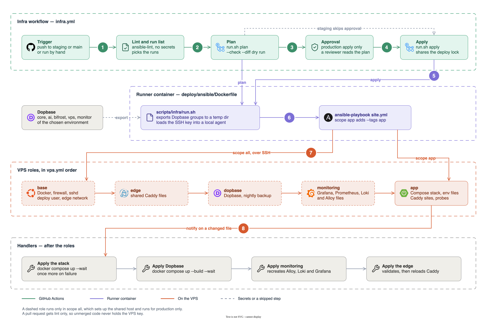

# CI/CD

This guide explains repository-controlled delivery behavior. Its diagrams show the topology drawn from the tracked `deploy/` and workflow files; environment addresses, domains, credential inventories and deployment access procedures belong to the private operations knowledge base, not this repository.

Branch and review rules are in [CONTRIBUTING](../../CONTRIBUTING.md). Workflow definitions are implementation evidence, not proof of a successful deployment or product acceptance.

## Workflows

| Workflow | Responsibility |
|---|---|
| [`ci.yml`](../../.github/workflows/ci.yml) | Selects changed areas, runs checks and invokes delivery after an eligible branch push |
| [`cd.yml`](../../.github/workflows/cd.yml) | Rechecks the commit and CI result, invokes service delivery and runs the configured staging smoke gate |
| [`deploy-backend.yml`](../../.github/workflows/deploy-backend.yml) | Builds and delivers backend artifacts |
| [`deploy-web.yml`](../../.github/workflows/deploy-web.yml) | Builds and delivers the Mobile web application |
| [`deploy-landing.yml`](../../.github/workflows/deploy-landing.yml) | Builds and delivers the web application |
| [`mobile-release.yml`](../../.github/workflows/mobile-release.yml) | Manually triggered Android build and optional publication |
| [`infra.yml`](../../.github/workflows/infra.yml) | Validates and applies infrastructure through the authorized operations workflow |
| [`eval-regression.yml`](../../.github/workflows/eval-regression.yml) | Runs the explicitly requested Agent evaluation and reports its result |
| [`honeyhive-sync.yml`](../../.github/workflows/honeyhive-sync.yml), [`honeyhive-dashboards.yml`](../../.github/workflows/honeyhive-dashboards.yml) | Apply observability configuration changes on a push to `main` that touches their files |
| [`release-policy.yml`](../../.github/workflows/release-policy.yml) | Checks the permitted production release source |

## Delivery and runtime topology


Green numbers are the deploy, purple the VPS setup with Ansible, from `infra.yml` or `scripts/infra/run.sh`, and orange the runtime requests. Gray dashed arrows are secrets: the deploy exports `core` and `ai` from Dopbase with runner tokens kept in the GitHub environment, and `scripts/infra/run.sh` exports the VPS files for Ansible. The application icons depict a stack template, not shared containers: staging and production each run as an isolated Compose project with their own Core, AI, Bifrost and Redis instances and separate Supabase databases. The VPS network diagram below shows these environment boundaries. The direct Mobile → Google Analytics 4 path in External is native-only and opt-in, with separate staging and production destinations; it bypasses Caddy/Core and does not imply verified rollout ([ADR-0010](../architecture/adr/0010-mobile-usage-analytics-ga4.md)). The diagram shows the target setup; [technical design §1](../architecture/technical-design.md#1-scope) records what is implemented. Edit [`ci-cd.drawio`](../architecture/diagrams/src/ci-cd.drawio) and re-export:

```bash
drawio -x -f svg -e --embed-svg-images --svg-theme light -b ffffff -o docs/architecture/diagrams/images/ci-cd.svg docs/architecture/diagrams/src/ci-cd.drawio
```


Source: [`vps-network.drawio`](../architecture/diagrams/src/vps-network.drawio), drawn from `deploy/*/compose.yaml` and the Caddy sites the playbook writes. Each dashed region is one Docker network and each container is drawn in its main network; a card that says `on edge as <alias>` or `also on edge` also joins `edge`. Each `name:port` is what another container dials inside that network. Only Caddy publishes public host ports (Dozzle binds a loopback port only); Core, Bifrost, Grafana, Alloy and Dopbase also join `edge`, and AI joins only its own project network, so only that environment's Core can call it.

## VPS



Source: [`ansible-flow.drawio`](../architecture/diagrams/src/ansible-flow.drawio), drawn from [`infra.yml`](../../.github/workflows/infra.yml), [`scripts/infra/run.sh`](../../scripts/infra/run.sh) and [`deploy/ansible`](../../deploy/ansible/vps.yml). A pull request gets lint only; a push to `staging` plans then applies staging in scope `app`, and a push to `main` plans then applies production in scope `all` after a reviewer approves the plan (1–5). A manual run does either a plan or an apply, never both: a manual apply runs no plan first, and a production apply still waits for approval. `run.sh` runs in the image of `deploy/ansible/Dockerfile`, exports the environment's Dopbase groups to a private temporary directory and starts `ansible-playbook` (6). Scope `all` runs every role in order and sets up the shared host, so it runs for production only; scope `app` runs only the `app` role for one environment (7). The roles prepare the host and write the stack files; the handlers that a changed file notifies then start the stack, Dopbase, monitoring and the edge, in that order (8). The apply shares the `vps-<environment>` lock with the backend deploy. Edit the source and re-export:

```bash
drawio -x -f svg -e --embed-svg-images --svg-theme light -b ffffff -o docs/architecture/diagrams/images/ansible-flow.svg docs/architecture/diagrams/src/ansible-flow.drawio
```

## Steps

1. Submit the change to `staging` through a pull request and required review.
2. Inspect the checks for the exact commit; a skipped area check does not mean its tests ran.
3. For a delivery, use the workflow result and resulting artifact/build identity as evidence.
4. Record [Bruno smoke-check](../../scripts/bruno/README.md) and UAT results separately; a deployment does not establish `AC-*` acceptance.
5. Use the private operations knowledge base for environment access, migration windows, rollout and recovery. Production approval is not bypassed by these instructions.

## CI runners

[`select-runner.yml`](../../.github/workflows/select-runner.yml) runs first in every workflow and gives the later jobs their `runs-on`, so one setting moves a whole run. CI reads the input `runner`, else the repository variable `CI_RUNNER`; CD and Infra read the input, else `CD_RUNNER`, else `CI_RUNNER`. Unset means `github-hosted`.

| Value | Runs on |
|---|---|
| `github-hosted` | `ubuntu-24.04` |
| `self-hosted` | Any machine labelled `self-hosted`; it needs Docker with buildx, Node, Python 3 and a JDK |
| `auto` | A free self-hosted machine, else `ubuntu-24.04`; it needs the secret `RUNNERS_READ_TOKEN`, without which it always picks GitHub-hosted |

- While GitHub-hosted runners cannot start, set `CI_RUNNER=self-hosted` and clear `CD_RUNNER`. `auto` cannot help, because its own pick runs on GitHub-hosted.
- Pull requests from forks always run on `ubuntu-24.04`, so a fork never runs code on a self-hosted machine.
- Tests start PostgreSQL with `docker run` on a free port, so jobs on one machine do not collide.

## Path filtering

Area checks are selected by changed paths in [`scripts/ci/changes.sh`](../../scripts/ci/changes.sh), not by workflow `on.paths`, so every check still reports a result. Read the definitions when changing dependencies or shared files; do not infer coverage from the PR's overall green status. The required-check policy is in [CONTRIBUTING](../../CONTRIBUTING.md#required-checks-and-deployment). The `docs` area (`*.md`, `.okf/`, `scripts/docs/`) runs the `docs` job, which runs `python3 scripts/docs/okf_sync.py --check` to fail when the [`.okf/` metadata bundle](../README.md#conventions) drifts from the documents, a human document starts with frontmatter or a relative link breaks.

## Service variables

Code defaults and required variable names belong to each service's `.env.example` and service guide. Actual environment values, domain/origin allowlists, credential ownership and access grants are maintained only in the private operations knowledge base and the authorized secret store. Public-prefixed frontend variables are shipped in the application and must never contain secrets.

### Dopbase and its backup


Source: [`dopbase-secrets-and-backup.drawio`](../architecture/diagrams/src/dopbase-secrets-and-backup.drawio). Green edges carry secrets, orange is the nightly backup and dashed edges are steps a person runs by hand. A maintainer sets secrets in Dopbase (1); `run.sh` reads the environment's groups for Ansible (2), which writes the backup settings to the VPS (3); the deploy reads `core/<environment>` and `ai/<environment>` with its own runner token (4). Each night `backup.sh` reads those settings (5), stops Dopbase and archives its volume (6), then encrypts the archive with `age` and uploads it to Cloudflare R2 (7). A restore happens by hand on the maintainer's machine, the only place that holds the age private key (8).

## Monitoring

Monitoring definitions exist in the repository; their existence does not verify live provisioning, alert delivery or access controls. The private operations knowledge base owns endpoints, topology, retention/access configuration and incident procedures. AI data exposure and redaction limits remain documented in the [AI architecture](../../backend/ai/docs/architecture.md#observability).

## Mobile web on Vercel

The delivery workflow builds environment-specific frontend artifacts. Public-prefixed values are build-time configuration, so changing them requires a new build. PR preview deployment is disabled; current workflow triggers, not historical preview instructions, define behavior. Deployment domains and authentication origin mappings are private operational information.


A browser request must pass Firebase Authorized domains and Core CORS, and Core accepts only tokens from its own Firebase project. Source: [`auth-request-flow.drawio`](../architecture/diagrams/src/auth-request-flow.drawio).

## Landing page on Vercel

[`deploy-landing.yml`](../../.github/workflows/deploy-landing.yml) builds `frontend/web` and deploys it to its own Vercel project; CD calls it for a commit whose `landing` check passed. A push to `staging` uses the GitHub environment `landing-staging` and a push to `main` uses `landing-production`, each followed by a smoke test of the environment's `LANDING_URL`. Vercel's Git deployments are off, so only this workflow deploys the landing. The admin dashboard is built only when the environment sets `VITE_ADMIN_ENABLED=true` with `VITE_API_ENDPOINT` and `VITE_FIREBASE_API_KEY`; the step `Check the admin in the build` fails on admin code in a build with the flag off.

## Android build

Use the manually triggered Android workflow for a configured build. Local development and native verification are in the [Mobile guide](../../frontend/mobile/README.md) and [operations guide](../../frontend/mobile/docs/operations.md). A successful build does not verify sign-in, recognition or install/update behavior on a device.

### Release signing

Signing keys, backups, certificate-to-environment mappings and publication credentials are managed through the private operations knowledge base. Never commit a keystore or its encoded contents, include secret values in shell arguments, or print them in logs. Verify the intended build identity and signing certificate before an authorized release.

### Publish the APK for the landing page


Source: [`apk-release.drawio`](../architecture/diagrams/src/apk-release.drawio). Publication is a separate, explicit workflow option. Follow the private operations procedure for access, destination, validation and rollback; a merged pull request does not itself prove that a signed APK was published or accepted.

## Ownership and dependency updates

The repository is public and its jobs can run on self-hosted machines, so what a workflow executes is pinned and a change to it is reviewed.

- **Pinned actions.** Every third-party action is pinned to a full commit SHA with its release as a comment (`actions/checkout@<sha> # v7.0.1`), so a moved or compromised tag cannot change what runs. Local actions and reusable workflows (`./.github/...`) run from the same commit and need no pin.
- **Dependabot.** [`dependabot.yml`](../../.github/dependabot.yml) opens one grouped pull request a week against `staging` for GitHub Actions, for the Dockerfiles of `backend/ai`, `deploy/ansible` and `deploy/dopbase`, and for the Compose stacks. Application packages (uv, npm, Maven) and `backend/core` are left out: Core changes need the owner's approval and app upgrades are planned per feature.
- **Code owners.** [`CODEOWNERS`](../../.github/CODEOWNERS) requests the project owner's review on `.github/`, `deploy/`, `scripts/`, `secrets/`, the HoneyHive config, `docs/development/` and `backend/core/`. It blocks a merge only where a branch ruleset requires code-owner review.
- **Vulnerability reports** go through GitHub's private reporting, as [`SECURITY.md`](../../SECURITY.md) describes.

## Eval regression

The [evaluation guide](../../backend/ai/evaluation/README.md) owns suites, commands and interpretation. Live model calls and external evaluation publication require intentional authorization and configured credentials; do not infer product acceptance from a mock or offline result.
