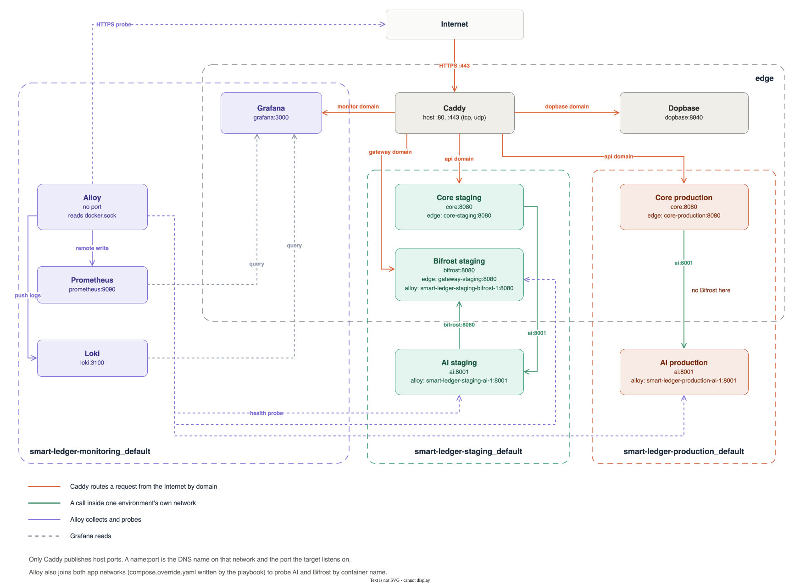
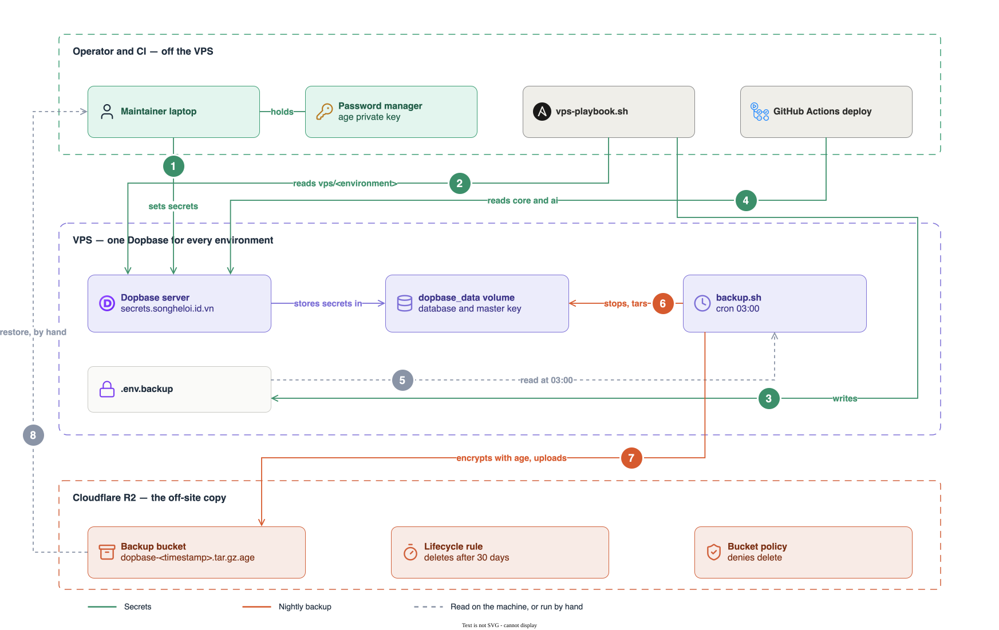

# CI/CD

`backend/core` and `backend/ai` deploy to a VPS; the mobile web and the landing page (with the admin dashboard at `/admin`) deploy to Vercel. The Android app has its own manual workflow, see [Android build](#android-build). Branch and review rules are in [CONTRIBUTING](../../CONTRIBUTING.md).

| Workflow | Does |
|---|---|
| [`ci.yml`](../../.github/workflows/ci.yml) | Finds the changed areas, tests them, builds images; on a push to `staging` or `main`, job `cd` starts CD |
| [`cd.yml`](../../.github/workflows/cd.yml) | Job `gate` re-checks the commit and its CI result, then calls the deploy workflows below |
| [`deploy-backend.yml`](../../.github/workflows/deploy-backend.yml) | Builds, pushes to GHCR and deploys `ai` and `core` to the VPS |
| [`deploy-web.yml`](../../.github/workflows/deploy-web.yml) | Builds and deploys `frontend/mobile` to Vercel |
| [`deploy-landing.yml`](../../.github/workflows/deploy-landing.yml) | Builds and deploys `frontend/web` to Vercel |
| [`select-runner.yml`](../../.github/workflows/select-runner.yml) | Picks the runner for CI, CD and the Android build |
| [`mobile-release.yml`](../../.github/workflows/mobile-release.yml) | Builds the Android app, started by hand |


Green numbers are the deploy, purple the one-time VPS setup, orange the runtime requests. Gray dashed arrows are secrets: the deploy exports `core` and `ai` from Dopbase with runner tokens kept in the GitHub environment, and `scripts/secrets/vps-playbook.sh` exports every VPS file from Dopbase for Ansible. The diagram shows the target setup: pgvector, the Bifrost gateway, Langfuse and the Grafana stack are not built yet; today AI calls OpenCode Go directly and traces to Logfire. Edit [`ci-cd.drawio`](../architecture/diagrams/src/ci-cd.drawio) and re-export:

```bash
drawio -x -f svg -e --embed-svg-images --svg-theme light -b ffffff -o docs/architecture/diagrams/images/ci-cd.svg docs/architecture/diagrams/src/ci-cd.drawio
```

## Steps

1. **PR into `staging`:** CI tests, checks migrations on a throwaway PostgreSQL and builds images. Nothing deploys.
2. **Merge into `staging`:** CI runs again and CD deploys the changed areas to staging, with no approval.
3. **PR `staging` → `main`:** open it after checking staging ([Target branch](../../CONTRIBUTING.md#target-branch)).
4. **Merge into `main`:** use a merge commit, never a squash; on conflicts, release from a `release/staging-to-main-<date>` branch. The production deploy jobs wait until a reviewer opens the CD run → **Review deployments** → approves each one.
5. **Check production, then tag:** the web smoke test against `https://app-production.songheloi.id.vn` must pass; open the app and sign in. Then tag by hand: `gh release create vX.Y.Z --target <merge commit> --generate-notes`.

<a id="path-filtering"></a>

### Path filtering

Job `changes` compares a PR with its base branch, or a push with the commit before it. Jobs outside the changed areas show as *Skipped*, which counts as passed.

| Area | Paths | Jobs |
|---|---|---|
| `ai` | `backend/ai/**`, `supabase/**`, `deploy-backend.yml` | `ai`, `container-images`, `deploy-backend` |
| `core` | `backend/core/**`, `deploy-backend.yml` | `core`, `container-images`, `deploy-backend` |
| `mobile` | `frontend/mobile/**`, `deploy-web.yml` | `mobile-web`, `deploy-web` |
| `landing` | `frontend/web/**`, `deploy-landing.yml` | `landing`, `deploy-landing` |
| `containers` | `compose.yaml` | `container-images` |

- A change to `ci.yml`, `cd.yml` or `select-runner.yml` runs everything; a docs-only change deploys nothing.
- Each area deploys on its own checks: a red `landing` does not hold back the backend, and a red `core` does not hold back the web.
- Re-running CI on a push hands every passing area to CD.
- To redeploy without testing (say, after changing a variable), start CD by hand: Actions → **CD** → **Run workflow**, with the branch, the full commit SHA and the areas. Leave `ci-run-id` empty to use the latest CI push run of that commit.
- A failed or cancelled deploy: re-run its CD run.

<a id="ci-runners"></a>

### Runners

CI reads input `runner`, else repository variable `CI_RUNNER`. CD reads input `runner`, else `CD_RUNNER`, else `CI_RUNNER`. Unset means `github-hosted`.

| Value | Runs on |
|---|---|
| `github-hosted` | `ubuntu-24.04` |
| `self-hosted` | Any machine labelled `self-hosted`; needs Docker with buildx, Node 22, Python 3 and a JDK |
| `auto` | A free self-hosted machine, else `ubuntu-24.04`; needs secret `RUNNERS_READ_TOKEN` ([Android runners](#android-runners)) |

- If GitHub-hosted runners are blocked (billing), set `CI_RUNNER=self-hosted` and clear `CD_RUNNER`. `auto` cannot help: its own pick runs on GitHub-hosted.
- PRs from forks always run on `ubuntu-24.04`, so a fork never runs code on a teammate's machine.
- Tests start PostgreSQL with `docker run` on a free port, so jobs on one machine do not collide.

## GitHub environments

| Environment | Branch | Approval | Secrets | Variables |
|---|---|---|---|---|
| `backend-staging` | `staging` | No | `VPS_SSH_KEY`, `VPS_KNOWN_HOSTS`, `DOPBASE_CORE_TOKEN`, `DOPBASE_AI_TOKEN` | `VPS_HOST`, `VPS_USER`, `VPS_APP_DIR`, `DOPBASE_URL` |
| `backend-production` | `main` | Yes | Same | Same, with `VPS_APP_DIR=/opt/smartledger-production` |
| `vercel-staging` | `staging` | No | `VERCEL_TOKEN`, `VERCEL_ORG_ID`, `VERCEL_PROJECT_ID` | `EXPO_PUBLIC_*`, `VERCEL_STAGING_ALIAS` |
| `vercel-production` | `main` | Yes | Same | `EXPO_PUBLIC_*` |
| `landing-staging` | `staging` | No | Same, for Vercel project `landing` | `VITE_LEGAL_DRAFT`, `LANDING_URL`, admin variables |
| `landing-production` | `main` | Yes | Same | Same, plus `VITE_ANDROID_APK_URL` |
| `android-dev` | Other branches (checked by `gate`) | No | `ANDROID_GOOGLE_SERVICES_JSON` | `EXPO_PUBLIC_*` |
| `android-staging` | `staging` | No | `ANDROID_GOOGLE_SERVICES_JSON` | `EXPO_PUBLIC_*` |
| `android-production` | `main` | Yes | `ANDROID_GOOGLE_SERVICES_JSON`, `ANDROID_KEYSTORE_*`, `R2_*` | `EXPO_PUBLIC_*`, `R2_BUCKET`, `R2_PUBLIC_URL` |

- Keep backend secrets out of `vercel-*` and `landing-*`.
- Both backend environments use the same VPS and deploy key, so a `backend-staging` job can reach production containers. The approval guards only the `main` deploy. The project owner accepted this.

<a id="vps"></a>

## VPS

One VPS (`103.162.31.93`, Ubuntu 24.04, 4 GB RAM plus swap) runs both environments as separate Compose projects from [`deploy/vps/`](../../deploy/vps/). A shared Caddy from [`deploy/edge/`](../../deploy/edge/) owns ports 80 and 443, gets Let's Encrypt certificates and routes each name to its Core over Docker network `edge`. `ai` is reachable only from its own `core`.

| Environment | Public name | Caddy routes to | App directory | Compose project |
|---|---|---|---|---|
| staging | `staging.103-162-31-93.sslip.io` | `core-staging:8080` | `/opt/smartledger` | `smart-ledger-staging` |
| production | `production.103-162-31-93.sslip.io` | `core-production:8080` | `/opt/smartledger-production` | `smart-ledger-production` |

### Networks and ports



Source: [`vps-network.drawio`](../architecture/diagrams/src/vps-network.drawio). Each dashed region is one Docker network, so a container drawn inside two regions is on both. Each `name:port` is what another container dials: the name is the container's DNS name on that network, prefixed `edge:` for its alias on `edge`, and the port is where the target listens inside its container. Only Caddy publishes host ports, so every other port is reachable only from a container on the same Docker network. Each Compose project has its own `default` network, and Core, Bifrost, Grafana and Dopbase also join `edge` so Caddy can reach them. Compose also registers each service name on `edge`, where `core` matches both environments' Core, so Caddy dials the unique aliases `core-<environment>` and `gateway-<environment>` instead. AI joins only its own project network, so only that environment's Core can call it, and Alloy, which joins every app network to probe AI and Bifrost by container name. Alloy listens on no port: it reads containers through the Docker socket, writes to Prometheus and Loki on the monitoring network, probes each Core through its public domain, joins `edge` to scrape Caddy's request metrics on `smart-ledger-edge-caddy-1:9180`, which Caddy does not publish, and scrapes AI's `/metrics` on each app network. Production runs no Bifrost.

Compose names a project after its directory unless the file sets `name:`, which would make the projects `smartledger` and `smartledger-production` while the repository and the GHCR images are kebab-case. Each compose file sets `name:` instead, so the containers are `smart-ledger-staging-core-1`, `smart-ledger-production-core-1` and `smart-ledger-edge-caddy-1`, and the shared Caddy keeps its certificates in `smart-ledger-edge_caddy_data`. The app directories are unchanged, so each stack reads its own environment from `ENVIRONMENT` in the project `.env`, which both `deploy.sh` and the playbook write.

- The bare `103-162-31-93.sslip.io` still reaches staging until every client has moved.
- Renaming a project changes the container and volume prefix, so Compose treats the old project as unrelated rather than as orphans: a VPS that still runs the `smartledger*` projects needs `docker compose down` in the old project before the first `up` under the new name, and the shared Caddy needs its certificate volume copied from `smartledger-edge_caddy_data` first, or it asks Let's Encrypt for every hostname again. The Dopbase project in `/opt/dopbase` is already named `dopbase` and is not part of this rename, so leave it running.
- With a real domain, point `api.<domain>` and `api-staging.<domain>` at the VPS and change `CADDY_DOMAIN`; nothing else changes.
- The firewall opens only 22, 80 and 443. Supabase, Redis Cloud, Cloudinary and Firebase stay external.
- One VPS is one point of failure: a staging service that runs out of memory takes production down too.

### How a backend deploy works

1. Maven builds Core's jar on the runner; [`Dockerfile.prebuilt`](../../backend/core/Dockerfile.prebuilt) wraps it in a JRE.
2. Images are pushed for `linux/amd64` as `ghcr.io/<owner>/<repo>-<service>-<environment>:<sha>`, using the job's `GITHUB_TOKEN`.
3. The job uploads the settings GitHub owns, then runs [`deploy/vps/deploy.sh`](../../deploy/vps/deploy.sh) over SSH.
4. `deploy.sh` writes `ENVIRONMENT` and the new image names to `.env`, pulls, starts `ai` then `core` with `docker compose up --wait` (fails if a container is unhealthy) and prunes unused images.
5. GHCR keeps the latest 10 staging and 20 production images per service; that is the rollback window.

The run page shows a summary table and uploads a `deploy-summary-<branch>` artifact.

### One-time setup

[`deploy/ansible/playbook.yml`](../../deploy/ansible/playbook.yml) does steps 1, 5 and 6, and can be re-run to restore a VPS or upload changed env files. Copy [`inventory.example.ini`](../../deploy/ansible/inventory.example.ini) to `inventory.ini`, then for each environment:

```bash
scripts/secrets/vps-playbook.sh staging
```

The wrapper exports `core`, `ai`, `bifrost` and `vps` of that environment from Dopbase into a temporary directory, loads `.env.vps` into the shell, runs the playbook and removes the directory.

Add `GHCR_USERNAME` and `GHCR_READ_TOKEN` to the shell if the packages are private.

1. Create user `deploy` in group `docker`, key-only SSH, `ufw` allowing port 22.
2. Generate a CI-only key with `ssh-keygen -t ed25519 -f deploy_key -N "" -C github-actions-deploy`. In `secrets/<environment>/env/.env.vps`, set `VPS_SSH_KEY` to `base64 < deploy_key | tr -d '\n'` and `VPS_SSH_PUBLIC_KEY` to `deploy_key.pub`, then delete both files and run `scripts/secrets/github.sh <environment> --apply`.
3. Set `VPS_KNOWN_HOSTS` to `ssh-keyscan -t ed25519 <VPS_HOST>` (check the fingerprint in the provider console) and `VPS_HOST` in both `.env.vps` and the GitHub environment variables.
4. Set `CADDY_DOMAIN`; production copies the `VPS_*` values from staging, because `deploy` has one key. Save the `VPS_*` and `CADDY_DOMAIN` values in Dopbase `vps/<environment>`.
5. Create network `edge`. In the app directory, put `compose.yaml` and `bifrost.json` from `deploy/vps/`, and with mode `600` `core.env`, `ai.env`, `bifrost.env` (from [secrets](secrets-and-env.md)) and `.env` with `ENVIRONMENT=<environment>` and `CORE_ALIAS=core-<environment>`. In `/opt/smartledger-edge`, put `deploy/edge/` and `sites/<environment>.caddy`, then reload Caddy.
6. After the first deploy, make the two GHCR packages public, or `docker login ghcr.io` once as `deploy` with a `read:packages` token.
7. Check database access: Supabase's direct host is IPv6-only, so a VPS without IPv6 uses the session pooler URL. Allowlist the VPS in Supabase and Redis Cloud if restrictions are on.

The first deploy must include both services (start CD by hand with `backend-ai` and `backend-core`).

### Service variables

`core.env` and `ai.env` hold the variables below. Every deploy of a service rewrites its file from Dopbase `core/<environment>` or `ai/<environment>`, so change values in Dopbase, not on the VPS. `github.ai.env` holds only `LOGFIRE_SERVICE_VERSION`, the deployed commit. Write `$` as `$$`. After editing on the VPS, run `docker compose up -d <service>` and send one chat through Core: a missing variable can still leave a healthy container.

**`core`**

| Variable | Value |
|---|---|
| `INTERNAL_API_TOKEN` | Random; same as in `ai.env`; different per environment |
| `DATABASE_URL`, `DATABASE_USERNAME`, `DATABASE_PASSWORD` | Supabase JDBC URL of the environment |
| `FIREBASE_PROJECT_ID`, `FIREBASE_SERVICE_ACCOUNT_JSON` | Firebase project of the environment; empty key falls back to `GOOGLE_APPLICATION_CREDENTIALS` |
| `JAVA_TOOL_OPTIONS` | Heap limit, e.g. `-Xmx256m` |
| `CORS_ALLOWED_ORIGINS` | From GitHub, see [Core CORS origins](#core-cors-origins) |
| `CLOUDINARY_ENABLED` | `true` only after V13 is migrated in that environment |
| `CLOUDINARY_CLOUD_NAME`, `CLOUDINARY_API_KEY`, `CLOUDINARY_API_SECRET` | Only in `core.env`, never in Vercel, GitHub variables or client code |
| `CLOUDINARY_PUBLIC_ID_PREFIX` | Required when enabled, e.g. `smartledger/staging`; no leading or trailing slash, no `..` |
| `MEDIA_UPLOAD_LEASE_SECONDS`, `CLOUDINARY_CLEANUP_FIXED_DELAY_MS` | Optional; keep the defaults `300` and `60000` |

Compose sets `AI_BASE_URL`, `SERVER_PORT` and `FLYWAY_ENABLED=false` itself. Before enabling Cloudinary, migrate V13, set the variables and smoke-test an upload, replace and delete.

**`ai`**

| Variable | Value |
|---|---|
| `INTERNAL_API_TOKEN` | Same as in `core.env` |
| `POSTGRES_URL` | Supabase `postgresql://` URL of the environment |
| `AI_SQL_READER_URL` | Read-only `ai_sql_reader` login as a `postgresql://` URL; empty means the agent cannot read shop data |
| `REDIS_URL` | Redis Cloud of the environment |
| `POSTGRES_POOL_MAX_SIZE`, `SQL_POOL_MAX_SIZE` | Optional, default `2`; they share the Supabase pooler limit with Core ([AI README](../../backend/ai/README.md#database-access)) |
| Model and Logfire variables | From GitHub, see below |
| `AGENT_MEMORY_*`, `CLOUDFLARE_ACCOUNT_ID`, `CLOUDFLARE_API_TOKEN` | Optional, `ai.env` only; memory is off until the PO approves it ([ADR-0002](../architecture/adr/0002-agent-long-term-memory.md), [AI README](../../backend/ai/README.md#long-term-memory-off-by-default)) |

**`bifrost`**

The model gateway in front of the providers, reachable by AI inside the project network at `http://bifrost:8080`. [`deploy/vps/bifrost.json`](../../deploy/vps/bifrost.json) declares the providers, the virtual key and the admin login, and wins over the store in the `bifrost-data` volume; `bifrost.env` holds the values it references. The playbook starts it; `deploy.sh` does not, so a new Bifrost version is a digest change in `compose.yaml` followed by the playbook.

Bifrost also joins `edge` as `gateway-<environment>`. When `.env.vps` sets `GATEWAY_DOMAIN` (`gateway-staging.songheloi.id.vn`, `gateway-production.songheloi.id.vn`), the playbook writes `sites/gateway-<environment>.caddy`, which serves the admin UI and its API behind the admin login and answers 404 to the inference prefixes, so model calls stay internal to AI; without it there is no public UI and an SSH tunnel to the container reaches it instead.

| Variable | Value |
|---|---|
| `OPENCODE_GO_API_KEY` | OpenCode Go key; only Bifrost holds it |
| `BIFROST_VIRTUAL_KEY` | Random `sk-bf-` value, different per environment; a request without it gets 401 |
| `BIFROST_ADMIN_USERNAME`, `BIFROST_ADMIN_PASSWORD` | Admin login of the UI and the management API; a long random password, because the domain is public |

### Dopbase and its backup



Source: [`dopbase-secrets-and-backup.drawio`](../architecture/diagrams/src/dopbase-secrets-and-backup.drawio). Green edges carry secrets in and out, orange is the nightly backup, and the dashed edges are the steps a person runs by hand. The numbers read as one flow:

1. A maintainer sets a secret in the Dopbase admin UI, which stores it in `dopbase_data`: `dopbase.db` holds the values encrypted under `master.key`.
2. `vps-playbook.sh` reads `vps/<environment>` before an Ansible run.
3. The playbook writes those five backup values to `/opt/dopbase/.env.backup` on the VPS.
4. The GitHub Actions deploy reads `core/<environment>` and `ai/<environment>` with its own runner token.
5. At 03:00 the cron job runs `backup.sh`, which reads `.env.backup`.
6. It stops Dopbase, tars the volume, and starts it again.
7. It encrypts the tar with `age -r` and uploads it with `rclone`, logging to `/var/log/dopbase-backup.log`.
8. A restore happens by hand on the maintainer's machine, the only place that holds the age private key.

The VPS holds the age public key only, so it writes an archive that nothing on the VPS can read back.

Dopbase, the team's self-hosted secrets manager, runs on the same VPS as its own Compose project in `/opt/dopbase` ([`deploy/dopbase/`](../../deploy/dopbase/)), shared by every environment and behind the same Caddy as Core. The playbook sets it up only when `DOPBASE_DOMAIN` holds a name that resolves to the VPS, `secrets.songheloi.id.vn`; without it every Dopbase task is skipped. The zone's nameservers are Mắt Bão, not Cloudflare, so Cloudflare Access cannot sit in front of it: until the zone moves, the login and setup pages are protected only by Dopbase's own password, and `sites/dopbase.caddy` is where an allowlist or `basic_auth` would go. On first start Dopbase prints a protected setup link, which an operator must open right away because the setup page is reachable by anyone who has the address: read it with `docker compose logs dopbase` in `/opt/dopbase`. Dopbase is the source of every service variable: the backend deploy exports `core/<environment>` and `ai/<environment>` with a runner token per service, and [`scripts/secrets/vps-playbook.sh`](../../scripts/secrets/vps-playbook.sh) exports the VPS files for the playbook. Create the tokens once per environment with `dopbase token create core/<environment> --name github-deploy` (and the same for `ai`), save them as `DOPBASE_CORE_TOKEN` and `DOPBASE_AI_TOKEN` on `backend-<environment>`, and set the variable `DOPBASE_URL` to `https://secrets.songheloi.id.vn`. Because Dopbase runs on the VPS it serves, a lost VPS is rebuilt in this order: restore Dopbase from its backup (below), then run the wrapper.

Its SQLite database and master key live in the `dopbase_data` volume, which is the only copy of every stored secret, so [`deploy/dopbase/backup.sh`](../../deploy/dopbase/backup.sh) copies it off-site every night at 03:00 as a cron job of user `deploy`, logging to `/var/log/dopbase-backup.log`. The script stops Dopbase for the few seconds of the copy, because a tar of a running SQLite database can catch a torn write-ahead log, encrypts the archive with age before it leaves the machine, and uploads it to an R2 bucket as `dopbase-<timestamp>.tar.gz.age`. The private half of the age key stays with the maintainer and never reaches the VPS, so a leaked bucket or a leaked VPS token exposes nothing. Old archives are deleted by a lifecycle rule on the bucket, which keeps the token free of delete permission; set the rule to the retention the team wants, for example 30 days.

Both environments share one VPS and one Dopbase, so set the same five values in `vps/staging` and `vps/production`: a playbook run for an environment that lacks them removes the cron job the other environment's run created.

Keep these in Dopbase `vps/<environment>`, which the wrapper loads into the shell, all five or none; an empty `DOPBASE_BACKUP_BUCKET` removes the cron job again and leaves Dopbase running:

| Variable | Value |
|---|---|
| `DOPBASE_BACKUP_BUCKET` | R2 bucket that holds only these archives, for example `smart-ledger-dopbase-backups` |
| `DOPBASE_BACKUP_ENDPOINT` | `https://<account id>.r2.cloudflarestorage.com` |
| `DOPBASE_BACKUP_RECIPIENT` | age public key of the backup key pair (`age1…`), generated with `age-keygen` off the VPS |
| `DOPBASE_BACKUP_KEY_ID`, `DOPBASE_BACKUP_SECRET` | R2 API token scoped to that bucket with Object Read & Write, which a bucket policy narrows to writing only |

**Creating the bucket:** it holds these archives only, so create it and its token apart from the public bucket that serves the [Android APK](#publish-the-apk-for-the-landing-page).

1. Create a bucket named `smart-ledger-dopbase-backups` with the Asia-Pacific location hint and public access left off, because an archive is read back only by an operator during a restore.
2. Add a lifecycle rule that deletes objects 30 days after creation and aborts incomplete multipart uploads after one day, so retention is enforced by the bucket and the token needs no delete permission.
3. Create an R2 API token named after the bucket, with **Object Read & Write** applied to that bucket only, from **R2 Object Storage > API > Manage API tokens**; the account API token page issues a bearer token instead of the Access Key ID and Secret Access Key that rclone needs.
4. Add a bucket policy that denies `s3:DeleteObject` and `s3:PutBucketPolicy` for every principal, because R2 has no write-only token preset and a `Deny` outranks the token's own permission; the lifecycle rule still deletes, as Cloudflare applies it server-side rather than through the token.
5. On a machine that is not the VPS, run `age-keygen -o dopbase-backup.key` for `DOPBASE_BACKUP_RECIPIENT`, and keep the file in the team password manager, because it is the only thing that reads an archive and no restore works without it.

Then run `./backup.sh` by hand in `/opt/dopbase` once: it prints the name and size it uploaded, and `rclone delete` against the same bucket with the same credentials must fail with `AccessDenied`.

**Restore:** download the newest archive, then, on a machine that holds the backup private key, `age -d -i <key file> dopbase-<timestamp>.tar.gz.age | tar -xz -C <directory>`, and load that directory into a fresh `dopbase_data` volume with `docker run --rm -v dopbase_data:/data -v <directory>:/in alpine:3.21 cp -a /in/. /data` before starting Dopbase. Test a restore before the team depends on Dopbase as the only source of secrets.

### AI model settings

These live in Dopbase `ai/<environment>` with the other AI variables; step `Upload ai settings` writes them into `ai.env` before deploying `ai`.

| Name | Value |
|---|---|
| `OPENAI_API_KEY` | Gateway key shared by every model; `BIFROST_VIRTUAL_KEY` once AI calls Bifrost |
| `OPENAI_BASE_URL` | Bifrost at `http://bifrost:8080` (being wired, see [`bifrost`](#service-variables)), or `https://opencode.ai/inference/go/v1` (OpenCode Go) or `https://api.openai.com/v1` directly; required for `anthropic` models |
| `MODEL_PROVIDER`, `MODEL_NAME` | e.g. `anthropic` and `claude-haiku-5-5`; see [AI README](../../backend/ai/README.md) |
| `MODEL_REASONING_EFFORT` | `none`, `low`, `medium` or `high` |
| `MODEL_FALLBACKS` | Optional JSON list, e.g. `["openai-chat:deepseek-v4.1-flash"]` |

To remove a setting, delete it in Dopbase; the next deploy drops it from `ai.env`.

### AI tracing settings

| Name | Source | Value |
|---|---|---|
| `LOGFIRE_TOKEN` | Dopbase `ai/<environment>` | Write token, one per environment; unset means no tracing |
| `LOGFIRE_ENVIRONMENT` | Dopbase `ai/<environment>` | `staging` or `production` |
| `LOGFIRE_SERVICE_VERSION` | Commit | `github.sha` |

Traces carry no message content ([AI README](../../backend/ai/README.md#observability)). To turn tracing off, delete `LOGFIRE_TOKEN` in Dopbase and redeploy `ai`.

### Core CORS origins


A browser request must pass Firebase Authorized domains and Core CORS, and Core accepts only tokens from its own Firebase project. Source: [`auth-request-flow.drawio`](../architecture/diagrams/src/auth-request-flow.drawio).

`CORS_ALLOWED_ORIGINS` is a comma-separated list of exact `http(s)` origins: no wildcard, path or trailing `/`. Core **refuses to start** on an invalid entry, so set it in Dopbase `core/<environment>`, not on the VPS; step `Upload core settings` rejects whitespace and wildcards before writing `core.env`. It applies on the next deploy of `core`.

Staging:

```text
https://app-staging.songheloi.id.vn,https://smart-ledger-staging.vercel.app,https://smart-ledger-preview-00.vercel.app,…,https://smart-ledger-preview-09.vercel.app
```

The `preview-0N` origins are kept for when PR previews return; Firebase Authorized domains must list them too.

<a id="monitoring"></a>

## Monitoring

[`deploy/monitoring/`](../../deploy/monitoring/) runs once per VPS in `/opt/smart-ledger-monitoring` and watches every environment: Alloy collects host, container and probe metrics plus container logs, Prometheus keeps metrics for 30 days, Loki keeps logs for 14 days, and Grafana shows them at `https://<MONITOR_DOMAIN>` and sends alerts to Discord. Each container has a memory limit, about 1 GB in total, so the stack cannot starve Core or AI.

The playbook sets it up when `.env.vps` has `MONITOR_DOMAIN`, `GRAFANA_ADMIN_PASSWORD` and `MONITOR_DISCORD_WEBHOOK_URL`; each run also writes `targets/<environment>.json`, the HTTPS probes of that environment's Core liveness and readiness plus the probes of its AI (`smart-ledger-<environment>-ai-1:8001/health`) and Bifrost (`smart-ledger-<environment>-bifrost-1:8080/health`). AI and Bifrost have no public URL, so Alloy joins each app network that exists through a `compose.override.yaml` the playbook writes before starting the stack, and dials them by container name because the service names `ai` and `bifrost` exist in both environments. Re-run the playbook after adding an environment so Alloy joins its network. Point an A record for `MONITOR_DOMAIN` at the VPS first. Sign-up and anonymous access are off; the admin password applies on the first start only.

Datasources, alerts and dashboards are provisioned from the repository and cannot be edited in the UI; change the files and re-run the playbook, which recreates the monitoring containers because Alloy, Loki and Grafana read their mounted config only at start. The alerts are:

| Alert | Fires when |
|---|---|
| Endpoint down | The HTTPS liveness probe of an environment's Core fails for 2 minutes |
| Database down | Core's readiness probe, which checks its database connection, fails for 2 minutes while liveness passes |
| Service down | The in-network health probe of an environment's AI or Bifrost fails for 2 minutes |
| Container restarting | A container starts more than 3 times in 15 minutes |
| Host memory high | VPS memory use stays above 90% for 5 minutes |
| Host disk high | The root disk stays above 85% for 10 minutes |
| Certificate expiring | A Core certificate expires in under 14 days |

Dashboards follow three layers, each one a level deeper, in the Infra folder ([`dashboards/`](../../deploy/monitoring/grafana/provisioning/dashboards/)). Each has an environment picker, and the link bar at the top lists every dashboard tagged `smart-ledger`, keeping the environment and time range:

| Dashboard | Answers | Shows |
|---|---|---|
| **SmartLedger overview** | Is anything wrong in this environment, and where? | Up or down for Core, its database, AI and Bifrost; Core availability and certificate days left; firing and pending alerts; each service's request rate, 5xx share and p95 latency, which links to its Service dashboard |
| **SmartLedger service** | How does one service behave? | Request rate by status class, 5xx share, p50/p95/p99 latency, its health probe, its container's memory against the limit, CPU and starts, and its logs with a regex search |
| **SmartLedger resources** | Is the VPS or a container short of resources? | CPU, memory, root disk and load of the host every environment shares, and each container's memory against its limit, starts, memory and CPU, filtered by Compose stack |

Request metrics follow one schema, so the dashboards do not depend on what exports them. The recording rules in [`service-red.yml`](../../deploy/monitoring/prometheus/rules/service-red.yml) turn each source into `service:http_requests:rate5m{env, service, code_class}` and `service:http_request_duration_seconds_bucket:rate5m{env, service, le}`. Core is measured at the shared Caddy, which serves request metrics per host on `smart-ledger-edge-caddy-1:9180` on the `edge` network only; the rules map each Core domain to its environment through the host on that environment's Core probe. AI exports its own request metrics on `/metrics` (prometheus-fastapi-instrumentator), timed to the last streamed byte and leaving out `/health`; the playbook lists `smart-ledger-<environment>-ai-1:8001` in `targets/services/<environment>.json`, which Alloy scrapes on the app network, so the endpoint needs no internal token and is not reachable from outside. Bifrost does not export request metrics to Alloy yet, because its `/metrics` requires the admin login, so the Service dashboard shows only its probe, container and logs. To add a service, give it a health probe whose `check` is the service name and, once it exports request metrics, add recording rules with the same names and labels; the Overview table and the Service picker then include it without dashboard changes.

**SmartLedger product**, in the Product folder ([`product.json`](../../deploy/monitoring/grafana/product/product.json)), shows how owners use the app: DAU, WAU, MAU and stickiness, weekly cohort retention, shop activation, feature adoption, AI use and sales. It reads each environment's Supabase through a read-only PostgreSQL datasource, `smartledger-staging-pg` or `smartledger-production-pg`, chosen by the environment picker; the metric definitions, the `grafana_reader` grants and what it cannot measure (logins, app sessions) are in [ADR-0003](../architecture/adr/0003-product-analytics-grafana.md). The login comes from `GRAFANA_PG_*` in the environment's `monitor` group in Dopbase, which `scripts/secrets/vps-playbook.sh` loads; the playbook writes it to `postgres-<environment>.env` beside the monitoring `.env`, so one environment's run keeps the other's datasource. Without `GRAFANA_PG_HOST` the playbook skips the file and that environment's SQL panels report a connection error. Grafana opens one connection per query and closes it, so it takes one of the 15 session pooler slots only while a panel refreshes.

To change a dashboard, edit a copy in the UI, export it as JSON and replace the file.

## Production checklist

A deploy can succeed while production still does not work. Check these first:

| Check | Symptom when missing |
|---|---|
| `VPS_*` set in `backend-production` and the [one-time setup](#one-time-setup) done | `Permission denied` or `Host key verification failed` |
| Domain resolves to the VPS, route in `sites/production.caddy` | TLS errors in the app |
| Firebase Email/Password enabled, web domain in Authorized domains | Sign-in returns 400 `signInWithPassword` |
| AI baseline and all Core migrations applied ([Database migrations](local-development.md#database-migrations)) | Chat returns 503 `ai_unavailable`, or Core fails its schema check |
| `CORS_ALLOWED_ORIGINS=https://app-production.songheloi.id.vn` | Smoke test fails with `Core CORS does not allow <URL>` |
| Supabase Data API off | `public` tables readable through the anon key |

A new Firebase project sends at most 10 SMS a day until billing is attached.

## Not automated

- **Migrations.** Flyway is off and `supabase db push` is not in CI. The migration owner runs them by hand, staging first ([Database migrations](local-development.md#database-migrations)).
- **Rollback.** Start CD by hand with an earlier SHA, or run `deploy.sh` on the VPS with that commit's `AI_IMAGE` and `CORE_IMAGE`.
- **Tags.** A person creates them after checking production.

## Mobile web on Vercel

`deploy-web` runs `vercel build` on the runner and uploads with `vercel deploy --prebuilt`. Vercel's Git deployments are off (`frontend/mobile/vercel.json`), so GitHub holds all web configuration.

| Event | Environment | Result |
|---|---|---|
| PR | — | No deploy |
| Push `staging` | `vercel-staging` | Deploy aliased to `https://app-staging.songheloi.id.vn` |
| Push `main` | `vercel-production` | Deploy after approval to `https://app-production.songheloi.id.vn` |

- `EXPO_PUBLIC_*` are baked in at build time, so they are **variables**, not secrets: `EXPO_PUBLIC_USE_MOCK`, `EXPO_PUBLIC_MOCK_CORE`, `EXPO_PUBLIC_MOCK_SHOPS`, `EXPO_PUBLIC_API_ENDPOINT`, `EXPO_PUBLIC_FIREBASE_API_KEY`, `EXPO_PUBLIC_FIREBASE_AUTH_DOMAIN`, `EXPO_PUBLIC_FIREBASE_PROJECT_ID`, `EXPO_PUBLIC_FIREBASE_APP_ID`. Re-run the deploy after changing one.
- The app stops at launch if the API endpoint or a mock flag is missing ([`config.ts`](../../frontend/mobile/src/config.ts)).
- `EXPO_PUBLIC_ZALO_LOGIN=true` only once that Core has `ZALO_ENABLED=true` and lists the web origin in `ZALO_CLIENT_ORIGINS`.
- The smoke test fails if the page is not 200, the bundle has no API endpoint, or Core rejects the CORS preflight. Mock builds skip the Core checks.
- `app-staging.songheloi.id.vn` carries the git branch `staging` in its Vercel domain settings. Without it Vercel counts the domain as a production domain and a `main` deploy takes the alias away from staging, so the staging page serves the production build until the next staging deploy.
- PR previews are off: they used up Vercel Hobby's 100 deployments a day and broke `staging` and `main` deploys. The preview environments and steps were removed from the deploy workflows; restoring them means bringing back the PR alias and comment steps from git history and calling `deploy-web.yml` and `deploy-landing.yml` from `ci.yml` for same-repository PRs with `sha` set to the PR head.
- If a domain changes in Vercel, update the `url` in `deploy-web.yml`.
- `VERCEL_ORG_ID` and `VERCEL_PROJECT_ID` are in Project Settings → General; create `VERCEL_TOKEN` under Account Settings → Tokens.

## Landing page on Vercel

Job `landing` lints and builds `frontend/web`. `deploy-landing` deploys it to Vercel project `landing` (Root Directory `frontend/web`) like `deploy-web`, only when the landing changed.

| Event | Environment | Result |
|---|---|---|
| PR | — | No deploy |
| Push `staging` | `landing-staging` | Deploy aliased to `LANDING_URL`, then smoke test |
| Push `main` | `landing-production` | Deploy after approval, then smoke test |

- `LANDING_URL` is the fixed `https://` domain of the environment.
- `VITE_LEGAL_DRAFT` stays unset or `true` until the PO approves the legal pages. The contact email and social links live in [`site.yaml`](../../frontend/web/site.yaml).
- After changing a `landing-*` variable, start CD by hand with only `landing`.
- Keep Vercel Authentication off on the `landing` project, or the smoke test gets a `302`.

**Admin dashboard (`/admin`).** Set `VITE_ADMIN_ENABLED=true`, `VITE_API_ENDPOINT` (Core root, no `/api/v1`) and `VITE_FIREBASE_API_KEY` (same as `EXPO_PUBLIC_FIREBASE_API_KEY`) as variables of the `landing-*` environment; without the flag the build contains no admin code. Add `LANDING_URL` to the matching `CORS_ALLOWED_ORIGINS`. Admins are Firebase email users whose Core profile is ACTIVE with `system_role=ADMIN`; someone with database access sets the role. Step `Check the admin in the build` fails on the mock password `admin123`, on missing admin values, or on admin code in a build with the flag off.

## Android build

[`mobile-release.yml`](../../.github/workflows/mobile-release.yml) runs only by hand. It calls [`scripts/release/android-release.sh`](../../scripts/release/android-release.sh), which also works locally (run `--help`; locally it builds for an emulator and installs it). EAS cloud builds are not used because the free queue is slow.

```bash
gh workflow run mobile-release.yml --ref <branch> -f environment=<environment> -f runner=auto
```

| Branch | Environment | Backend | Output | ABIs |
|---|---|---|---|---|
| `main` | `android-production` | Production | AAB, or APK with `publish`; needs green CI and approval | `armeabi-v7a`, `arm64-v8a` |
| `staging` | `android-staging` | Staging | APK; needs green CI | `armeabi-v7a`, `arm64-v8a` |
| Any other | `android-dev` | Staging | APK | `arm64-v8a` |

Job `gate` rejects any other branch and environment pair before a runner starts.

Each `android-*` environment needs:

- Secret `ANDROID_GOOGLE_SERVICES_JSON`: the content of `google-services.json`.
- Variables `EXPO_PUBLIC_*`, as for the [mobile web](#mobile-web-on-vercel).
- Variable `STT_MODEL_BASE_URL`: the public R2 address holding the speech model ([models README](../../frontend/mobile/assets/models/README.md#đưa-model-lên-r2)). A publish uploads missing files; a test build only warns.

Every run uploads `android-build-summary-<environment>-<run>` (runner, toolchain, timings, size and SHA-256). A successful run uploads the APK or AAB as `android-<environment>-<run>`, kept 14 days.

<a id="android-runners"></a>

### Runners

Same as [CI runners](#ci-runners), with label `android-build`. `auto` needs a fine-grained token with **Administration: read** stored as `RUNNERS_READ_TOKEN`; without it, it falls back to GitHub-hosted.

To add a machine, install Node 22, JDK 17 and the Android SDK (platform 36, build-tools 36.0.0, NDK 27.1.12297006), set `ANDROID_HOME`, and register a runner labelled `android-build`. The preflight checks these versions and never downloads anything.

- Never trigger a self-hosted job from a fork PR: it runs the branch's code on a teammate's machine.
- `android-dev` secrets must hold only dev-level values.
- Windows is untested; enable long paths if you try it.

### Release signing

Without a keystore the build uses the Expo template's public debug key. Create the release keystore once:

```bash
keytool -genkeypair -v -keystore smart-ledger-release.keystore -alias smart-ledger -keyalg RSA -keysize 2048 -validity 10000
base64 -i smart-ledger-release.keystore | pbcopy
```

Store it in `android-production` as `ANDROID_KEYSTORE_BASE64` and `ANDROID_KEYSTORE_PASSWORD`.

- Never commit the keystore, and keep a copy outside GitHub: losing it means every user must uninstall to update.
- Add its key hash to the Meta app, or Facebook sign-in fails. `keytool -list -v -keystore smart-ledger-release.keystore` prints the fingerprints.

### Publish the APK for the landing page


Run from `main` with `environment=android-production` and `publish=true`. The job builds a release-signed APK and uploads to Cloudflare R2:

| Key | Purpose |
|---|---|
| `android/production/latest.apk` | Fixed link for the landing page |
| `android/production/builds/<name>.apk` | One copy per publish; the in-app update downloads this |
| `android/production/version.json` | `{versionCode, versionName, apk}`, written last |

One-time setup:

1. In R2, create a bucket and enable its **Public Development URL** (`https://pub-<hash>.r2.dev`).
2. Create an R2 API token with **Object Read & Write** on that bucket.
3. In `android-production`, add secrets `R2_ACCOUNT_ID`, `R2_ACCESS_KEY_ID`, `R2_SECRET_ACCESS_KEY` and variables `R2_BUCKET`, `R2_PUBLIC_URL` (no trailing slash), `STT_MODEL_BASE_URL`.
4. In `landing-production`, set `VITE_ANDROID_APK_URL=https://pub-<hash>.r2.dev/android/production/latest.apk` and redeploy the landing.
5. Optional: expire `android/production/builds/` after 30 days. Never `stt-model/`.

- The app checks `version.json` on launch and offers newer builds. Only published APKs check; APKs published before this feature never ask.
- Rollback: copy a file from `builds/` over `latest.apk` and edit `version.json`. Do not re-run an old publish run; it overwrites files.
- `r2.dev` is rate-limited and meant for development; a custom domain only changes `VITE_ANDROID_APK_URL`.

### Measured and not yet verified

- `ubuntu-24.04`, `android-dev`, cold cache: about 12 minutes. A self-hosted Apple M4 Pro with a warm cache is about three times faster.
- APK size settings in [`frontend/mobile/README.md`](../../frontend/mobile/README.md#dung-lượng-apk-android) cut the `arm64-v8a` APK from 95.2 MB to 40.3 MB; a two-ABI release APK is about 58 MB.
- Not yet run: `android-staging`, `android-production`, the self-hosted and `auto` paths, a full signed build, the R2 upload and the APK on a physical device.
- iOS is built separately ([mobile-ios-device-release.md](mobile-ios-device-release.md)).
