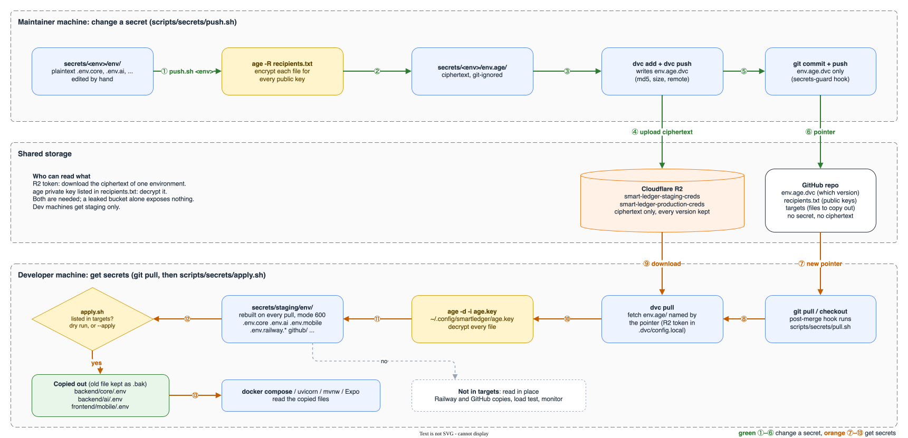

# secrets

The team's env files, encrypted, one folder per environment. After setup, `git pull` keeps `staging/env/` current and one command copies the files the services read. How it works, the file format and what each file holds: [Secrets and env files](../docs/development/secrets-and-env.md).



## Set up once

1. Install the tools and the git hooks:

   ```bash
   brew install age dvc pre-commit
   pre-commit install --hook-type pre-commit --hook-type post-merge --hook-type post-checkout
   ```

2. Create your age key, then send the `age1...` public key it prints to the secrets maintainer:

   ```bash
   mkdir -p ~/.config/smartledger && age-keygen -o ~/.config/smartledger/age.key && chmod 600 ~/.config/smartledger/age.key
   ```

3. Ask the maintainer for an R2 token for `smart-ledger-staging-creds` (Object Read only) and store it; `.dvc/config.local` is git-ignored:

   ```bash
   dvc remote modify --local r2-staging access_key_id <access key id>
   dvc remote modify --local r2-staging secret_access_key <secret access key>
   ```

4. Once the maintainer has added your key and pushed, pull and write the service env files:

   ```bash
   scripts/secrets/pull.sh
   scripts/secrets/apply.sh --apply
   ```

## Use

| Task | Command |
|---|---|
| Get the latest secrets | `git pull`; the hook runs `pull.sh` into `staging/env/` |
| See what would change in `backend/core/.env`, `backend/ai/.env`, `frontend/mobile/.env` | `scripts/secrets/apply.sh` |
| Write those files, keeping the old ones as `.bak` | `scripts/secrets/apply.sh --apply` |
| Run the backend | `docker compose --env-file backend/core/.env --env-file backend/ai/.env up --build` |
| Read any other file (Railway, GitHub, load test, monitor) | Open it in `staging/env/`; it is not copied anywhere |

## Change a secret

```bash
$EDITOR secrets/staging/env/.env.core
scripts/secrets/push.sh staging
git add secrets/staging/env.age.dvc && git commit -m "chore(secrets): <what changed>"
```

Only `recipients.txt`, `targets` and `env.age.dvc` are committed; the `secrets-guard` hook refuses anything else here. To add or remove a person, see [Add or remove a person](../docs/development/secrets-and-env.md#add-or-remove-a-person).
